# HPX performance history

The results of the performance tests of [HPX](https://github.com/TheHPXProject/hpx) for the commits of its master branch, measured by its Jenkins CI on the Rostam cluster at LSU (see `.jenkins/lsu-perftests` and `tools/perftests_ci` in the HPX repository). The graphs below show the median time of every measurement over the master commits in their order, labeled with their pull requests (or the commits without one); lower is faster. The table below each graph lists the commits after which a median changed, the numbered commits are marked on the graph, and the ringed points are the medians that changed (red slower, green faster).

## Layout

- `<year>/<node>/<commit date>-<commit>-b<build>/`: one run, with its report (`README.md`), the commit, when and where the benchmarks ran and the configuration (`metadata.json`), the medians of all measurements (`summary.json`), the results of all benchmarks as measured (`results.tar.gz`), and the comparison with the references of the node.
- `runs.tsv`: all runs. `timeline.csv`: the medians of all measurements of all runs, as written by `tools/perftests_ci/perftests_history.py`, which rebuilds it from the run directories. `timeline/`: the graphs below, drawn by `tools/perftests_ci/perftests_timeline.py`.

## Runs

- [2026](2026/README.md)

## Performance over time

### benchmark_inplace_merge

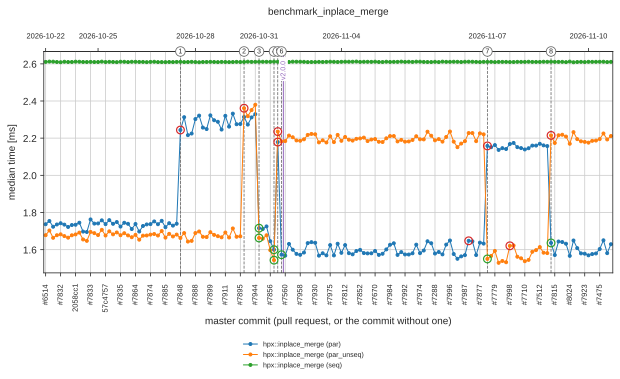

Medians that moved by more than 5% against the median of up to 3 runs before it, not reaching back past the last change (+ is slower); the numbers are those on the graph.

| # | Commit | Pull request | Measurement | Change |
| --- | --- | --- | --- | --- |
| 8 | [be63a9fb2cc9](2026/medusa00/20261108T204337Z-be63a9fb2cc9-b0/README.md) | [#7986](https://github.com/TheHPXProject/hpx/pull/7986) | hpx::inplace_merge (par) | -24% |
|  |  |  | hpx::inplace_merge (par_unseq) | +40% |
|  | [175529d41da8](2026/medusa00/20261107T202811Z-175529d41da8-b0/README.md) | [#7998](https://github.com/TheHPXProject/hpx/pull/7998) | hpx::inplace_merge (par_unseq) | +6% |
| 7 | [f7df98473ccc](2026/medusa00/20261107T201452Z-f7df98473ccc-b0/README.md) | [#7963](https://github.com/TheHPXProject/hpx/pull/7963) | hpx::inplace_merge (par) | +32% |
|  |  |  | hpx::inplace_merge (par_unseq) | -30% |
|  | [a25ea7880afe](2026/medusa00/20261106T154609Z-a25ea7880afe-b0/README.md) | [#7994](https://github.com/TheHPXProject/hpx/pull/7994) | hpx::inplace_merge (par) | +5% |
| 6 | [122f97511ef4](2026/medusa00/20261031T215646Z-122f97511ef4-b0/README.md) | [#7949](https://github.com/TheHPXProject/hpx/pull/7949) | hpx::inplace_merge (par) | -28% |
| 5 | [48e2d1ece9e7](2026/medusa00/20261031T215629Z-48e2d1ece9e7-b0/README.md) | [#7948](https://github.com/TheHPXProject/hpx/pull/7948) | hpx::inplace_merge (par) | +36% |
|  |  |  | hpx::inplace_merge (par_unseq) | +45% |
| 4 | [1e6e51150ec1](2026/medusa00/20261031T215553Z-1e6e51150ec1-b0/README.md) | [#7942](https://github.com/TheHPXProject/hpx/pull/7942) | hpx::inplace_merge (par) | -7% |
|  |  |  | hpx::inplace_merge (par_unseq) | -7% |
| 3 | [4b2db341e39e](2026/medusa00/20261031T113857Z-4b2db341e39e-b0/README.md) | [#7926](https://github.com/TheHPXProject/hpx/pull/7926) | hpx::inplace_merge (par) | -26% |
|  |  |  | hpx::inplace_merge (par_unseq) | -29% |
| 2 | [965e3686171a](2026/medusa00/20261030T131743Z-965e3686171a-b0/README.md) | [#7925](https://github.com/TheHPXProject/hpx/pull/7925) | hpx::inplace_merge (par_unseq) | +41% |
| 1 | [d13eb7506802](2026/medusa00/20261027T135959Z-d13eb7506802-b0/README.md) | [#7848](https://github.com/TheHPXProject/hpx/pull/7848) | hpx::inplace_merge (par) | +29% |

### benchmark_is_heap

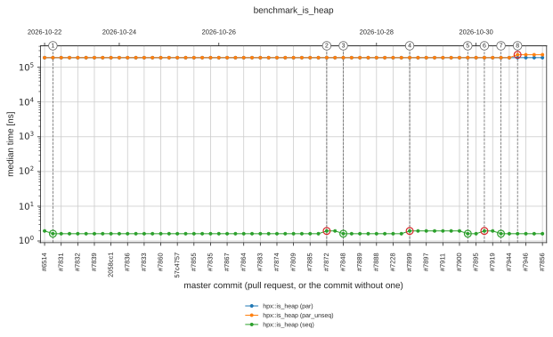

Medians that moved by more than 5% against the median of up to 3 runs before it, not reaching back past the last change (+ is slower); the numbers are those on the graph.

| # | Commit | Pull request | Measurement | Change |
| --- | --- | --- | --- | --- |
|  | [bc88ff5b8392](2026/medusa00/20261108T144211Z-bc88ff5b8392-b0/README.md) | [#7777](https://github.com/TheHPXProject/hpx/pull/7777) | hpx::is_heap (seq) | -17% |
| 8 | [d41f64c48c77](2026/medusa00/20261108T143240Z-d41f64c48c77-b0/README.md) | [#8012](https://github.com/TheHPXProject/hpx/pull/8012) | hpx::is_heap (seq) | +20% |
|  | [1ad403e0b145](2026/medusa00/20261107T202442Z-1ad403e0b145-b0/README.md) | [#7779](https://github.com/TheHPXProject/hpx/pull/7779) | hpx::is_heap (seq) | -17% |
|  | [f7df98473ccc](2026/medusa00/20261107T201452Z-f7df98473ccc-b0/README.md) | [#7963](https://github.com/TheHPXProject/hpx/pull/7963) | hpx::is_heap (par_unseq) | +9% |
| 7 | [56e9945e87f1](2026/medusa00/20261106T154554Z-56e9945e87f1-b0/README.md) | [#7987](https://github.com/TheHPXProject/hpx/pull/7987) | hpx::is_heap (seq) | +20% |
|  | [122f97511ef4](2026/medusa00/20261031T215646Z-122f97511ef4-b0/README.md) | [#7949](https://github.com/TheHPXProject/hpx/pull/7949) | hpx::is_heap (par) | -16% |
|  |  |  | hpx::is_heap (par_unseq) | -16% |
| 6 | [48e2d1ece9e7](2026/medusa00/20261031T215629Z-48e2d1ece9e7-b0/README.md) | [#7948](https://github.com/TheHPXProject/hpx/pull/7948) | hpx::is_heap (par_unseq) | -18% |
| 5 | [4b2db341e39e](2026/medusa00/20261031T113857Z-4b2db341e39e-b0/README.md) | [#7926](https://github.com/TheHPXProject/hpx/pull/7926) | hpx::is_heap (par_unseq) | +21% |
|  | [f27ce60ad6f0](2026/medusa00/20261030T181847Z-f27ce60ad6f0-b0/README.md) | [#7909](https://github.com/TheHPXProject/hpx/pull/7909) | hpx::is_heap (seq) | -17% |
| 4 | [965e3686171a](2026/medusa00/20261030T131743Z-965e3686171a-b0/README.md) | [#7925](https://github.com/TheHPXProject/hpx/pull/7925) | hpx::is_heap (seq) | +20% |
|  | [b8275fd3c4cd](2026/medusa00/20261029T211026Z-b8275fd3c4cd-b0/README.md) | [#7904](https://github.com/TheHPXProject/hpx/pull/7904) | hpx::is_heap (seq) | -17% |
| 3 | [f28fd29c4c7f](2026/medusa00/20261028T202642Z-f28fd29c4c7f-b0/README.md) | [#7899](https://github.com/TheHPXProject/hpx/pull/7899) | hpx::is_heap (seq) | +20% |
|  | [d13eb7506802](2026/medusa00/20261027T135959Z-d13eb7506802-b0/README.md) | [#7848](https://github.com/TheHPXProject/hpx/pull/7848) | hpx::is_heap (seq) | -17% |
| 2 | [d6cd9372b23e](2026/medusa00/20261027T113128Z-d6cd9372b23e-b0/README.md) | [#7872](https://github.com/TheHPXProject/hpx/pull/7872) | hpx::is_heap (seq) | +20% |
| 1 | [7ac1a1d7b2c8](2026/medusa00/20261022T210309Z-7ac1a1d7b2c8-b2/README.md) | [#7819](https://github.com/TheHPXProject/hpx/pull/7819) | hpx::is_heap (seq) | -17% |

### benchmark_is_heap_until

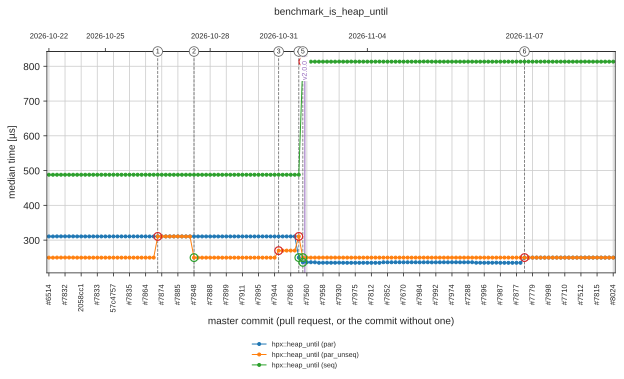

Medians that moved by more than 5% against the median of up to 3 runs before it, not reaching back past the last change (+ is slower); the numbers are those on the graph.

| # | Commit | Pull request | Measurement | Change |
| --- | --- | --- | --- | --- |
| 6 | [f7df98473ccc](2026/medusa00/20261107T201452Z-f7df98473ccc-b0/README.md) | [#7963](https://github.com/TheHPXProject/hpx/pull/7963) | hpx::heap_until (par) | +6% |
| 5 | [122f97511ef4](2026/medusa00/20261031T215646Z-122f97511ef4-b0/README.md) | [#7949](https://github.com/TheHPXProject/hpx/pull/7949) | hpx::heap_until (par) | -5% |
|  |  |  | hpx::heap_until (par_unseq) | -20% |
|  |  |  | hpx::heap_until (seq) | +67% |
| 4 | [48e2d1ece9e7](2026/medusa00/20261031T215629Z-48e2d1ece9e7-b0/README.md) | [#7948](https://github.com/TheHPXProject/hpx/pull/7948) | hpx::heap_until (par) | -20% |
|  |  |  | hpx::heap_until (par_unseq) | +15% |
| 3 | [4b2db341e39e](2026/medusa00/20261031T113857Z-4b2db341e39e-b0/README.md) | [#7926](https://github.com/TheHPXProject/hpx/pull/7926) | hpx::heap_until (par_unseq) | +8% |
| 2 | [d13eb7506802](2026/medusa00/20261027T135959Z-d13eb7506802-b0/README.md) | [#7848](https://github.com/TheHPXProject/hpx/pull/7848) | hpx::heap_until (par_unseq) | -20% |
| 1 | [2acdd1c7de18](2026/medusa00/20261026T210937Z-2acdd1c7de18-b0/README.md) | [#7879](https://github.com/TheHPXProject/hpx/pull/7879) | hpx::heap_until (par_unseq) | +24% |

### benchmark_merge

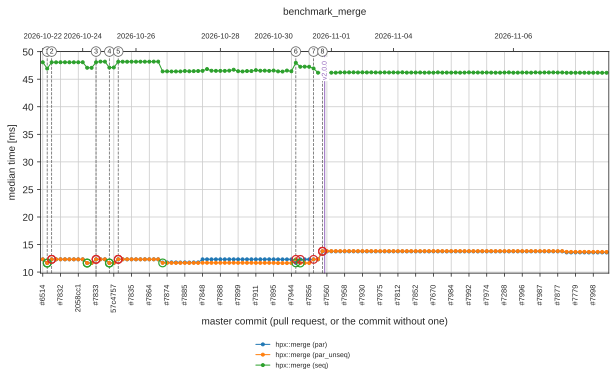

Medians that moved by more than 5% against the median of up to 3 runs before it, not reaching back past the last change (+ is slower); the numbers are those on the graph.

| # | Commit | Pull request | Measurement | Change |
| --- | --- | --- | --- | --- |
| 8 | [122f97511ef4](2026/medusa00/20261031T215646Z-122f97511ef4-b0/README.md) | [#7949](https://github.com/TheHPXProject/hpx/pull/7949) | hpx::merge (par) | +12% |
|  |  |  | hpx::merge (par_unseq) | +12% |
| 7 | [1e6e51150ec1](2026/medusa00/20261031T215553Z-1e6e51150ec1-b0/README.md) | [#7942](https://github.com/TheHPXProject/hpx/pull/7942) | hpx::merge (par_unseq) | +6% |
|  | [5401785b4f14](2026/medusa00/20261031T114013Z-5401785b4f14-b0/README.md) | [#7946](https://github.com/TheHPXProject/hpx/pull/7946) | hpx::merge (par) | +5% |
|  |  |  | hpx::merge (par_unseq) | -5% |
| 6 | [4b2db341e39e](2026/medusa00/20261031T113857Z-4b2db341e39e-b0/README.md) | [#7926](https://github.com/TheHPXProject/hpx/pull/7926) | hpx::merge (par) | -5% |
|  |  |  | hpx::merge (par_unseq) | +6% |
|  | [2acdd1c7de18](2026/medusa00/20261026T210937Z-2acdd1c7de18-b0/README.md) | [#7879](https://github.com/TheHPXProject/hpx/pull/7879) | hpx::merge (par_unseq) | -5% |
| 5 | [6b30e62af6bf](2026/medusa00/20261025T224510Z-6b30e62af6bf-b0/README.md) | [#7828](https://github.com/TheHPXProject/hpx/pull/7828) | hpx::merge (par) | +6% |
|  |  |  | hpx::merge (par_unseq) | +6% |
| 4 | [47aed4f6502a](2026/medusa00/20261025T154456Z-47aed4f6502a-b16/README.md) |  | hpx::merge (par) | -5% |
|  |  |  | hpx::merge (par_unseq) | -5% |
| 3 | [c9c9f3e1a70e](2026/medusa00/20261024T180141Z-c9c9f3e1a70e-b13/README.md) | [#7833](https://github.com/TheHPXProject/hpx/pull/7833) | hpx::merge (par) | +6% |
|  |  |  | hpx::merge (par_unseq) | +6% |
|  | [f251b51f33b2](2026/medusa00/20261024T141942Z-f251b51f33b2-b11/README.md) | [#7836](https://github.com/TheHPXProject/hpx/pull/7836) | hpx::merge (par) | -5% |
|  |  |  | hpx::merge (par_unseq) | -5% |
| 2 | [eaff5b9649bb](2026/medusa00/20261022T213041Z-eaff5b9649bb-b3/README.md) | [#7831](https://github.com/TheHPXProject/hpx/pull/7831) | hpx::merge (par) | +6% |
|  |  |  | hpx::merge (par_unseq) | +6% |
| 1 | [7ac1a1d7b2c8](2026/medusa00/20261022T210309Z-7ac1a1d7b2c8-b2/README.md) | [#7819](https://github.com/TheHPXProject/hpx/pull/7819) | hpx::merge (par) | -5% |
|  |  |  | hpx::merge (par_unseq) | -5% |

### benchmark_nth_element

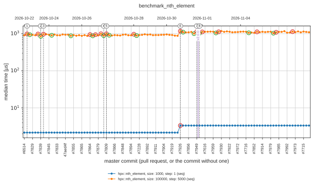

Medians that moved by more than 5% against the median of up to 3 runs before it, not reaching back past the last change (+ is slower); the numbers are those on the graph.

| # | Commit | Pull request | Measurement | Change |
| --- | --- | --- | --- | --- |
|  | [9d863061c599](2026/medusa00/20261108T144051Z-9d863061c599-b0/README.md) | [#7733](https://github.com/TheHPXProject/hpx/pull/7733) | hpx::nth_element, size: 100000, step: 5000 (seq) | +9% |
|  | [f7df98473ccc](2026/medusa00/20261107T201452Z-f7df98473ccc-b0/README.md) | [#7963](https://github.com/TheHPXProject/hpx/pull/7963) | hpx::nth_element, size: 100000, step: 5000 (seq) | +5% |
|  | [f3caaa84647f](2026/medusa00/20261106T161305Z-f3caaa84647f-b0/README.md) | [#7877](https://github.com/TheHPXProject/hpx/pull/7877) | hpx::nth_element, size: 100000, step: 5000 (seq) | -9% |
| 8 | [a25ea7880afe](2026/medusa00/20261106T154609Z-a25ea7880afe-b0/README.md) | [#7994](https://github.com/TheHPXProject/hpx/pull/7994) | hpx::nth_element, size: 100000, step: 5000 (seq) | +10% |
|  | [56e9945e87f1](2026/medusa00/20261106T154554Z-56e9945e87f1-b0/README.md) | [#7987](https://github.com/TheHPXProject/hpx/pull/7987) | hpx::nth_element, size: 100000, step: 5000 (seq) | -7% |
|  | [a9de023e4098](2026/medusa00/20261106T150520Z-a9de023e4098-b0/README.md) | [#7951](https://github.com/TheHPXProject/hpx/pull/7951) | hpx::nth_element, size: 100000, step: 5000 (seq) | +5% |
|  | [326fe34cf521](2026/medusa00/20261105T032145Z-326fe34cf521-b0/README.md) | [#7934](https://github.com/TheHPXProject/hpx/pull/7934) | hpx::nth_element, size: 100000, step: 5000 (seq) | +6% |
|  | [bb2649ad4a5c](2026/medusa00/20261104T201553Z-bb2649ad4a5c-b0/README.md) | [#7984](https://github.com/TheHPXProject/hpx/pull/7984) | hpx::nth_element, size: 100000, step: 5000 (seq) | +6% |
|  | [1c9e6dc93fa3](2026/medusa00/20261104T201219Z-1c9e6dc93fa3-b0/README.md) | [#7928](https://github.com/TheHPXProject/hpx/pull/7928) | hpx::nth_element, size: 100000, step: 5000 (seq) | -8% |
|  | [fce10534ffda](2026/medusa00/20261104T195148Z-fce10534ffda-b0/README.md) | [#7813](https://github.com/TheHPXProject/hpx/pull/7813) | hpx::nth_element, size: 100000, step: 5000 (seq) | +6% |
|  | [3ad5bb936852](2026/medusa00/20261104T194628Z-3ad5bb936852-b0/README.md) | [#7808](https://github.com/TheHPXProject/hpx/pull/7808) | hpx::nth_element, size: 100000, step: 5000 (seq) | -6% |
|  | [b4b1af62b064](2026/medusa00/20261102T194246Z-b4b1af62b064-b0/README.md) | [#7844](https://github.com/TheHPXProject/hpx/pull/7844) | hpx::nth_element, size: 100000, step: 5000 (seq) | +7% |
|  | [e7dcfa1a93b5](2026/medusa00/20261102T173509Z-e7dcfa1a93b5-b0/README.md) | [#7953](https://github.com/TheHPXProject/hpx/pull/7953) | hpx::nth_element, size: 100000, step: 5000 (seq) | -8% |
|  | [23292d59e39e](2026/medusa00/20261101T014642Z-23292d59e39e-b0/README.md) | [#7917](https://github.com/TheHPXProject/hpx/pull/7917) | hpx::nth_element, size: 100000, step: 5000 (seq) | +9% |
| 7 | [7dbfb3a5067f](2026/medusa00/20261031T225539Z-7dbfb3a5067f-b0/README.md) | [#7560](https://github.com/TheHPXProject/hpx/pull/7560) | hpx::nth_element, size: 100000, step: 5000 (seq) | -10% |
| 6 | [122f97511ef4](2026/medusa00/20261031T215646Z-122f97511ef4-b0/README.md) | [#7949](https://github.com/TheHPXProject/hpx/pull/7949) | hpx::nth_element, size: 100000, step: 5000 (seq) | +14% |
|  | [48e2d1ece9e7](2026/medusa00/20261031T215629Z-48e2d1ece9e7-b0/README.md) | [#7948](https://github.com/TheHPXProject/hpx/pull/7948) | hpx::nth_element, size: 100000, step: 5000 (seq) | -8% |
|  | [5401785b4f14](2026/medusa00/20261031T114013Z-5401785b4f14-b0/README.md) | [#7946](https://github.com/TheHPXProject/hpx/pull/7946) | hpx::nth_element, size: 100000, step: 5000 (seq) | -6% |
| 5 | [4b2db341e39e](2026/medusa00/20261031T113857Z-4b2db341e39e-b0/README.md) | [#7926](https://github.com/TheHPXProject/hpx/pull/7926) | hpx::nth_element, size: 1000, step: 1 (seq) | +55% |
|  |  |  | hpx::nth_element, size: 100000, step: 5000 (seq) | +32% |
|  | [280a90ed311b](2026/medusa00/20261028T142049Z-280a90ed311b-b0/README.md) | [#7901](https://github.com/TheHPXProject/hpx/pull/7901) | hpx::nth_element, size: 100000, step: 5000 (seq) | -8% |
|  | [3094e4aae085](2026/medusa00/20261028T001141Z-3094e4aae085-b0/README.md) | [#7888](https://github.com/TheHPXProject/hpx/pull/7888) | hpx::nth_element, size: 100000, step: 5000 (seq) | +6% |
|  | [9508ff15ff41](2026/medusa00/20261027T112827Z-9508ff15ff41-b0/README.md) | [#7711](https://github.com/TheHPXProject/hpx/pull/7711) | hpx::nth_element, size: 100000, step: 5000 (seq) | -9% |
| 4 | [0bb4fe759234](2026/medusa00/20261026T212323Z-0bb4fe759234-b0/README.md) | [#7809](https://github.com/TheHPXProject/hpx/pull/7809) | hpx::nth_element, size: 100000, step: 5000 (seq) | +12% |
| 3 | [9925ce705b23](2026/medusa00/20261026T211303Z-9925ce705b23-b0/README.md) | [#7886](https://github.com/TheHPXProject/hpx/pull/7886) | hpx::nth_element, size: 100000, step: 5000 (seq) | -11% |
|  | [924c62330602](2026/medusa00/20261026T211221Z-924c62330602-b0/README.md) | [#7874](https://github.com/TheHPXProject/hpx/pull/7874) | hpx::nth_element, size: 100000, step: 5000 (seq) | +8% |
|  | [b07138598e83](2026/medusa00/20261026T210849Z-b07138598e83-b0/README.md) | [#7883](https://github.com/TheHPXProject/hpx/pull/7883) | hpx::nth_element, size: 100000, step: 5000 (seq) | +8% |
|  | [55ef914598c3](2026/medusa00/20261026T104728Z-55ef914598c3-b0/README.md) | [#7784](https://github.com/TheHPXProject/hpx/pull/7784) | hpx::nth_element, size: 100000, step: 5000 (seq) | -7% |
|  | [ff9e673a5887](2026/medusa00/20261026T102649Z-ff9e673a5887-b0/README.md) | [#7864](https://github.com/TheHPXProject/hpx/pull/7864) | hpx::nth_element, size: 100000, step: 5000 (seq) | +8% |
|  | [6b30e62af6bf](2026/medusa00/20261025T224510Z-6b30e62af6bf-b0/README.md) | [#7828](https://github.com/TheHPXProject/hpx/pull/7828) | hpx::nth_element, size: 100000, step: 5000 (seq) | -7% |
|  | [f251b51f33b2](2026/medusa00/20261024T141942Z-f251b51f33b2-b11/README.md) | [#7836](https://github.com/TheHPXProject/hpx/pull/7836) | hpx::nth_element, size: 100000, step: 5000 (seq) | -6% |
| 2 | [076e45a6ceb9](2026/medusa00/20261023T191320Z-076e45a6ceb9-b8/README.md) | [#7769](https://github.com/TheHPXProject/hpx/pull/7769) | hpx::nth_element, size: 100000, step: 5000 (seq) | +15% |
| 1 | [b5f65f9bbb3f](2026/medusa00/20261023T182839Z-b5f65f9bbb3f-b7/README.md) | [#7839](https://github.com/TheHPXProject/hpx/pull/7839) | hpx::nth_element, size: 100000, step: 5000 (seq) | -14% |
|  | [527180d0b6af](2026/medusa00/20261023T163358Z-527180d0b6af-b6/README.md) |  | hpx::nth_element, size: 100000, step: 5000 (seq) | +5% |
|  | [eaff5b9649bb](2026/medusa00/20261022T213041Z-eaff5b9649bb-b3/README.md) | [#7831](https://github.com/TheHPXProject/hpx/pull/7831) | hpx::nth_element, size: 100000, step: 5000 (seq) | -5% |
|  | [7ac1a1d7b2c8](2026/medusa00/20261022T210309Z-7ac1a1d7b2c8-b2/README.md) | [#7819](https://github.com/TheHPXProject/hpx/pull/7819) | hpx::nth_element, size: 100000, step: 5000 (seq) | +9% |

### benchmark_nth_element_parallel

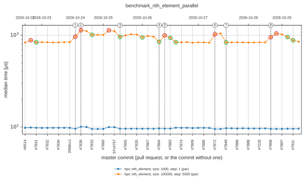

Medians that moved by more than 5% against the median of up to 3 runs before it, not reaching back past the last change (+ is slower); the numbers are those on the graph.

| # | Commit | Pull request | Measurement | Change |
| --- | --- | --- | --- | --- |
|  | [1ad403e0b145](2026/medusa00/20261107T202442Z-1ad403e0b145-b0/README.md) | [#7779](https://github.com/TheHPXProject/hpx/pull/7779) | hpx::nth_element, size: 100000, step: 5000 (par) | +7% |
|  | [61739d45974f](2026/medusa00/20261107T202123Z-61739d45974f-b0/README.md) | [#8008](https://github.com/TheHPXProject/hpx/pull/8008) | hpx::nth_element, size: 100000, step: 5000 (par) | -7% |
| 8 | [56e9945e87f1](2026/medusa00/20261106T154554Z-56e9945e87f1-b0/README.md) | [#7987](https://github.com/TheHPXProject/hpx/pull/7987) | hpx::nth_element, size: 100000, step: 5000 (par) | +24% |
|  | [712eea2399f9](2026/medusa00/20261106T150625Z-712eea2399f9-b0/README.md) | [#7648](https://github.com/TheHPXProject/hpx/pull/7648) | hpx::nth_element, size: 100000, step: 5000 (par) | -14% |
|  | [ec3b59b1fa0b](2026/medusa00/20261106T150024Z-ec3b59b1fa0b-b0/README.md) | [#8001](https://github.com/TheHPXProject/hpx/pull/8001) | hpx::nth_element, size: 100000, step: 5000 (par) | +7% |
|  | [b8dc6233ffc3](2026/medusa00/20261106T145549Z-b8dc6233ffc3-b0/README.md) | [#7977](https://github.com/TheHPXProject/hpx/pull/7977) | hpx::nth_element, size: 100000, step: 5000 (par) | +12% |
|  | [2aba6877abca](2026/medusa00/20261106T145306Z-2aba6877abca-b0/README.md) | [#7778](https://github.com/TheHPXProject/hpx/pull/7778) | hpx::nth_element, size: 100000, step: 5000 (par) | -10% |
|  | [c0457a471a6f](2026/medusa00/20261105T140224Z-c0457a471a6f-b0/README.md) | [#7988](https://github.com/TheHPXProject/hpx/pull/7988) | hpx::nth_element, size: 100000, step: 5000 (par) | -11% |
|  | [2469176f1309](2026/medusa00/20261104T201606Z-2469176f1309-b0/README.md) | [#7985](https://github.com/TheHPXProject/hpx/pull/7985) | hpx::nth_element, size: 100000, step: 5000 (par) | +8% |
|  | [bb2649ad4a5c](2026/medusa00/20261104T201553Z-bb2649ad4a5c-b0/README.md) | [#7984](https://github.com/TheHPXProject/hpx/pull/7984) | hpx::nth_element, size: 100000, step: 5000 (par) | -7% |
|  | [97e5672ca089](2026/medusa00/20261104T195947Z-97e5672ca089-b0/README.md) | [#7981](https://github.com/TheHPXProject/hpx/pull/7981) | hpx::nth_element, size: 100000, step: 5000 (par) | +6% |
|  | [88071b955a3f](2026/medusa00/20261104T195847Z-88071b955a3f-b0/README.md) | [#7670](https://github.com/TheHPXProject/hpx/pull/7670) | hpx::nth_element, size: 100000, step: 5000 (par) | -6% |
|  | [2535af607aa7](2026/medusa00/20261102T195816Z-2535af607aa7-b0/README.md) | [#7975](https://github.com/TheHPXProject/hpx/pull/7975) | hpx::nth_element, size: 100000, step: 5000 (par) | +10% |
|  | [2506beb245a8](2026/medusa00/20261102T195747Z-2506beb245a8-b0/README.md) | [#7922](https://github.com/TheHPXProject/hpx/pull/7922) | hpx::nth_element, size: 100000, step: 5000 (par) | -10% |
|  | [a71ab88dfd37](2026/medusa00/20261102T194939Z-a71ab88dfd37-b0/README.md) | [#7930](https://github.com/TheHPXProject/hpx/pull/7930) | hpx::nth_element, size: 100000, step: 5000 (par) | +9% |
|  | [0194d98a466d](2026/medusa00/20261102T153810Z-0194d98a466d-b0/README.md) | [#7959](https://github.com/TheHPXProject/hpx/pull/7959) | hpx::nth_element, size: 100000, step: 5000 (par) | +15% |
|  | [027de27ac2db](2026/medusa00/20261102T153015Z-027de27ac2db-b0/README.md) | [#7958](https://github.com/TheHPXProject/hpx/pull/7958) | hpx::nth_element, size: 100000, step: 5000 (par) | -17% |
| 7 | [e8b595c1764d](2026/medusa00/20261102T152924Z-e8b595c1764d-b0/README.md) | [#7964](https://github.com/TheHPXProject/hpx/pull/7964) | hpx::nth_element, size: 100000, step: 5000 (par) | +20% |
|  | [974ae9d09aad](2026/medusa00/20261102T125313Z-974ae9d09aad-b0/README.md) | [#7616](https://github.com/TheHPXProject/hpx/pull/7616) | hpx::nth_element, size: 100000, step: 5000 (par) | -13% |
|  | [23292d59e39e](2026/medusa00/20261101T014642Z-23292d59e39e-b0/README.md) | [#7917](https://github.com/TheHPXProject/hpx/pull/7917) | hpx::nth_element, size: 100000, step: 5000 (par) | +15% |
| 6 | [7dbfb3a5067f](2026/medusa00/20261031T225539Z-7dbfb3a5067f-b0/README.md) | [#7560](https://github.com/TheHPXProject/hpx/pull/7560) | hpx::nth_element, size: 100000, step: 5000 (par) | -20% |
|  | [122f97511ef4](2026/medusa00/20261031T215646Z-122f97511ef4-b0/README.md) | [#7949](https://github.com/TheHPXProject/hpx/pull/7949) | hpx::nth_element, size: 100000, step: 5000 (par) | +16% |
|  | [1e6e51150ec1](2026/medusa00/20261031T215553Z-1e6e51150ec1-b0/README.md) | [#7942](https://github.com/TheHPXProject/hpx/pull/7942) | hpx::nth_element, size: 100000, step: 5000 (par) | +7% |
| 5 | [1a5b15496b23](2026/medusa00/20261031T151324Z-1a5b15496b23-b0/README.md) | [#7856](https://github.com/TheHPXProject/hpx/pull/7856) | hpx::nth_element, size: 100000, step: 5000 (par) | -19% |
|  | [4b2db341e39e](2026/medusa00/20261031T113857Z-4b2db341e39e-b0/README.md) | [#7926](https://github.com/TheHPXProject/hpx/pull/7926) | hpx::nth_element, size: 100000, step: 5000 (par) | +12% |
|  | [f27ce60ad6f0](2026/medusa00/20261030T181847Z-f27ce60ad6f0-b0/README.md) | [#7909](https://github.com/TheHPXProject/hpx/pull/7909) | hpx::nth_element, size: 100000, step: 5000 (par) | -6% |
|  | [b8275fd3c4cd](2026/medusa00/20261029T211026Z-b8275fd3c4cd-b0/README.md) | [#7904](https://github.com/TheHPXProject/hpx/pull/7904) | hpx::nth_element, size: 100000, step: 5000 (par) | +7% |
|  | [e8727ab5a0e9](2026/medusa00/20261029T205016Z-e8727ab5a0e9-b0/README.md) | [#7900](https://github.com/TheHPXProject/hpx/pull/7900) | hpx::nth_element, size: 100000, step: 5000 (par) | +10% |
|  | [2553fc02be5f](2026/medusa00/20261029T133557Z-2553fc02be5f-b0/README.md) | [#7911](https://github.com/TheHPXProject/hpx/pull/7911) | hpx::nth_element, size: 100000, step: 5000 (par) | -8% |
|  | [6e71866f21da](2026/medusa00/20261029T133530Z-6e71866f21da-b0/README.md) | [#7912](https://github.com/TheHPXProject/hpx/pull/7912) | hpx::nth_element, size: 100000, step: 5000 (par) | -8% |
|  | [0881d8d566de](2026/medusa00/20261028T202717Z-0881d8d566de-b0/README.md) | [#7892](https://github.com/TheHPXProject/hpx/pull/7892) | hpx::nth_element, size: 100000, step: 5000 (par) | +10% |
|  | [f28fd29c4c7f](2026/medusa00/20261028T202642Z-f28fd29c4c7f-b0/README.md) | [#7899](https://github.com/TheHPXProject/hpx/pull/7899) | hpx::nth_element, size: 100000, step: 5000 (par) | +14% |
| 4 | [d13eb7506802](2026/medusa00/20261027T135959Z-d13eb7506802-b0/README.md) | [#7848](https://github.com/TheHPXProject/hpx/pull/7848) | hpx::nth_element, size: 100000, step: 5000 (par) | -19% |
| 3 | [d6cd9372b23e](2026/medusa00/20261027T113128Z-d6cd9372b23e-b0/README.md) | [#7872](https://github.com/TheHPXProject/hpx/pull/7872) | hpx::nth_element, size: 100000, step: 5000 (par) | +23% |
|  | [2acdd1c7de18](2026/medusa00/20261026T210937Z-2acdd1c7de18-b0/README.md) | [#7879](https://github.com/TheHPXProject/hpx/pull/7879) | hpx::nth_element, size: 100000, step: 5000 (par) | -10% |
|  | [b07138598e83](2026/medusa00/20261026T210849Z-b07138598e83-b0/README.md) | [#7883](https://github.com/TheHPXProject/hpx/pull/7883) | hpx::nth_element, size: 100000, step: 5000 (par) | -6% |
| 2 | [55ef914598c3](2026/medusa00/20261026T104728Z-55ef914598c3-b0/README.md) | [#7784](https://github.com/TheHPXProject/hpx/pull/7784) | hpx::nth_element, size: 100000, step: 5000 (par) | +18% |
|  | [ff9e673a5887](2026/medusa00/20261026T102649Z-ff9e673a5887-b0/README.md) | [#7864](https://github.com/TheHPXProject/hpx/pull/7864) | hpx::nth_element, size: 100000, step: 5000 (par) | -12% |
|  | [fef31456e98a](2026/medusa00/20261026T102437Z-fef31456e98a-b0/README.md) | [#7865](https://github.com/TheHPXProject/hpx/pull/7865) | hpx::nth_element, size: 100000, step: 5000 (par) | -7% |
|  | [6b30e62af6bf](2026/medusa00/20261025T224510Z-6b30e62af6bf-b0/README.md) | [#7828](https://github.com/TheHPXProject/hpx/pull/7828) | hpx::nth_element, size: 100000, step: 5000 (par) | -15% |
|  | [47aed4f6502a](2026/medusa00/20261025T154456Z-47aed4f6502a-b16/README.md) |  | hpx::nth_element, size: 100000, step: 5000 (par) | +12% |
|  | [c9c9f3e1a70e](2026/medusa00/20261024T180141Z-c9c9f3e1a70e-b13/README.md) | [#7833](https://github.com/TheHPXProject/hpx/pull/7833) | hpx::nth_element, size: 100000, step: 5000 (par) | -10% |
| 1 | [f251b51f33b2](2026/medusa00/20261024T141942Z-f251b51f33b2-b11/README.md) | [#7836](https://github.com/TheHPXProject/hpx/pull/7836) | hpx::nth_element, size: 100000, step: 5000 (par) | +17% |
|  | [5741795e5c3a](2026/medusa00/20261024T140557Z-5741795e5c3a-b10/README.md) | [#7845](https://github.com/TheHPXProject/hpx/pull/7845) | hpx::nth_element, size: 100000, step: 5000 (par) | +15% |
|  | [eaff5b9649bb](2026/medusa00/20261022T213041Z-eaff5b9649bb-b3/README.md) | [#7831](https://github.com/TheHPXProject/hpx/pull/7831) | hpx::nth_element, size: 100000, step: 5000 (par) | -5% |
|  | [7ac1a1d7b2c8](2026/medusa00/20261022T210309Z-7ac1a1d7b2c8-b2/README.md) | [#7819](https://github.com/TheHPXProject/hpx/pull/7819) | hpx::nth_element, size: 100000, step: 5000 (par) | +6% |

### benchmark_partial_sort

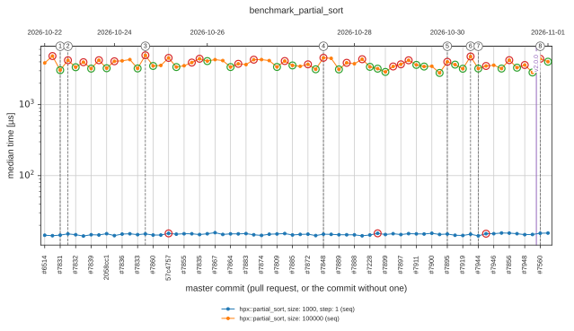

Medians that moved by more than 5% against the median of up to 3 runs before it, not reaching back past the last change (+ is slower); the numbers are those on the graph.

| # | Commit | Pull request | Measurement | Change |
| --- | --- | --- | --- | --- |
|  | [9479d240ceb3](2026/medusa00/20261109T230011Z-9479d240ceb3-b0/README.md) | [#7923](https://github.com/TheHPXProject/hpx/pull/7923) | hpx::partial_sort, size: 100000 (seq) | -14% |
|  | [b2733a95fa81](2026/medusa00/20261109T162325Z-b2733a95fa81-b0/README.md) | [#8016](https://github.com/TheHPXProject/hpx/pull/8016) | hpx::partial_sort, size: 100000 (seq) | -7% |
|  | [73afdb5761aa](2026/medusa00/20261109T154719Z-73afdb5761aa-b0/README.md) | [#7578](https://github.com/TheHPXProject/hpx/pull/7578) | hpx::partial_sort, size: 100000 (seq) | +11% |
|  | [953e6823658a](2026/medusa00/20261109T154348Z-953e6823658a-b0/README.md) | [#8024](https://github.com/TheHPXProject/hpx/pull/8024) | hpx::partial_sort, size: 100000 (seq) | +28% |
|  | [2c449c50b3a4](2026/medusa00/20261109T153600Z-2c449c50b3a4-b0/README.md) | [#8015](https://github.com/TheHPXProject/hpx/pull/8015) | hpx::partial_sort, size: 100000 (seq) | -32% |
|  | [9df0c28bd288](2026/medusa00/20261109T134836Z-9df0c28bd288-b0/README.md) |  | hpx::partial_sort, size: 100000 (seq) | +37% |
|  | [29e648ba019b](2026/medusa00/20261108T210210Z-29e648ba019b-b0/README.md) | [#7815](https://github.com/TheHPXProject/hpx/pull/7815) | hpx::partial_sort, size: 100000 (seq) | -14% |
|  | [be63a9fb2cc9](2026/medusa00/20261108T204337Z-be63a9fb2cc9-b0/README.md) | [#7986](https://github.com/TheHPXProject/hpx/pull/7986) | hpx::partial_sort, size: 100000 (seq) | +24% |
|  | [bc88ff5b8392](2026/medusa00/20261108T144211Z-bc88ff5b8392-b0/README.md) | [#7777](https://github.com/TheHPXProject/hpx/pull/7777) | hpx::partial_sort, size: 100000 (seq) | -21% |
|  | [9d863061c599](2026/medusa00/20261108T144051Z-9d863061c599-b0/README.md) | [#7733](https://github.com/TheHPXProject/hpx/pull/7733) | hpx::partial_sort, size: 100000 (seq) | -10% |
|  | [bd84353a6b82](2026/medusa00/20261108T143932Z-bd84353a6b82-b0/README.md) | [#7512](https://github.com/TheHPXProject/hpx/pull/7512) | hpx::partial_sort, size: 1000, step: 1 (seq) | -7% |
|  |  |  | hpx::partial_sort, size: 100000 (seq) | +25% |
|  | [0800cb212e30](2026/medusa00/20261108T143845Z-0800cb212e30-b0/README.md) | [#7818](https://github.com/TheHPXProject/hpx/pull/7818) | hpx::partial_sort, size: 1000, step: 1 (seq) | +6% |
|  |  |  | hpx::partial_sort, size: 100000 (seq) | -18% |
|  | [a9c9c753580e](2026/medusa00/20261108T143523Z-a9c9c753580e-b0/README.md) | [#8014](https://github.com/TheHPXProject/hpx/pull/8014) | hpx::partial_sort, size: 100000 (seq) | +5% |
|  | [d41f64c48c77](2026/medusa00/20261108T143240Z-d41f64c48c77-b0/README.md) | [#8012](https://github.com/TheHPXProject/hpx/pull/8012) | hpx::partial_sort, size: 100000 (seq) | -10% |
|  | [916f037f8899](2026/medusa00/20261108T143055Z-916f037f8899-b0/README.md) | [#7710](https://github.com/TheHPXProject/hpx/pull/7710) | hpx::partial_sort, size: 100000 (seq) | +16% |
|  | [b14b8523cf48](2026/medusa00/20261107T203012Z-b14b8523cf48-b0/README.md) | [#8002](https://github.com/TheHPXProject/hpx/pull/8002) | hpx::partial_sort, size: 100000 (seq) | -13% |
|  | [6c02a1b2103d](2026/medusa00/20261107T202922Z-6c02a1b2103d-b0/README.md) | [#8010](https://github.com/TheHPXProject/hpx/pull/8010) | hpx::partial_sort, size: 100000 (seq) | +21% |
|  | [b58d65528d91](2026/medusa00/20261107T202707Z-b58d65528d91-b0/README.md) | [#7927](https://github.com/TheHPXProject/hpx/pull/7927) | hpx::partial_sort, size: 100000 (seq) | -21% |
|  | [8b7498098df9](2026/medusa00/20261107T202624Z-8b7498098df9-b0/README.md) | [#7902](https://github.com/TheHPXProject/hpx/pull/7902) | hpx::partial_sort, size: 100000 (seq) | +8% |
|  | [1ad403e0b145](2026/medusa00/20261107T202442Z-1ad403e0b145-b0/README.md) | [#7779](https://github.com/TheHPXProject/hpx/pull/7779) | hpx::partial_sort, size: 100000 (seq) | +8% |
|  | [f7df98473ccc](2026/medusa00/20261107T201452Z-f7df98473ccc-b0/README.md) | [#7963](https://github.com/TheHPXProject/hpx/pull/7963) | hpx::partial_sort, size: 100000 (seq) | +20% |
|  | [f3caaa84647f](2026/medusa00/20261106T161305Z-f3caaa84647f-b0/README.md) | [#7877](https://github.com/TheHPXProject/hpx/pull/7877) | hpx::partial_sort, size: 100000 (seq) | -15% |
|  | [67899353fad4](2026/medusa00/20261106T154630Z-67899353fad4-b0/README.md) | [#7997](https://github.com/TheHPXProject/hpx/pull/7997) | hpx::partial_sort, size: 100000 (seq) | +22% |
|  | [56e9945e87f1](2026/medusa00/20261106T154554Z-56e9945e87f1-b0/README.md) | [#7987](https://github.com/TheHPXProject/hpx/pull/7987) | hpx::partial_sort, size: 100000 (seq) | -30% |
|  | [712eea2399f9](2026/medusa00/20261106T150625Z-712eea2399f9-b0/README.md) | [#7648](https://github.com/TheHPXProject/hpx/pull/7648) | hpx::partial_sort, size: 100000 (seq) | +21% |
|  | [a9de023e4098](2026/medusa00/20261106T150520Z-a9de023e4098-b0/README.md) | [#7951](https://github.com/TheHPXProject/hpx/pull/7951) | hpx::partial_sort, size: 100000 (seq) | -5% |
|  | [ec3b59b1fa0b](2026/medusa00/20261106T150024Z-ec3b59b1fa0b-b0/README.md) | [#8001](https://github.com/TheHPXProject/hpx/pull/8001) | hpx::partial_sort, size: 100000 (seq) | +23% |
|  | [dbc3a665f6a0](2026/medusa00/20261106T145638Z-dbc3a665f6a0-b0/README.md) | [#7996](https://github.com/TheHPXProject/hpx/pull/7996) | hpx::partial_sort, size: 100000 (seq) | -15% |
|  | [2aba6877abca](2026/medusa00/20261106T145306Z-2aba6877abca-b0/README.md) | [#7778](https://github.com/TheHPXProject/hpx/pull/7778) | hpx::partial_sort, size: 100000 (seq) | -9% |
|  | [c0457a471a6f](2026/medusa00/20261105T140224Z-c0457a471a6f-b0/README.md) | [#7988](https://github.com/TheHPXProject/hpx/pull/7988) | hpx::partial_sort, size: 100000 (seq) | +17% |
|  | [11d80c3254ef](2026/medusa00/20261105T140141Z-11d80c3254ef-b0/README.md) | [#7288](https://github.com/TheHPXProject/hpx/pull/7288) | hpx::partial_sort, size: 100000 (seq) | -23% |
| 8 | [0090ddb68d9d](2026/medusa00/20261105T140010Z-0090ddb68d9d-b0/README.md) | [#7941](https://github.com/TheHPXProject/hpx/pull/7941) | hpx::partial_sort, size: 100000 (seq) | +45% |
|  | [0c3d1acb2825](2026/medusa00/20261105T135914Z-0c3d1acb2825-b0/README.md) | [#7715](https://github.com/TheHPXProject/hpx/pull/7715) | hpx::partial_sort, size: 100000 (seq) | -20% |
|  | [9e806ad23972](2026/medusa00/20261105T132201Z-9e806ad23972-b0/README.md) | [#7974](https://github.com/TheHPXProject/hpx/pull/7974) | hpx::partial_sort, size: 100000 (seq) | +7% |
|  | [ff30aa01f64f](2026/medusa00/20261105T132136Z-ff30aa01f64f-b0/README.md) | [#7973](https://github.com/TheHPXProject/hpx/pull/7973) | hpx::partial_sort, size: 100000 (seq) | +7% |
|  | [326fe34cf521](2026/medusa00/20261105T032145Z-326fe34cf521-b0/README.md) | [#7934](https://github.com/TheHPXProject/hpx/pull/7934) | hpx::partial_sort, size: 100000 (seq) | -10% |
|  | [717b90ec7cec](2026/medusa00/20261105T032108Z-717b90ec7cec-b0/README.md) | [#7993](https://github.com/TheHPXProject/hpx/pull/7993) | hpx::partial_sort, size: 1000, step: 1 (seq) | +5% |
|  |  |  | hpx::partial_sort, size: 100000 (seq) | +13% |
|  | [9f306f0cea9a](2026/medusa00/20261105T014819Z-9f306f0cea9a-b0/README.md) | [#7992](https://github.com/TheHPXProject/hpx/pull/7992) | hpx::partial_sort, size: 100000 (seq) | -13% |
|  | [e0ec0de0ea79](2026/medusa00/20261105T014759Z-e0ec0de0ea79-b0/README.md) | [#7991](https://github.com/TheHPXProject/hpx/pull/7991) | hpx::partial_sort, size: 100000 (seq) | -15% |
|  | [2ccda2d570df](2026/medusa00/20261104T202405Z-2ccda2d570df-b0/README.md) | [#7976](https://github.com/TheHPXProject/hpx/pull/7976) | hpx::partial_sort, size: 100000 (seq) | +23% |
|  | [2469176f1309](2026/medusa00/20261104T201606Z-2469176f1309-b0/README.md) | [#7985](https://github.com/TheHPXProject/hpx/pull/7985) | hpx::partial_sort, size: 100000 (seq) | +17% |
|  | [bb2649ad4a5c](2026/medusa00/20261104T201553Z-bb2649ad4a5c-b0/README.md) | [#7984](https://github.com/TheHPXProject/hpx/pull/7984) | hpx::partial_sort, size: 100000 (seq) | -31% |
|  | [1c9e6dc93fa3](2026/medusa00/20261104T201219Z-1c9e6dc93fa3-b0/README.md) | [#7928](https://github.com/TheHPXProject/hpx/pull/7928) | hpx::partial_sort, size: 100000 (seq) | +18% |
| 7 | [643711237e76](2026/medusa00/20261104T200513Z-643711237e76-b0/README.md) | [#7979](https://github.com/TheHPXProject/hpx/pull/7979) | hpx::partial_sort, size: 100000 (seq) | +61% |
|  | [97e5672ca089](2026/medusa00/20261104T195947Z-97e5672ca089-b0/README.md) | [#7981](https://github.com/TheHPXProject/hpx/pull/7981) | hpx::partial_sort, size: 100000 (seq) | -24% |
|  | [88071b955a3f](2026/medusa00/20261104T195847Z-88071b955a3f-b0/README.md) | [#7670](https://github.com/TheHPXProject/hpx/pull/7670) | hpx::partial_sort, size: 100000 (seq) | -19% |
|  | [6a148399c192](2026/medusa00/20261104T195449Z-6a148399c192-b0/README.md) | [#7914](https://github.com/TheHPXProject/hpx/pull/7914) | hpx::partial_sort, size: 100000 (seq) | +17% |
|  | [165e38eedbf8](2026/medusa00/20261104T195301Z-165e38eedbf8-b0/README.md) | [#7880](https://github.com/TheHPXProject/hpx/pull/7880) | hpx::partial_sort, size: 100000 (seq) | -7% |
|  | [fce10534ffda](2026/medusa00/20261104T195148Z-fce10534ffda-b0/README.md) | [#7813](https://github.com/TheHPXProject/hpx/pull/7813) | hpx::partial_sort, size: 100000 (seq) | +28% |
|  | [a7252ec98d66](2026/medusa00/20261104T195028Z-a7252ec98d66-b0/README.md) | [#7852](https://github.com/TheHPXProject/hpx/pull/7852) | hpx::partial_sort, size: 100000 (seq) | -10% |
|  | [2655ed112e4e](2026/medusa00/20261104T194920Z-2655ed112e4e-b0/README.md) | [#7803](https://github.com/TheHPXProject/hpx/pull/7803) | hpx::partial_sort, size: 100000 (seq) | +8% |
|  | [3ad5bb936852](2026/medusa00/20261104T194628Z-3ad5bb936852-b0/README.md) | [#7808](https://github.com/TheHPXProject/hpx/pull/7808) | hpx::partial_sort, size: 100000 (seq) | -14% |
|  | [2743e92c3610](2026/medusa00/20261104T194307Z-2743e92c3610-b0/README.md) | [#7716](https://github.com/TheHPXProject/hpx/pull/7716) | hpx::partial_sort, size: 100000 (seq) | -23% |
|  | [ead4445df755](2026/medusa00/20261104T005601Z-ead4445df755-b0/README.md) | [#7812](https://github.com/TheHPXProject/hpx/pull/7812) | hpx::partial_sort, size: 100000 (seq) | +14% |
|  | [e65a7a3cd7b2](2026/medusa00/20261102T200026Z-e65a7a3cd7b2-b0/README.md) | [#7972](https://github.com/TheHPXProject/hpx/pull/7972) | hpx::partial_sort, size: 100000 (seq) | +10% |
|  | [33a1ebcd9bdc](2026/medusa00/20261102T195916Z-33a1ebcd9bdc-b0/README.md) | [#7970](https://github.com/TheHPXProject/hpx/pull/7970) | hpx::partial_sort, size: 1000, step: 1 (seq) | +5% |
|  |  |  | hpx::partial_sort, size: 100000 (seq) | +19% |
|  | [2535af607aa7](2026/medusa00/20261102T195816Z-2535af607aa7-b0/README.md) | [#7975](https://github.com/TheHPXProject/hpx/pull/7975) | hpx::partial_sort, size: 100000 (seq) | -29% |
|  | [2506beb245a8](2026/medusa00/20261102T195747Z-2506beb245a8-b0/README.md) | [#7922](https://github.com/TheHPXProject/hpx/pull/7922) | hpx::partial_sort, size: 100000 (seq) | +23% |
|  | [2062a470a975](2026/medusa00/20261102T195537Z-2062a470a975-b0/README.md) | [#7798](https://github.com/TheHPXProject/hpx/pull/7798) | hpx::partial_sort, size: 100000 (seq) | +29% |
|  | [b24228a15645](2026/medusa00/20261102T195129Z-b24228a15645-b0/README.md) | [#7871](https://github.com/TheHPXProject/hpx/pull/7871) | hpx::partial_sort, size: 100000 (seq) | -19% |
|  | [a71ab88dfd37](2026/medusa00/20261102T194939Z-a71ab88dfd37-b0/README.md) | [#7930](https://github.com/TheHPXProject/hpx/pull/7930) | hpx::partial_sort, size: 1000, step: 1 (seq) | -5% |
|  | [b4b1af62b064](2026/medusa00/20261102T194246Z-b4b1af62b064-b0/README.md) | [#7844](https://github.com/TheHPXProject/hpx/pull/7844) | hpx::partial_sort, size: 1000, step: 1 (seq) | +6% |
|  | [e7dcfa1a93b5](2026/medusa00/20261102T173509Z-e7dcfa1a93b5-b0/README.md) | [#7953](https://github.com/TheHPXProject/hpx/pull/7953) | hpx::partial_sort, size: 100000 (seq) | +5% |
|  | [0194d98a466d](2026/medusa00/20261102T153810Z-0194d98a466d-b0/README.md) | [#7959](https://github.com/TheHPXProject/hpx/pull/7959) | hpx::partial_sort, size: 1000, step: 1 (seq) | -5% |
|  |  |  | hpx::partial_sort, size: 100000 (seq) | -22% |
|  | [027de27ac2db](2026/medusa00/20261102T153015Z-027de27ac2db-b0/README.md) | [#7958](https://github.com/TheHPXProject/hpx/pull/7958) | hpx::partial_sort, size: 100000 (seq) | -6% |
| 6 | [e8b595c1764d](2026/medusa00/20261102T152924Z-e8b595c1764d-b0/README.md) | [#7964](https://github.com/TheHPXProject/hpx/pull/7964) | hpx::partial_sort, size: 100000 (seq) | +54% |
|  | [974ae9d09aad](2026/medusa00/20261102T125313Z-974ae9d09aad-b0/README.md) | [#7616](https://github.com/TheHPXProject/hpx/pull/7616) | hpx::partial_sort, size: 100000 (seq) | -31% |
|  | [23292d59e39e](2026/medusa00/20261101T014642Z-23292d59e39e-b0/README.md) | [#7917](https://github.com/TheHPXProject/hpx/pull/7917) | hpx::partial_sort, size: 100000 (seq) | -9% |
| 5 | [7dbfb3a5067f](2026/medusa00/20261031T225539Z-7dbfb3a5067f-b0/README.md) | [#7560](https://github.com/TheHPXProject/hpx/pull/7560) | hpx::partial_sort, size: 100000 (seq) | +56% |
|  | [122f97511ef4](2026/medusa00/20261031T215646Z-122f97511ef4-b0/README.md) | [#7949](https://github.com/TheHPXProject/hpx/pull/7949) | hpx::partial_sort, size: 100000 (seq) | -22% |
|  | [48e2d1ece9e7](2026/medusa00/20261031T215629Z-48e2d1ece9e7-b0/README.md) | [#7948](https://github.com/TheHPXProject/hpx/pull/7948) | hpx::partial_sort, size: 100000 (seq) | +9% |
|  | [1e6e51150ec1](2026/medusa00/20261031T215553Z-1e6e51150ec1-b0/README.md) | [#7942](https://github.com/TheHPXProject/hpx/pull/7942) | hpx::partial_sort, size: 100000 (seq) | -22% |
|  | [1a5b15496b23](2026/medusa00/20261031T151324Z-1a5b15496b23-b0/README.md) | [#7856](https://github.com/TheHPXProject/hpx/pull/7856) | hpx::partial_sort, size: 100000 (seq) | +31% |
|  | [85ed2bc23e4d](2026/medusa00/20261031T114057Z-85ed2bc23e4d-b0/README.md) | [#7918](https://github.com/TheHPXProject/hpx/pull/7918) | hpx::partial_sort, size: 100000 (seq) | -9% |
|  | [4b2db341e39e](2026/medusa00/20261031T113857Z-4b2db341e39e-b0/README.md) | [#7926](https://github.com/TheHPXProject/hpx/pull/7926) | hpx::partial_sort, size: 1000, step: 1 (seq) | +6% |
|  |  |  | hpx::partial_sort, size: 100000 (seq) | +9% |
|  | [ab065771e2ac](2026/medusa00/20261030T211219Z-ab065771e2ac-b0/README.md) | [#7944](https://github.com/TheHPXProject/hpx/pull/7944) | hpx::partial_sort, size: 100000 (seq) | -32% |
| 4 | [f27ce60ad6f0](2026/medusa00/20261030T181847Z-f27ce60ad6f0-b0/README.md) | [#7909](https://github.com/TheHPXProject/hpx/pull/7909) | hpx::partial_sort, size: 100000 (seq) | +49% |
|  | [9a73996f52ab](2026/medusa00/20261030T132448Z-9a73996f52ab-b0/README.md) | [#7919](https://github.com/TheHPXProject/hpx/pull/7919) | hpx::partial_sort, size: 100000 (seq) | -12% |
|  | [965e3686171a](2026/medusa00/20261030T131743Z-965e3686171a-b0/README.md) | [#7925](https://github.com/TheHPXProject/hpx/pull/7925) | hpx::partial_sort, size: 100000 (seq) | -9% |
| 3 | [bc6756b553a3](2026/medusa00/20261030T131136Z-bc6756b553a3-b0/README.md) | [#7895](https://github.com/TheHPXProject/hpx/pull/7895) | hpx::partial_sort, size: 100000 (seq) | +43% |
|  | [b8275fd3c4cd](2026/medusa00/20261029T211026Z-b8275fd3c4cd-b0/README.md) | [#7904](https://github.com/TheHPXProject/hpx/pull/7904) | hpx::partial_sort, size: 100000 (seq) | -19% |
|  | [2152675212c2](2026/medusa00/20261029T133842Z-2152675212c2-b0/README.md) | [#7920](https://github.com/TheHPXProject/hpx/pull/7920) | hpx::partial_sort, size: 100000 (seq) | -5% |
|  | [2553fc02be5f](2026/medusa00/20261029T133557Z-2553fc02be5f-b0/README.md) | [#7911](https://github.com/TheHPXProject/hpx/pull/7911) | hpx::partial_sort, size: 100000 (seq) | -14% |
|  | [6e71866f21da](2026/medusa00/20261029T133530Z-6e71866f21da-b0/README.md) | [#7912](https://github.com/TheHPXProject/hpx/pull/7912) | hpx::partial_sort, size: 100000 (seq) | +14% |
|  | [b98a58cb1f89](2026/medusa00/20261029T133437Z-b98a58cb1f89-b0/README.md) | [#7897](https://github.com/TheHPXProject/hpx/pull/7897) | hpx::partial_sort, size: 100000 (seq) | +7% |
|  | [0881d8d566de](2026/medusa00/20261028T202717Z-0881d8d566de-b0/README.md) | [#7892](https://github.com/TheHPXProject/hpx/pull/7892) | hpx::partial_sort, size: 100000 (seq) | +19% |
|  | [f28fd29c4c7f](2026/medusa00/20261028T202642Z-f28fd29c4c7f-b0/README.md) | [#7899](https://github.com/TheHPXProject/hpx/pull/7899) | hpx::partial_sort, size: 100000 (seq) | -10% |
|  | [126b843be369](2026/medusa00/20261028T202529Z-126b843be369-b0/README.md) | [#7903](https://github.com/TheHPXProject/hpx/pull/7903) | hpx::partial_sort, size: 1000, step: 1 (seq) | +6% |
|  |  |  | hpx::partial_sort, size: 100000 (seq) | -6% |
|  | [97551e19f6a5](2026/medusa00/20261028T155305Z-97551e19f6a5-b0/README.md) | [#7228](https://github.com/TheHPXProject/hpx/pull/7228) | hpx::partial_sort, size: 100000 (seq) | -22% |
|  | [280a90ed311b](2026/medusa00/20261028T142049Z-280a90ed311b-b0/README.md) | [#7901](https://github.com/TheHPXProject/hpx/pull/7901) | hpx::partial_sort, size: 100000 (seq) | +14% |
|  | [36db49497c30](2026/medusa00/20261027T180041Z-36db49497c30-b0/README.md) | [#7894](https://github.com/TheHPXProject/hpx/pull/7894) | hpx::partial_sort, size: 100000 (seq) | +24% |
|  | [ef73e452dfbd](2026/medusa00/20261027T175908Z-ef73e452dfbd-b0/README.md) | [#7889](https://github.com/TheHPXProject/hpx/pull/7889) | hpx::partial_sort, size: 100000 (seq) | -31% |
| 2 | [d13eb7506802](2026/medusa00/20261027T135959Z-d13eb7506802-b0/README.md) | [#7848](https://github.com/TheHPXProject/hpx/pull/7848) | hpx::partial_sort, size: 100000 (seq) | +45% |
|  | [440a78d5bbb4](2026/medusa00/20261027T115041Z-440a78d5bbb4-b0/README.md) | [#7847](https://github.com/TheHPXProject/hpx/pull/7847) | hpx::partial_sort, size: 100000 (seq) | -15% |
|  | [d6cd9372b23e](2026/medusa00/20261027T113128Z-d6cd9372b23e-b0/README.md) | [#7872](https://github.com/TheHPXProject/hpx/pull/7872) | hpx::partial_sort, size: 100000 (seq) | +5% |
|  | [7b6478fb3fbd](2026/medusa00/20261027T112948Z-7b6478fb3fbd-b0/README.md) | [#7885](https://github.com/TheHPXProject/hpx/pull/7885) | hpx::partial_sort, size: 100000 (seq) | -13% |
|  | [9508ff15ff41](2026/medusa00/20261027T112827Z-9508ff15ff41-b0/README.md) | [#7711](https://github.com/TheHPXProject/hpx/pull/7711) | hpx::partial_sort, size: 100000 (seq) | +21% |
|  | [0bb4fe759234](2026/medusa00/20261026T212323Z-0bb4fe759234-b0/README.md) | [#7809](https://github.com/TheHPXProject/hpx/pull/7809) | hpx::partial_sort, size: 100000 (seq) | -21% |
|  | [2acdd1c7de18](2026/medusa00/20261026T210937Z-2acdd1c7de18-b0/README.md) | [#7879](https://github.com/TheHPXProject/hpx/pull/7879) | hpx::partial_sort, size: 100000 (seq) | +16% |
|  | [55ef914598c3](2026/medusa00/20261026T104728Z-55ef914598c3-b0/README.md) | [#7784](https://github.com/TheHPXProject/hpx/pull/7784) | hpx::partial_sort, size: 100000 (seq) | +11% |
|  | [ff9e673a5887](2026/medusa00/20261026T102649Z-ff9e673a5887-b0/README.md) | [#7864](https://github.com/TheHPXProject/hpx/pull/7864) | hpx::partial_sort, size: 100000 (seq) | -19% |
|  | [fef31456e98a](2026/medusa00/20261026T102437Z-fef31456e98a-b0/README.md) | [#7865](https://github.com/TheHPXProject/hpx/pull/7865) | hpx::partial_sort, size: 100000 (seq) | -7% |
|  | [1097623840cb](2026/medusa00/20261025T224947Z-1097623840cb-b0/README.md) | [#7835](https://github.com/TheHPXProject/hpx/pull/7835) | hpx::partial_sort, size: 100000 (seq) | +13% |
|  | [6f0a12845a8e](2026/medusa00/20261025T224830Z-6f0a12845a8e-b0/README.md) | [#7863](https://github.com/TheHPXProject/hpx/pull/7863) | hpx::partial_sort, size: 100000 (seq) | +13% |
|  | [6b30e62af6bf](2026/medusa00/20261025T224510Z-6b30e62af6bf-b0/README.md) | [#7828](https://github.com/TheHPXProject/hpx/pull/7828) | hpx::partial_sort, size: 100000 (seq) | -26% |
|  | [57c47578605f](2026/medusa00/20261025T164831Z-57c47578605f-b17/README.md) |  | hpx::partial_sort, size: 1000, step: 1 (seq) | +6% |
|  |  |  | hpx::partial_sort, size: 100000 (seq) | +29% |
|  | [27381afefe1f](2026/medusa00/20261025T142714Z-27381afefe1f-b15/README.md) | [#7860](https://github.com/TheHPXProject/hpx/pull/7860) | hpx::partial_sort, size: 100000 (seq) | -29% |
| 1 | [585b332c4aeb](2026/medusa00/20261024T215359Z-585b332c4aeb-b14/README.md) | [#7858](https://github.com/TheHPXProject/hpx/pull/7858) | hpx::partial_sort, size: 100000 (seq) | +53% |
|  | [c9c9f3e1a70e](2026/medusa00/20261024T180141Z-c9c9f3e1a70e-b13/README.md) | [#7833](https://github.com/TheHPXProject/hpx/pull/7833) | hpx::partial_sort, size: 100000 (seq) | -22% |
|  | [5741795e5c3a](2026/medusa00/20261024T140557Z-5741795e5c3a-b10/README.md) | [#7845](https://github.com/TheHPXProject/hpx/pull/7845) | hpx::partial_sort, size: 100000 (seq) | +25% |
|  | [2058cc119343](2026/medusa00/20261023T193102Z-2058cc119343-b9/README.md) |  | hpx::partial_sort, size: 100000 (seq) | -23% |
|  | [076e45a6ceb9](2026/medusa00/20261023T191320Z-076e45a6ceb9-b8/README.md) | [#7769](https://github.com/TheHPXProject/hpx/pull/7769) | hpx::partial_sort, size: 100000 (seq) | +31% |
|  | [b5f65f9bbb3f](2026/medusa00/20261023T182839Z-b5f65f9bbb3f-b7/README.md) | [#7839](https://github.com/TheHPXProject/hpx/pull/7839) | hpx::partial_sort, size: 100000 (seq) | -19% |
|  | [527180d0b6af](2026/medusa00/20261023T163358Z-527180d0b6af-b6/README.md) |  | hpx::partial_sort, size: 100000 (seq) | +18% |
|  | [85b03a1f4663](2026/medusa00/20261023T151352Z-85b03a1f4663-b5/README.md) | [#7832](https://github.com/TheHPXProject/hpx/pull/7832) | hpx::partial_sort, size: 100000 (seq) | -20% |
|  | [cacea4d26116](2026/medusa00/20261023T112554Z-cacea4d26116-b4/README.md) | [#7829](https://github.com/TheHPXProject/hpx/pull/7829) | hpx::partial_sort, size: 100000 (seq) | +38% |
|  | [eaff5b9649bb](2026/medusa00/20261022T213041Z-eaff5b9649bb-b3/README.md) | [#7831](https://github.com/TheHPXProject/hpx/pull/7831) | hpx::partial_sort, size: 100000 (seq) | -37% |
|  | [7ac1a1d7b2c8](2026/medusa00/20261022T210309Z-7ac1a1d7b2c8-b2/README.md) | [#7819](https://github.com/TheHPXProject/hpx/pull/7819) | hpx::partial_sort, size: 100000 (seq) | +25% |

### benchmark_partial_sort_parallel

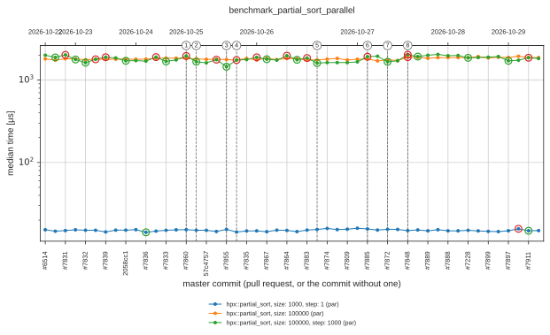

Medians that moved by more than 5% against the median of up to 3 runs before it, not reaching back past the last change (+ is slower); the numbers are those on the graph.

| # | Commit | Pull request | Measurement | Change |
| --- | --- | --- | --- | --- |
|  | [9479d240ceb3](2026/medusa00/20261109T230011Z-9479d240ceb3-b0/README.md) | [#7923](https://github.com/TheHPXProject/hpx/pull/7923) | hpx::partial_sort, size: 100000, step: 1000 (par) | +19% |
| 8 | [b2733a95fa81](2026/medusa00/20261109T162325Z-b2733a95fa81-b0/README.md) | [#8016](https://github.com/TheHPXProject/hpx/pull/8016) | hpx::partial_sort, size: 100000, step: 1000 (par) | -19% |
|  | [73afdb5761aa](2026/medusa00/20261109T154719Z-73afdb5761aa-b0/README.md) | [#7578](https://github.com/TheHPXProject/hpx/pull/7578) | hpx::partial_sort, size: 100000, step: 1000 (par) | +9% |
|  | [953e6823658a](2026/medusa00/20261109T154348Z-953e6823658a-b0/README.md) | [#8024](https://github.com/TheHPXProject/hpx/pull/8024) | hpx::partial_sort, size: 100000, step: 1000 (par) | +10% |
|  | [2c449c50b3a4](2026/medusa00/20261109T153600Z-2c449c50b3a4-b0/README.md) | [#8015](https://github.com/TheHPXProject/hpx/pull/8015) | hpx::partial_sort, size: 100000, step: 1000 (par) | -11% |
|  | [20da13211d9e](2026/medusa00/20261109T135014Z-20da13211d9e-b0/README.md) | [#8026](https://github.com/TheHPXProject/hpx/pull/8026) | hpx::partial_sort, size: 100000, step: 1000 (par) | +19% |
|  | [9df0c28bd288](2026/medusa00/20261109T134836Z-9df0c28bd288-b0/README.md) |  | hpx::partial_sort, size: 100000, step: 1000 (par) | -13% |
|  | [29e648ba019b](2026/medusa00/20261108T210210Z-29e648ba019b-b0/README.md) | [#7815](https://github.com/TheHPXProject/hpx/pull/7815) | hpx::partial_sort, size: 1000, step: 1 (par) | -7% |
|  | [be63a9fb2cc9](2026/medusa00/20261108T204337Z-be63a9fb2cc9-b0/README.md) | [#7986](https://github.com/TheHPXProject/hpx/pull/7986) | hpx::partial_sort, size: 100000, step: 1000 (par) | +6% |
|  | [bd84353a6b82](2026/medusa00/20261108T143932Z-bd84353a6b82-b0/README.md) | [#7512](https://github.com/TheHPXProject/hpx/pull/7512) | hpx::partial_sort, size: 100000, step: 1000 (par) | -15% |
|  | [0800cb212e30](2026/medusa00/20261108T143845Z-0800cb212e30-b0/README.md) | [#7818](https://github.com/TheHPXProject/hpx/pull/7818) | hpx::partial_sort, size: 100000, step: 1000 (par) | +15% |
|  | [d41f64c48c77](2026/medusa00/20261108T143240Z-d41f64c48c77-b0/README.md) | [#8012](https://github.com/TheHPXProject/hpx/pull/8012) | hpx::partial_sort, size: 100000, step: 1000 (par) | +18% |
| 7 | [916f037f8899](2026/medusa00/20261108T143055Z-916f037f8899-b0/README.md) | [#7710](https://github.com/TheHPXProject/hpx/pull/7710) | hpx::partial_sort, size: 100000, step: 1000 (par) | -22% |
|  | [8a2503e4eef9](2026/medusa00/20261107T203722Z-8a2503e4eef9-b0/README.md) | [#7795](https://github.com/TheHPXProject/hpx/pull/7795) | hpx::partial_sort, size: 100000, step: 1000 (par) | -8% |
| 6 | [6c02a1b2103d](2026/medusa00/20261107T202922Z-6c02a1b2103d-b0/README.md) | [#8010](https://github.com/TheHPXProject/hpx/pull/8010) | hpx::partial_sort, size: 100000, step: 1000 (par) | +33% |
|  | [175529d41da8](2026/medusa00/20261107T202811Z-175529d41da8-b0/README.md) | [#7998](https://github.com/TheHPXProject/hpx/pull/7998) | hpx::partial_sort, size: 100000, step: 1000 (par) | -6% |
|  | [b58d65528d91](2026/medusa00/20261107T202707Z-b58d65528d91-b0/README.md) | [#7927](https://github.com/TheHPXProject/hpx/pull/7927) | hpx::partial_sort, size: 100000, step: 1000 (par) | -10% |
|  | [8b7498098df9](2026/medusa00/20261107T202624Z-8b7498098df9-b0/README.md) | [#7902](https://github.com/TheHPXProject/hpx/pull/7902) | hpx::partial_sort, size: 100000, step: 1000 (par) | -6% |
|  | [61739d45974f](2026/medusa00/20261107T202123Z-61739d45974f-b0/README.md) | [#8008](https://github.com/TheHPXProject/hpx/pull/8008) | hpx::partial_sort, size: 100000 (par) | +6% |
|  | [f7df98473ccc](2026/medusa00/20261107T201452Z-f7df98473ccc-b0/README.md) | [#7963](https://github.com/TheHPXProject/hpx/pull/7963) | hpx::partial_sort, size: 100000 (par) | -5% |
|  | [f3caaa84647f](2026/medusa00/20261106T161305Z-f3caaa84647f-b0/README.md) | [#7877](https://github.com/TheHPXProject/hpx/pull/7877) | hpx::partial_sort, size: 100000, step: 1000 (par) | +12% |
|  | [740189b0e212](2026/medusa00/20261106T154916Z-740189b0e212-b0/README.md) | [#7962](https://github.com/TheHPXProject/hpx/pull/7962) | hpx::partial_sort, size: 100000, step: 1000 (par) | +14% |
|  | [67899353fad4](2026/medusa00/20261106T154630Z-67899353fad4-b0/README.md) | [#7997](https://github.com/TheHPXProject/hpx/pull/7997) | hpx::partial_sort, size: 100000, step: 1000 (par) | -7% |
|  | [a9de023e4098](2026/medusa00/20261106T150520Z-a9de023e4098-b0/README.md) | [#7951](https://github.com/TheHPXProject/hpx/pull/7951) | hpx::partial_sort, size: 100000, step: 1000 (par) | -9% |
|  | [ec3b59b1fa0b](2026/medusa00/20261106T150024Z-ec3b59b1fa0b-b0/README.md) | [#8001](https://github.com/TheHPXProject/hpx/pull/8001) | hpx::partial_sort, size: 100000, step: 1000 (par) | +12% |
|  | [b8dc6233ffc3](2026/medusa00/20261106T145549Z-b8dc6233ffc3-b0/README.md) | [#7977](https://github.com/TheHPXProject/hpx/pull/7977) | hpx::partial_sort, size: 100000, step: 1000 (par) | -14% |
|  | [2aba6877abca](2026/medusa00/20261106T145306Z-2aba6877abca-b0/README.md) | [#7778](https://github.com/TheHPXProject/hpx/pull/7778) | hpx::partial_sort, size: 100000, step: 1000 (par) | -7% |
|  | [11d80c3254ef](2026/medusa00/20261105T140141Z-11d80c3254ef-b0/README.md) | [#7288](https://github.com/TheHPXProject/hpx/pull/7288) | hpx::partial_sort, size: 100000, step: 1000 (par) | +13% |
|  | [0090ddb68d9d](2026/medusa00/20261105T140010Z-0090ddb68d9d-b0/README.md) | [#7941](https://github.com/TheHPXProject/hpx/pull/7941) | hpx::partial_sort, size: 100000, step: 1000 (par) | +19% |
|  | [0c3d1acb2825](2026/medusa00/20261105T135914Z-0c3d1acb2825-b0/README.md) | [#7715](https://github.com/TheHPXProject/hpx/pull/7715) | hpx::partial_sort, size: 100000, step: 1000 (par) | -18% |
|  | [e0ec0de0ea79](2026/medusa00/20261105T014759Z-e0ec0de0ea79-b0/README.md) | [#7991](https://github.com/TheHPXProject/hpx/pull/7991) | hpx::partial_sort, size: 100000, step: 1000 (par) | -12% |
|  | [2ccda2d570df](2026/medusa00/20261104T202405Z-2ccda2d570df-b0/README.md) | [#7976](https://github.com/TheHPXProject/hpx/pull/7976) | hpx::partial_sort, size: 100000, step: 1000 (par) | +10% |
|  | [2469176f1309](2026/medusa00/20261104T201606Z-2469176f1309-b0/README.md) | [#7985](https://github.com/TheHPXProject/hpx/pull/7985) | hpx::partial_sort, size: 100000, step: 1000 (par) | +10% |
|  | [bb2649ad4a5c](2026/medusa00/20261104T201553Z-bb2649ad4a5c-b0/README.md) | [#7984](https://github.com/TheHPXProject/hpx/pull/7984) | hpx::partial_sort, size: 1000, step: 1 (par) | -5% |
|  |  |  | hpx::partial_sort, size: 100000, step: 1000 (par) | -11% |
|  | [1c9e6dc93fa3](2026/medusa00/20261104T201219Z-1c9e6dc93fa3-b0/README.md) | [#7928](https://github.com/TheHPXProject/hpx/pull/7928) | hpx::partial_sort, size: 100000, step: 1000 (par) | +13% |
|  | [643711237e76](2026/medusa00/20261104T200513Z-643711237e76-b0/README.md) | [#7979](https://github.com/TheHPXProject/hpx/pull/7979) | hpx::partial_sort, size: 100000, step: 1000 (par) | -10% |
|  | [88071b955a3f](2026/medusa00/20261104T195847Z-88071b955a3f-b0/README.md) | [#7670](https://github.com/TheHPXProject/hpx/pull/7670) | hpx::partial_sort, size: 100000, step: 1000 (par) | +19% |
|  | [6a148399c192](2026/medusa00/20261104T195449Z-6a148399c192-b0/README.md) | [#7914](https://github.com/TheHPXProject/hpx/pull/7914) | hpx::partial_sort, size: 100000, step: 1000 (par) | -11% |
|  | [165e38eedbf8](2026/medusa00/20261104T195301Z-165e38eedbf8-b0/README.md) | [#7880](https://github.com/TheHPXProject/hpx/pull/7880) | hpx::partial_sort, size: 100000, step: 1000 (par) | +16% |
|  | [fce10534ffda](2026/medusa00/20261104T195148Z-fce10534ffda-b0/README.md) | [#7813](https://github.com/TheHPXProject/hpx/pull/7813) | hpx::partial_sort, size: 100000, step: 1000 (par) | -17% |
|  | [2655ed112e4e](2026/medusa00/20261104T194920Z-2655ed112e4e-b0/README.md) | [#7803](https://github.com/TheHPXProject/hpx/pull/7803) | hpx::partial_sort, size: 100000, step: 1000 (par) | +14% |
|  | [3ad5bb936852](2026/medusa00/20261104T194628Z-3ad5bb936852-b0/README.md) | [#7808](https://github.com/TheHPXProject/hpx/pull/7808) | hpx::partial_sort, size: 1000, step: 1 (par) | +8% |
|  |  |  | hpx::partial_sort, size: 100000, step: 1000 (par) | -11% |
|  | [2743e92c3610](2026/medusa00/20261104T194307Z-2743e92c3610-b0/README.md) | [#7716](https://github.com/TheHPXProject/hpx/pull/7716) | hpx::partial_sort, size: 1000, step: 1 (par) | -8% |
|  |  |  | hpx::partial_sort, size: 100000, step: 1000 (par) | -9% |
|  | [e65a7a3cd7b2](2026/medusa00/20261102T200026Z-e65a7a3cd7b2-b0/README.md) | [#7972](https://github.com/TheHPXProject/hpx/pull/7972) | hpx::partial_sort, size: 100000 (par) | +8% |
|  |  |  | hpx::partial_sort, size: 100000, step: 1000 (par) | +12% |
|  | [33a1ebcd9bdc](2026/medusa00/20261102T195916Z-33a1ebcd9bdc-b0/README.md) | [#7970](https://github.com/TheHPXProject/hpx/pull/7970) | hpx::partial_sort, size: 100000 (par) | -6% |
| 5 | [2535af607aa7](2026/medusa00/20261102T195816Z-2535af607aa7-b0/README.md) | [#7975](https://github.com/TheHPXProject/hpx/pull/7975) | hpx::partial_sort, size: 100000, step: 1000 (par) | +24% |
|  | [2506beb245a8](2026/medusa00/20261102T195747Z-2506beb245a8-b0/README.md) | [#7922](https://github.com/TheHPXProject/hpx/pull/7922) | hpx::partial_sort, size: 100000, step: 1000 (par) | -11% |
|  | [b24228a15645](2026/medusa00/20261102T195129Z-b24228a15645-b0/README.md) | [#7871](https://github.com/TheHPXProject/hpx/pull/7871) | hpx::partial_sort, size: 1000, step: 1 (par) | +6% |
|  | [a71ab88dfd37](2026/medusa00/20261102T194939Z-a71ab88dfd37-b0/README.md) | [#7930](https://github.com/TheHPXProject/hpx/pull/7930) | hpx::partial_sort, size: 100000, step: 1000 (par) | +11% |
|  | [b4b1af62b064](2026/medusa00/20261102T194246Z-b4b1af62b064-b0/README.md) | [#7844](https://github.com/TheHPXProject/hpx/pull/7844) | hpx::partial_sort, size: 100000, step: 1000 (par) | -13% |
|  | [e7dcfa1a93b5](2026/medusa00/20261102T173509Z-e7dcfa1a93b5-b0/README.md) | [#7953](https://github.com/TheHPXProject/hpx/pull/7953) | hpx::partial_sort, size: 100000, step: 1000 (par) | +14% |
|  | [0194d98a466d](2026/medusa00/20261102T153810Z-0194d98a466d-b0/README.md) | [#7959](https://github.com/TheHPXProject/hpx/pull/7959) | hpx::partial_sort, size: 100000, step: 1000 (par) | -11% |
|  | [027de27ac2db](2026/medusa00/20261102T153015Z-027de27ac2db-b0/README.md) | [#7958](https://github.com/TheHPXProject/hpx/pull/7958) | hpx::partial_sort, size: 100000, step: 1000 (par) | +9% |
|  | [e8b595c1764d](2026/medusa00/20261102T152924Z-e8b595c1764d-b0/README.md) | [#7964](https://github.com/TheHPXProject/hpx/pull/7964) | hpx::partial_sort, size: 100000 (par) | +8% |
|  | [974ae9d09aad](2026/medusa00/20261102T125313Z-974ae9d09aad-b0/README.md) | [#7616](https://github.com/TheHPXProject/hpx/pull/7616) | hpx::partial_sort, size: 100000 (par) | -7% |
| 4 | [23292d59e39e](2026/medusa00/20261101T014642Z-23292d59e39e-b0/README.md) | [#7917](https://github.com/TheHPXProject/hpx/pull/7917) | hpx::partial_sort, size: 100000, step: 1000 (par) | +22% |
|  | [7dbfb3a5067f](2026/medusa00/20261031T225539Z-7dbfb3a5067f-b0/README.md) | [#7560](https://github.com/TheHPXProject/hpx/pull/7560) | hpx::partial_sort, size: 100000, step: 1000 (par) | -19% |
|  | [122f97511ef4](2026/medusa00/20261031T215646Z-122f97511ef4-b0/README.md) | [#7949](https://github.com/TheHPXProject/hpx/pull/7949) | hpx::partial_sort, size: 100000, step: 1000 (par) | -19% |
| 3 | [48e2d1ece9e7](2026/medusa00/20261031T215629Z-48e2d1ece9e7-b0/README.md) | [#7948](https://github.com/TheHPXProject/hpx/pull/7948) | hpx::partial_sort, size: 100000, step: 1000 (par) | +39% |
|  | [1e6e51150ec1](2026/medusa00/20261031T215553Z-1e6e51150ec1-b0/README.md) | [#7942](https://github.com/TheHPXProject/hpx/pull/7942) | hpx::partial_sort, size: 1000, step: 1 (par) | +5% |
|  |  |  | hpx::partial_sort, size: 100000, step: 1000 (par) | -8% |
|  | [1a5b15496b23](2026/medusa00/20261031T151324Z-1a5b15496b23-b0/README.md) | [#7856](https://github.com/TheHPXProject/hpx/pull/7856) | hpx::partial_sort, size: 1000, step: 1 (par) | -5% |
|  |  |  | hpx::partial_sort, size: 100000, step: 1000 (par) | -8% |
|  | [85ed2bc23e4d](2026/medusa00/20261031T114057Z-85ed2bc23e4d-b0/README.md) | [#7918](https://github.com/TheHPXProject/hpx/pull/7918) | hpx::partial_sort, size: 100000 (par) | -6% |
|  |  |  | hpx::partial_sort, size: 100000, step: 1000 (par) | -13% |
|  | [4b2db341e39e](2026/medusa00/20261031T113857Z-4b2db341e39e-b0/README.md) | [#7926](https://github.com/TheHPXProject/hpx/pull/7926) | hpx::partial_sort, size: 100000 (par) | -7% |
|  | [ab065771e2ac](2026/medusa00/20261030T211219Z-ab065771e2ac-b0/README.md) | [#7944](https://github.com/TheHPXProject/hpx/pull/7944) | hpx::partial_sort, size: 100000, step: 1000 (par) | -5% |
|  | [9a73996f52ab](2026/medusa00/20261030T132448Z-9a73996f52ab-b0/README.md) | [#7919](https://github.com/TheHPXProject/hpx/pull/7919) | hpx::partial_sort, size: 100000, step: 1000 (par) | +8% |
|  | [bc6756b553a3](2026/medusa00/20261030T131136Z-bc6756b553a3-b0/README.md) | [#7895](https://github.com/TheHPXProject/hpx/pull/7895) | hpx::partial_sort, size: 100000, step: 1000 (par) | -9% |
|  | [e8727ab5a0e9](2026/medusa00/20261029T205016Z-e8727ab5a0e9-b0/README.md) | [#7900](https://github.com/TheHPXProject/hpx/pull/7900) | hpx::partial_sort, size: 100000, step: 1000 (par) | +6% |
|  | [2553fc02be5f](2026/medusa00/20261029T133557Z-2553fc02be5f-b0/README.md) | [#7911](https://github.com/TheHPXProject/hpx/pull/7911) | hpx::partial_sort, size: 1000, step: 1 (par) | -5% |
|  |  |  | hpx::partial_sort, size: 100000, step: 1000 (par) | +8% |
|  | [6e71866f21da](2026/medusa00/20261029T133530Z-6e71866f21da-b0/README.md) | [#7912](https://github.com/TheHPXProject/hpx/pull/7912) | hpx::partial_sort, size: 1000, step: 1 (par) | +7% |
|  | [b98a58cb1f89](2026/medusa00/20261029T133437Z-b98a58cb1f89-b0/README.md) | [#7897](https://github.com/TheHPXProject/hpx/pull/7897) | hpx::partial_sort, size: 100000, step: 1000 (par) | -10% |
|  | [97551e19f6a5](2026/medusa00/20261028T155305Z-97551e19f6a5-b0/README.md) | [#7228](https://github.com/TheHPXProject/hpx/pull/7228) | hpx::partial_sort, size: 100000, step: 1000 (par) | -6% |
|  | [acc9d1823949](2026/medusa00/20261027T152111Z-acc9d1823949-b0/README.md) | [#7896](https://github.com/TheHPXProject/hpx/pull/7896) | hpx::partial_sort, size: 100000, step: 1000 (par) | -5% |
| 2 | [d13eb7506802](2026/medusa00/20261027T135959Z-d13eb7506802-b0/README.md) | [#7848](https://github.com/TheHPXProject/hpx/pull/7848) | hpx::partial_sort, size: 100000 (par) | +10% |
|  |  |  | hpx::partial_sort, size: 100000, step: 1000 (par) | +20% |
|  | [d6cd9372b23e](2026/medusa00/20261027T113128Z-d6cd9372b23e-b0/README.md) | [#7872](https://github.com/TheHPXProject/hpx/pull/7872) | hpx::partial_sort, size: 100000, step: 1000 (par) | -14% |
|  | [7b6478fb3fbd](2026/medusa00/20261027T112948Z-7b6478fb3fbd-b0/README.md) | [#7885](https://github.com/TheHPXProject/hpx/pull/7885) | hpx::partial_sort, size: 100000, step: 1000 (par) | +18% |
|  | [2acdd1c7de18](2026/medusa00/20261026T210937Z-2acdd1c7de18-b0/README.md) | [#7879](https://github.com/TheHPXProject/hpx/pull/7879) | hpx::partial_sort, size: 100000, step: 1000 (par) | -13% |
|  | [b07138598e83](2026/medusa00/20261026T210849Z-b07138598e83-b0/README.md) | [#7883](https://github.com/TheHPXProject/hpx/pull/7883) | hpx::partial_sort, size: 100000, step: 1000 (par) | +5% |
|  | [55ef914598c3](2026/medusa00/20261026T104728Z-55ef914598c3-b0/README.md) | [#7784](https://github.com/TheHPXProject/hpx/pull/7784) | hpx::partial_sort, size: 100000, step: 1000 (par) | -11% |
|  | [ff9e673a5887](2026/medusa00/20261026T102649Z-ff9e673a5887-b0/README.md) | [#7864](https://github.com/TheHPXProject/hpx/pull/7864) | hpx::partial_sort, size: 100000, step: 1000 (par) | +12% |
|  | [fb5b51af387b](2026/medusa00/20261026T102522Z-fb5b51af387b-b0/README.md) | [#7867](https://github.com/TheHPXProject/hpx/pull/7867) | hpx::partial_sort, size: 100000, step: 1000 (par) | -5% |
|  | [fef31456e98a](2026/medusa00/20261026T102437Z-fef31456e98a-b0/README.md) | [#7865](https://github.com/TheHPXProject/hpx/pull/7865) | hpx::partial_sort, size: 100000, step: 1000 (par) | +7% |
| 1 | [6f0a12845a8e](2026/medusa00/20261025T224830Z-6f0a12845a8e-b0/README.md) | [#7863](https://github.com/TheHPXProject/hpx/pull/7863) | hpx::partial_sort, size: 100000, step: 1000 (par) | +21% |
|  | [04ee6268abd7](2026/medusa00/20261025T224744Z-04ee6268abd7-b0/README.md) | [#7855](https://github.com/TheHPXProject/hpx/pull/7855) | hpx::partial_sort, size: 100000, step: 1000 (par) | -18% |
|  | [6b30e62af6bf](2026/medusa00/20261025T224510Z-6b30e62af6bf-b0/README.md) | [#7828](https://github.com/TheHPXProject/hpx/pull/7828) | hpx::partial_sort, size: 100000, step: 1000 (par) | +8% |
|  | [47aed4f6502a](2026/medusa00/20261025T154456Z-47aed4f6502a-b16/README.md) |  | hpx::partial_sort, size: 100000, step: 1000 (par) | -15% |
|  | [27381afefe1f](2026/medusa00/20261025T142714Z-27381afefe1f-b15/README.md) | [#7860](https://github.com/TheHPXProject/hpx/pull/7860) | hpx::partial_sort, size: 100000, step: 1000 (par) | +14% |
|  | [c9c9f3e1a70e](2026/medusa00/20261024T180141Z-c9c9f3e1a70e-b13/README.md) | [#7833](https://github.com/TheHPXProject/hpx/pull/7833) | hpx::partial_sort, size: 100000, step: 1000 (par) | -11% |
|  | [9afb016babde](2026/medusa00/20261024T143201Z-9afb016babde-b12/README.md) | [#7787](https://github.com/TheHPXProject/hpx/pull/7787) | hpx::partial_sort, size: 100000, step: 1000 (par) | +11% |
|  | [f251b51f33b2](2026/medusa00/20261024T141942Z-f251b51f33b2-b11/README.md) | [#7836](https://github.com/TheHPXProject/hpx/pull/7836) | hpx::partial_sort, size: 1000, step: 1 (par) | -6% |
|  | [2058cc119343](2026/medusa00/20261023T193102Z-2058cc119343-b9/README.md) |  | hpx::partial_sort, size: 100000, step: 1000 (par) | -9% |
|  | [b5f65f9bbb3f](2026/medusa00/20261023T182839Z-b5f65f9bbb3f-b7/README.md) | [#7839](https://github.com/TheHPXProject/hpx/pull/7839) | hpx::partial_sort, size: 100000, step: 1000 (par) | +6% |
|  | [527180d0b6af](2026/medusa00/20261023T163358Z-527180d0b6af-b6/README.md) |  | hpx::partial_sort, size: 100000, step: 1000 (par) | +10% |
|  | [85b03a1f4663](2026/medusa00/20261023T151352Z-85b03a1f4663-b5/README.md) | [#7832](https://github.com/TheHPXProject/hpx/pull/7832) | hpx::partial_sort, size: 100000, step: 1000 (par) | -8% |
|  | [cacea4d26116](2026/medusa00/20261023T112554Z-cacea4d26116-b4/README.md) | [#7829](https://github.com/TheHPXProject/hpx/pull/7829) | hpx::partial_sort, size: 100000, step: 1000 (par) | -12% |
|  | [eaff5b9649bb](2026/medusa00/20261022T213041Z-eaff5b9649bb-b3/README.md) | [#7831](https://github.com/TheHPXProject/hpx/pull/7831) | hpx::partial_sort, size: 100000, step: 1000 (par) | +7% |
|  | [7ac1a1d7b2c8](2026/medusa00/20261022T210309Z-7ac1a1d7b2c8-b2/README.md) | [#7819](https://github.com/TheHPXProject/hpx/pull/7819) | hpx::partial_sort, size: 100000, step: 1000 (par) | -6% |

### benchmark_remove

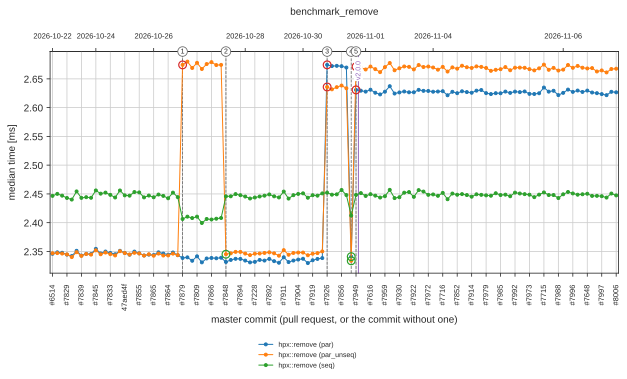

Medians that moved by more than 5% against the median of up to 3 runs before it, not reaching back past the last change (+ is slower); the numbers are those on the graph.

| # | Commit | Pull request | Measurement | Change |
| --- | --- | --- | --- | --- |
| 5 | [122f97511ef4](2026/medusa00/20261031T215646Z-122f97511ef4-b0/README.md) | [#7949](https://github.com/TheHPXProject/hpx/pull/7949) | hpx::remove (par) | +12% |
|  |  |  | hpx::remove (par_unseq) | +14% |
| 4 | [48e2d1ece9e7](2026/medusa00/20261031T215629Z-48e2d1ece9e7-b0/README.md) | [#7948](https://github.com/TheHPXProject/hpx/pull/7948) | hpx::remove (par) | -12% |
|  |  |  | hpx::remove (par_unseq) | -11% |
| 3 | [4b2db341e39e](2026/medusa00/20261031T113857Z-4b2db341e39e-b0/README.md) | [#7926](https://github.com/TheHPXProject/hpx/pull/7926) | hpx::remove (par) | +14% |
|  |  |  | hpx::remove (par_unseq) | +12% |
| 2 | [d13eb7506802](2026/medusa00/20261027T135959Z-d13eb7506802-b0/README.md) | [#7848](https://github.com/TheHPXProject/hpx/pull/7848) | hpx::remove (par_unseq) | -12% |
| 1 | [2acdd1c7de18](2026/medusa00/20261026T210937Z-2acdd1c7de18-b0/README.md) | [#7879](https://github.com/TheHPXProject/hpx/pull/7879) | hpx::remove (par_unseq) | +14% |

### benchmark_remove_if

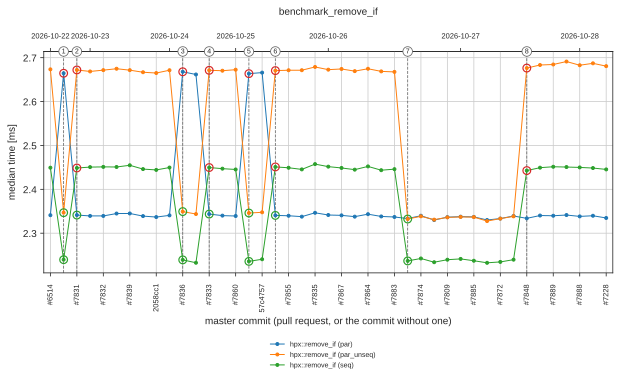

Medians that moved by more than 5% against the median of up to 3 runs before it, not reaching back past the last change (+ is slower); the numbers are those on the graph.

| # | Commit | Pull request | Measurement | Change |
| --- | --- | --- | --- | --- |
|  | [122f97511ef4](2026/medusa00/20261031T215646Z-122f97511ef4-b0/README.md) | [#7949](https://github.com/TheHPXProject/hpx/pull/7949) | hpx::remove_if (par) | -12% |
|  |  |  | hpx::remove_if (par_unseq) | -11% |
|  |  |  | hpx::remove_if (seq) | -7% |
| 8 | [48e2d1ece9e7](2026/medusa00/20261031T215629Z-48e2d1ece9e7-b0/README.md) | [#7948](https://github.com/TheHPXProject/hpx/pull/7948) | hpx::remove_if (par) | +14% |
|  |  |  | hpx::remove_if (par_unseq) | +12% |
|  |  |  | hpx::remove_if (seq) | +9% |
|  | [4b2db341e39e](2026/medusa00/20261031T113857Z-4b2db341e39e-b0/README.md) | [#7926](https://github.com/TheHPXProject/hpx/pull/7926) | hpx::remove_if (par_unseq) | -13% |
|  |  |  | hpx::remove_if (seq) | -9% |
| 7 | [d13eb7506802](2026/medusa00/20261027T135959Z-d13eb7506802-b0/README.md) | [#7848](https://github.com/TheHPXProject/hpx/pull/7848) | hpx::remove_if (par_unseq) | +15% |
|  |  |  | hpx::remove_if (seq) | +9% |
|  | [2acdd1c7de18](2026/medusa00/20261026T210937Z-2acdd1c7de18-b0/README.md) | [#7879](https://github.com/TheHPXProject/hpx/pull/7879) | hpx::remove_if (par_unseq) | -13% |
|  |  |  | hpx::remove_if (seq) | -9% |
| 6 | [6b30e62af6bf](2026/medusa00/20261025T224510Z-6b30e62af6bf-b0/README.md) | [#7828](https://github.com/TheHPXProject/hpx/pull/7828) | hpx::remove_if (par) | -12% |
|  |  |  | hpx::remove_if (par_unseq) | +14% |
|  |  |  | hpx::remove_if (seq) | +10% |
| 5 | [47aed4f6502a](2026/medusa00/20261025T154456Z-47aed4f6502a-b16/README.md) |  | hpx::remove_if (par) | +14% |
|  |  |  | hpx::remove_if (par_unseq) | -12% |
|  |  |  | hpx::remove_if (seq) | -9% |
| 4 | [c9c9f3e1a70e](2026/medusa00/20261024T180141Z-c9c9f3e1a70e-b13/README.md) | [#7833](https://github.com/TheHPXProject/hpx/pull/7833) | hpx::remove_if (par) | -12% |
|  |  |  | hpx::remove_if (par_unseq) | +14% |
|  |  |  | hpx::remove_if (seq) | +10% |
| 3 | [f251b51f33b2](2026/medusa00/20261024T141942Z-f251b51f33b2-b11/README.md) | [#7836](https://github.com/TheHPXProject/hpx/pull/7836) | hpx::remove_if (par) | +14% |
|  |  |  | hpx::remove_if (par_unseq) | -12% |
|  |  |  | hpx::remove_if (seq) | -8% |
| 2 | [eaff5b9649bb](2026/medusa00/20261022T213041Z-eaff5b9649bb-b3/README.md) | [#7831](https://github.com/TheHPXProject/hpx/pull/7831) | hpx::remove_if (par) | -12% |
|  |  |  | hpx::remove_if (par_unseq) | +14% |
|  |  |  | hpx::remove_if (seq) | +9% |
| 1 | [7ac1a1d7b2c8](2026/medusa00/20261022T210309Z-7ac1a1d7b2c8-b2/README.md) | [#7819](https://github.com/TheHPXProject/hpx/pull/7819) | hpx::remove_if (par) | +14% |
|  |  |  | hpx::remove_if (par_unseq) | -12% |
|  |  |  | hpx::remove_if (seq) | -9% |

### foreach_report

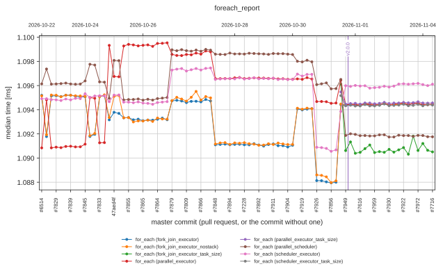

No median moved by more than 5% against the median of up to 3 runs before it, not reaching back past the last change.

### future_overhead_report

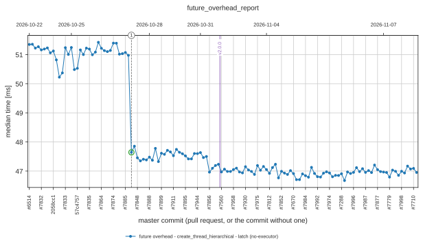

Medians that moved by more than 5% against the median of up to 3 runs before it, not reaching back past the last change (+ is slower); the numbers are those on the graph.

| # | Commit | Pull request | Measurement | Change |
| --- | --- | --- | --- | --- |
| 1 | [d6cd9372b23e](2026/medusa00/20261027T113128Z-d6cd9372b23e-b0/README.md) | [#7872](https://github.com/TheHPXProject/hpx/pull/7872) | future overhead - create_thread_hierarchical - latch (no-executor) | -7% |

### scheduler_latency_report

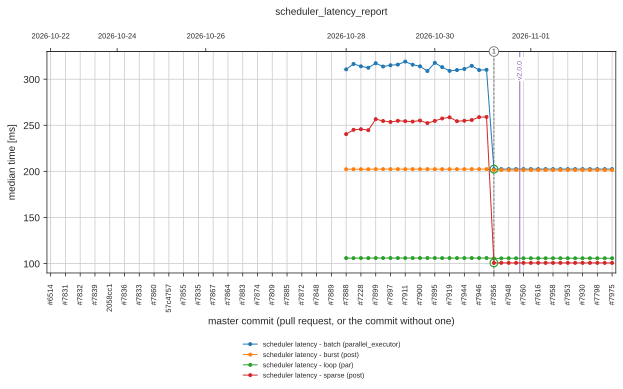

Medians that moved by more than 5% against the median of up to 3 runs before it, not reaching back past the last change (+ is slower); the numbers are those on the graph.

| # | Commit | Pull request | Measurement | Change |
| --- | --- | --- | --- | --- |
| 1 | [1a5b15496b23](2026/medusa00/20261031T151324Z-1a5b15496b23-b0/README.md) | [#7856](https://github.com/TheHPXProject/hpx/pull/7856) | scheduler latency - batch (parallel_executor) | -35% |
|  |  |  | scheduler latency - sparse (post) | -61% |

### scheduler_throughput_report

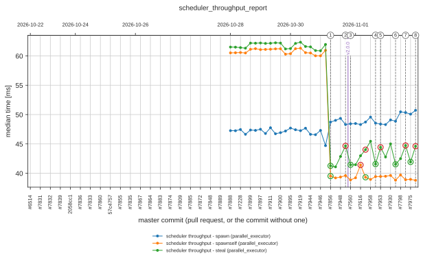

Medians that moved by more than 5% against the median of up to 3 runs before it, not reaching back past the last change (+ is slower); the numbers are those on the graph.

| # | Commit | Pull request | Measurement | Change |
| --- | --- | --- | --- | --- |
|  | [bc88ff5b8392](2026/medusa00/20261108T144211Z-bc88ff5b8392-b0/README.md) | [#7777](https://github.com/TheHPXProject/hpx/pull/7777) | scheduler throughput - spawn (parallel_executor) | +5% |
| 8 | [a9c9c753580e](2026/medusa00/20261108T143523Z-a9c9c753580e-b0/README.md) | [#8014](https://github.com/TheHPXProject/hpx/pull/8014) | scheduler throughput - spawnself (parallel_executor) | -9% |
| 7 | [d41f64c48c77](2026/medusa00/20261108T143240Z-d41f64c48c77-b0/README.md) | [#8012](https://github.com/TheHPXProject/hpx/pull/8012) | scheduler throughput - spawnself (parallel_executor) | +8% |
|  | [1ad403e0b145](2026/medusa00/20261107T202442Z-1ad403e0b145-b0/README.md) | [#7779](https://github.com/TheHPXProject/hpx/pull/7779) | scheduler throughput - spawnself (parallel_executor) | +5% |
|  | [67899353fad4](2026/medusa00/20261106T154630Z-67899353fad4-b0/README.md) | [#7997](https://github.com/TheHPXProject/hpx/pull/7997) | scheduler throughput - steal (parallel_executor) | +6% |
| 6 | [712eea2399f9](2026/medusa00/20261106T150625Z-712eea2399f9-b0/README.md) | [#7648](https://github.com/TheHPXProject/hpx/pull/7648) | scheduler throughput - steal (parallel_executor) | -8% |
|  | [ec3b59b1fa0b](2026/medusa00/20261106T150024Z-ec3b59b1fa0b-b0/README.md) | [#8001](https://github.com/TheHPXProject/hpx/pull/8001) | scheduler throughput - steal (parallel_executor) | +7% |
|  | [dbc3a665f6a0](2026/medusa00/20261106T145638Z-dbc3a665f6a0-b0/README.md) | [#7996](https://github.com/TheHPXProject/hpx/pull/7996) | scheduler throughput - steal (parallel_executor) | -7% |
|  | [b8dc6233ffc3](2026/medusa00/20261106T145549Z-b8dc6233ffc3-b0/README.md) | [#7977](https://github.com/TheHPXProject/hpx/pull/7977) | scheduler throughput - steal (parallel_executor) | +7% |
|  | [ff30aa01f64f](2026/medusa00/20261105T132136Z-ff30aa01f64f-b0/README.md) | [#7973](https://github.com/TheHPXProject/hpx/pull/7973) | scheduler throughput - steal (parallel_executor) | -6% |
| 5 | [326fe34cf521](2026/medusa00/20261105T032145Z-326fe34cf521-b0/README.md) | [#7934](https://github.com/TheHPXProject/hpx/pull/7934) | scheduler throughput - steal (parallel_executor) | +7% |
|  | [2469176f1309](2026/medusa00/20261104T201606Z-2469176f1309-b0/README.md) | [#7985](https://github.com/TheHPXProject/hpx/pull/7985) | scheduler throughput - steal (parallel_executor) | -6% |
|  | [3ad5bb936852](2026/medusa00/20261104T194628Z-3ad5bb936852-b0/README.md) | [#7808](https://github.com/TheHPXProject/hpx/pull/7808) | scheduler throughput - steal (parallel_executor) | -7% |
|  | [2743e92c3610](2026/medusa00/20261104T194307Z-2743e92c3610-b0/README.md) | [#7716](https://github.com/TheHPXProject/hpx/pull/7716) | scheduler throughput - steal (parallel_executor) | +7% |
|  | [e65a7a3cd7b2](2026/medusa00/20261102T200026Z-e65a7a3cd7b2-b0/README.md) | [#7972](https://github.com/TheHPXProject/hpx/pull/7972) | scheduler throughput - steal (parallel_executor) | -6% |
|  | [33a1ebcd9bdc](2026/medusa00/20261102T195916Z-33a1ebcd9bdc-b0/README.md) | [#7970](https://github.com/TheHPXProject/hpx/pull/7970) | scheduler throughput - steal (parallel_executor) | +6% |
|  | [2535af607aa7](2026/medusa00/20261102T195816Z-2535af607aa7-b0/README.md) | [#7975](https://github.com/TheHPXProject/hpx/pull/7975) | scheduler throughput - steal (parallel_executor) | -6% |
|  | [2506beb245a8](2026/medusa00/20261102T195747Z-2506beb245a8-b0/README.md) | [#7922](https://github.com/TheHPXProject/hpx/pull/7922) | scheduler throughput - steal (parallel_executor) | +6% |
|  | [b24228a15645](2026/medusa00/20261102T195129Z-b24228a15645-b0/README.md) | [#7871](https://github.com/TheHPXProject/hpx/pull/7871) | scheduler throughput - steal (parallel_executor) | -7% |
|  | [e7dcfa1a93b5](2026/medusa00/20261102T173509Z-e7dcfa1a93b5-b0/README.md) | [#7953](https://github.com/TheHPXProject/hpx/pull/7953) | scheduler throughput - steal (parallel_executor) | +7% |
| 4 | [0194d98a466d](2026/medusa00/20261102T153810Z-0194d98a466d-b0/README.md) | [#7959](https://github.com/TheHPXProject/hpx/pull/7959) | scheduler throughput - steal (parallel_executor) | -7% |
|  | [e8b595c1764d](2026/medusa00/20261102T152924Z-e8b595c1764d-b0/README.md) | [#7964](https://github.com/TheHPXProject/hpx/pull/7964) | scheduler throughput - spawnself (parallel_executor) | -5% |
|  |  |  | scheduler throughput - steal (parallel_executor) | +6% |
|  | [974ae9d09aad](2026/medusa00/20261102T125313Z-974ae9d09aad-b0/README.md) | [#7616](https://github.com/TheHPXProject/hpx/pull/7616) | scheduler throughput - spawnself (parallel_executor) | +6% |
| 3 | [7dbfb3a5067f](2026/medusa00/20261031T225539Z-7dbfb3a5067f-b0/README.md) | [#7560](https://github.com/TheHPXProject/hpx/pull/7560) | scheduler throughput - steal (parallel_executor) | -7% |
| 2 | [122f97511ef4](2026/medusa00/20261031T215646Z-122f97511ef4-b0/README.md) | [#7949](https://github.com/TheHPXProject/hpx/pull/7949) | scheduler throughput - steal (parallel_executor) | +8% |
| 1 | [1a5b15496b23](2026/medusa00/20261031T151324Z-1a5b15496b23-b0/README.md) | [#7856](https://github.com/TheHPXProject/hpx/pull/7856) | scheduler throughput - spawnself (parallel_executor) | -34% |
|  |  |  | scheduler throughput - steal (parallel_executor) | -32% |

### small_vector_benchmark

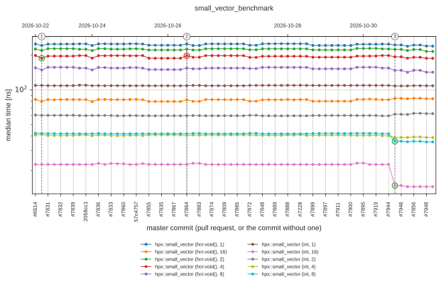

Medians that moved by more than 5% against the median of up to 3 runs before it, not reaching back past the last change (+ is slower); the numbers are those on the graph.

| # | Commit | Pull request | Measurement | Change |
| --- | --- | --- | --- | --- |
| 3 | [4b2db341e39e](2026/medusa00/20261031T113857Z-4b2db341e39e-b0/README.md) | [#7926](https://github.com/TheHPXProject/hpx/pull/7926) | hpx::small_vector (int, 16) | -34% |
|  |  |  | hpx::small_vector (int, 8) | -14% |
| 2 | [ff9e673a5887](2026/medusa00/20261026T102649Z-ff9e673a5887-b0/README.md) | [#7864](https://github.com/TheHPXProject/hpx/pull/7864) | hpx::small_vector (fxn:void(), 4) | +5% |
| 1 | [7ac1a1d7b2c8](2026/medusa00/20261022T210309Z-7ac1a1d7b2c8-b2/README.md) | [#7819](https://github.com/TheHPXProject/hpx/pull/7819) | hpx::small_vector (fxn:void(), 4) | -5% |

### stream_report

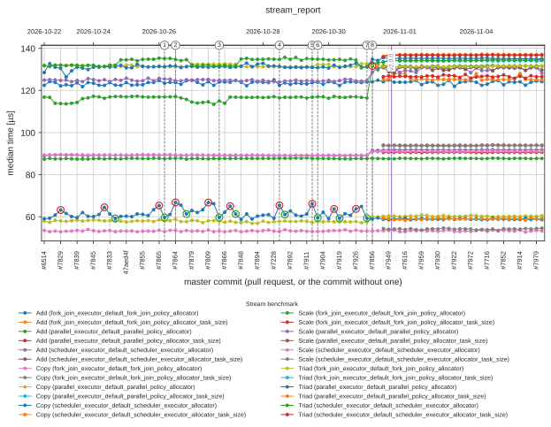

Medians that moved by more than 5% against the median of up to 3 runs before it, not reaching back past the last change (+ is slower); the numbers are those on the graph.

| # | Commit | Pull request | Measurement | Change |
| --- | --- | --- | --- | --- |
| 8 | [1a5b15496b23](2026/medusa00/20261031T151324Z-1a5b15496b23-b0/README.md) | [#7856](https://github.com/TheHPXProject/hpx/pull/7856) | Stream benchmark - Add (parallel_executor_default_parallel_policy_allocator) | +13% |
| 7 | [85ed2bc23e4d](2026/medusa00/20261031T114057Z-85ed2bc23e4d-b0/README.md) | [#7918](https://github.com/TheHPXProject/hpx/pull/7918) | stream benchmark - Copy (scheduler_executor_default_scheduler_executor_allocator) | -8% |
|  | [4b2db341e39e](2026/medusa00/20261031T113857Z-4b2db341e39e-b0/README.md) | [#7926](https://github.com/TheHPXProject/hpx/pull/7926) | stream benchmark - Copy (scheduler_executor_default_scheduler_executor_allocator) | +5% |
|  | [9a73996f52ab](2026/medusa00/20261030T132448Z-9a73996f52ab-b0/README.md) | [#7919](https://github.com/TheHPXProject/hpx/pull/7919) | stream benchmark - Copy (scheduler_executor_default_scheduler_executor_allocator) | -7% |
|  | [965e3686171a](2026/medusa00/20261030T131743Z-965e3686171a-b0/README.md) | [#7925](https://github.com/TheHPXProject/hpx/pull/7925) | stream benchmark - Copy (scheduler_executor_default_scheduler_executor_allocator) | +7% |
| 6 | [e8727ab5a0e9](2026/medusa00/20261029T205016Z-e8727ab5a0e9-b0/README.md) | [#7900](https://github.com/TheHPXProject/hpx/pull/7900) | stream benchmark - Copy (scheduler_executor_default_scheduler_executor_allocator) | -10% |
| 5 | [2152675212c2](2026/medusa00/20261029T133842Z-2152675212c2-b0/README.md) | [#7920](https://github.com/TheHPXProject/hpx/pull/7920) | stream benchmark - Copy (scheduler_executor_default_scheduler_executor_allocator) | +9% |
|  | [f28fd29c4c7f](2026/medusa00/20261028T202642Z-f28fd29c4c7f-b0/README.md) | [#7899](https://github.com/TheHPXProject/hpx/pull/7899) | stream benchmark - Copy (scheduler_executor_default_scheduler_executor_allocator) | -7% |
| 4 | [126b843be369](2026/medusa00/20261028T202529Z-126b843be369-b0/README.md) | [#7903](https://github.com/TheHPXProject/hpx/pull/7903) | stream benchmark - Copy (scheduler_executor_default_scheduler_executor_allocator) | +8% |
|  | [440a78d5bbb4](2026/medusa00/20261027T115041Z-440a78d5bbb4-b0/README.md) | [#7847](https://github.com/TheHPXProject/hpx/pull/7847) | stream benchmark - Copy (scheduler_executor_default_scheduler_executor_allocator) | -6% |
|  | [d6cd9372b23e](2026/medusa00/20261027T113128Z-d6cd9372b23e-b0/README.md) | [#7872](https://github.com/TheHPXProject/hpx/pull/7872) | stream benchmark - Copy (scheduler_executor_default_scheduler_executor_allocator) | +7% |
| 3 | [7b6478fb3fbd](2026/medusa00/20261027T112948Z-7b6478fb3fbd-b0/README.md) | [#7885](https://github.com/TheHPXProject/hpx/pull/7885) | stream benchmark - Copy (scheduler_executor_default_scheduler_executor_allocator) | -10% |
|  | [0bb4fe759234](2026/medusa00/20261026T212323Z-0bb4fe759234-b0/README.md) | [#7809](https://github.com/TheHPXProject/hpx/pull/7809) | stream benchmark - Copy (scheduler_executor_default_scheduler_executor_allocator) | +6% |
|  | [b07138598e83](2026/medusa00/20261026T210849Z-b07138598e83-b0/README.md) | [#7883](https://github.com/TheHPXProject/hpx/pull/7883) | stream benchmark - Copy (scheduler_executor_default_scheduler_executor_allocator) | -7% |
| 2 | [ff9e673a5887](2026/medusa00/20261026T102649Z-ff9e673a5887-b0/README.md) | [#7864](https://github.com/TheHPXProject/hpx/pull/7864) | stream benchmark - Copy (scheduler_executor_default_scheduler_executor_allocator) | +11% |
| 1 | [fb5b51af387b](2026/medusa00/20261026T102522Z-fb5b51af387b-b0/README.md) | [#7867](https://github.com/TheHPXProject/hpx/pull/7867) | stream benchmark - Copy (scheduler_executor_default_scheduler_executor_allocator) | -9% |
|  | [fef31456e98a](2026/medusa00/20261026T102437Z-fef31456e98a-b0/README.md) | [#7865](https://github.com/TheHPXProject/hpx/pull/7865) | stream benchmark - Copy (scheduler_executor_default_scheduler_executor_allocator) | +7% |
|  | [585b332c4aeb](2026/medusa00/20261024T215359Z-585b332c4aeb-b14/README.md) | [#7858](https://github.com/TheHPXProject/hpx/pull/7858) | stream benchmark - Copy (scheduler_executor_default_scheduler_executor_allocator) | -6% |
|  | [9afb016babde](2026/medusa00/20261024T143201Z-9afb016babde-b12/README.md) | [#7787](https://github.com/TheHPXProject/hpx/pull/7787) | stream benchmark - Copy (scheduler_executor_default_scheduler_executor_allocator) | +7% |
|  | [cacea4d26116](2026/medusa00/20261023T112554Z-cacea4d26116-b4/README.md) | [#7829](https://github.com/TheHPXProject/hpx/pull/7829) | stream benchmark - Copy (scheduler_executor_default_scheduler_executor_allocator) | +7% |

### transform_reduce_scaling

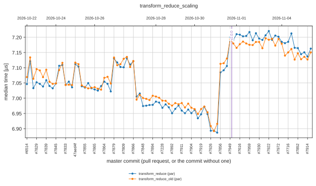

Medians that moved by more than 5% against the median of up to 3 runs before it, not reaching back past the last change (+ is slower); the numbers are those on the graph.

| # | Commit | Pull request | Measurement | Change |
| --- | --- | --- | --- | --- |
| 1 | [f7df98473ccc](2026/medusa00/20261107T201452Z-f7df98473ccc-b0/README.md) | [#7963](https://github.com/TheHPXProject/hpx/pull/7963) | transform_reduce (par) | -8% |
|  |  |  | transform_reduce_old (par) | -8% |

## License

Distributed under the Boost Software License, Version 1.0, see [LICENSE_1_0.txt](LICENSE_1_0.txt).
