# HPX performance history

The results of the performance tests of [HPX](https://github.com/TheHPXProject/hpx) for the commits of its master branch, measured by its Jenkins CI on the Rostam cluster at LSU (see `.jenkins/lsu-perftests` and `tools/perftests_ci` in the HPX repository). The graphs below show the median time of every measurement over the master commits in their order, labeled with their pull requests (or the commits without one); lower is faster. The table below each graph lists the commits after which a median changed, the numbered commits are marked on the graph, and the ringed points are the medians that changed (red slower, green faster).

## Layout

- `<year>/<node>/<commit date>-<commit>-b<build>/`: one run, with its report (`README.md`), the commit, when and where the benchmarks ran and the configuration (`metadata.json`), the medians of all measurements (`summary.json`), the results of all benchmarks as measured (`results.tar.gz`), and the comparison with the references of the node.
- `runs.tsv`: all runs. `timeline.csv`: the medians of all measurements of all runs, as written by `tools/perftests_ci/perftests_history.py`, which rebuilds it from the run directories. `timeline/`: the graphs below, drawn by `tools/perftests_ci/perftests_timeline.py`.

## Runs

- [2026](2026/README.md)

## Performance over time

### Overview

The lasting changes: a step of more than 5% between the median of 5 runs and that of the 5 runs before it, for the measurements whose level doesn't go up and down. The net change compares the median of the last runs of a measurement with that of its first runs (the graph on the right of each benchmark shows where it came from).

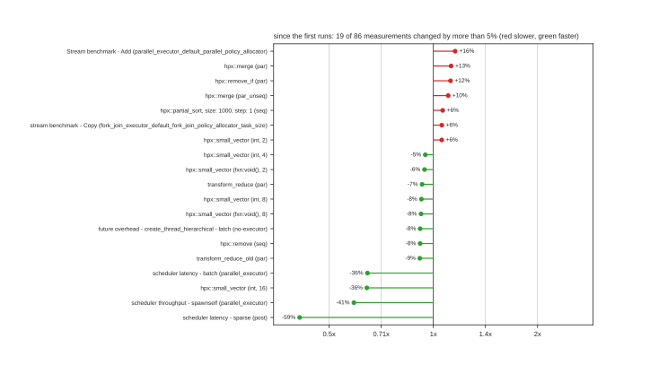

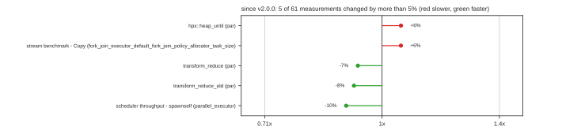

Measurements whose level goes up and down, so that their changes are not attributed to pull requests: hpx::heap_until (par_unseq), hpx::heap_until (seq), hpx::inplace_merge (par), hpx::inplace_merge (par_unseq), hpx::is_heap (par), hpx::is_heap (par_unseq), hpx::is_heap (seq), hpx::nth_element, size: 1000, step: 1 (seq), hpx::nth_element, size: 100000, step: 5000 (par), hpx::nth_element, size: 100000, step: 5000 (seq), hpx::partial_sort, size: 100000 (par), hpx::partial_sort, size: 100000 (seq), hpx::partial_sort, size: 100000, step: 1000 (par), hpx::remove (par), hpx::remove (par_unseq), hpx::remove_if (par_unseq), hpx::remove_if (seq), scheduler throughput - spawn (parallel_executor), scheduler throughput - steal (parallel_executor).

### Pull requests that changed performance

The commits after which a measurement changed for good since v2.0.0, and at least the last 20.

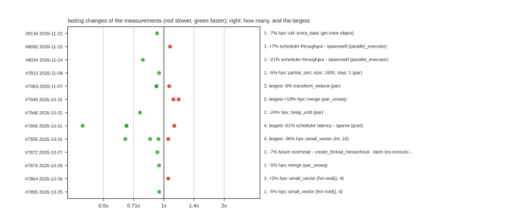

| Pull request | Merged | Measurement | Change |
| --- | --- | --- | --- |
| [#8137](https://github.com/TheHPXProject/hpx/pull/8137) | [2026-11-23](2026/medusa00/20261123T153642Z-88df87fc49dd-b0/README.md) | hpx::small_vector (fxn:void(), 2) | -5% |
| [#8134](https://github.com/TheHPXProject/hpx/pull/8134) | [2026-11-22](2026/medusa00/20261122T015611Z-4241485718db-b0/README.md) | hpx::util::extra_data::get (new object) | -7% |
| [#8092](https://github.com/TheHPXProject/hpx/pull/8092) | [2026-11-15](2026/medusa00/20261115T142802Z-41b78d5465db-b0/README.md) | scheduler throughput - spawnself (parallel_executor) | +7% |
| [#8034](https://github.com/TheHPXProject/hpx/pull/8034) | [2026-11-14](2026/medusa00/20261114T002158Z-4df84c175b63-b0/README.md) | scheduler throughput - spawnself (parallel_executor) | -21% |
| [#7815](https://github.com/TheHPXProject/hpx/pull/7815) | [2026-11-08](2026/medusa00/20261108T210210Z-29e648ba019b-b0/README.md) | hpx::partial_sort, size: 1000, step: 1 (par) | -5% |
| [#7963](https://github.com/TheHPXProject/hpx/pull/7963) | [2026-11-07](2026/medusa00/20261107T201452Z-f7df98473ccc-b0/README.md) | transform_reduce (par) | -8% |
|  |  | transform_reduce_old (par) | -8% |
|  |  | hpx::heap_until (par) | +6% |
| [#7949](https://github.com/TheHPXProject/hpx/pull/7949) | [2026-10-31](2026/medusa00/20261031T215646Z-122f97511ef4-b0/README.md) | hpx::merge (par_unseq) | +19% |
|  |  | hpx::merge (par) | +12% |
| [#7948](https://github.com/TheHPXProject/hpx/pull/7948) | [2026-10-31](2026/medusa00/20261031T215629Z-48e2d1ece9e7-b0/README.md) | hpx::heap_until (par) | -24% |
| [#7856](https://github.com/TheHPXProject/hpx/pull/7856) | [2026-10-31](2026/medusa00/20261031T151324Z-1a5b15496b23-b0/README.md) | scheduler latency - sparse (post) | -61% |
|  |  | scheduler throughput - spawnself (parallel_executor) | -35% |
|  |  | scheduler latency - batch (parallel_executor) | -35% |
|  |  | Stream benchmark - Add (parallel_executor_default_parallel_policy_allocator) | +13% |
| [#7926](https://github.com/TheHPXProject/hpx/pull/7926) | [2026-10-31](2026/medusa00/20261031T113857Z-4b2db341e39e-b0/README.md) | hpx::small_vector (int, 16) | -36% |
|  |  | hpx::small_vector (int, 8) | -15% |
|  |  | hpx::small_vector (fxn:void(), 8) | -6% |
|  |  | hpx::partial_sort, size: 1000, step: 1 (seq) | +5% |
| [#7872](https://github.com/TheHPXProject/hpx/pull/7872) | [2026-10-27](2026/medusa00/20261027T113128Z-d6cd9372b23e-b0/README.md) | future overhead - create_thread_hierarchical - latch (no-executor) | -7% |
| [#7879](https://github.com/TheHPXProject/hpx/pull/7879) | [2026-10-26](2026/medusa00/20261026T210937Z-2acdd1c7de18-b0/README.md) | hpx::merge (par_unseq) | -5% |
| [#7864](https://github.com/TheHPXProject/hpx/pull/7864) | [2026-10-26](2026/medusa00/20261026T102649Z-ff9e673a5887-b0/README.md) | hpx::small_vector (fxn:void(), 4) | +5% |
| [#7855](https://github.com/TheHPXProject/hpx/pull/7855) | [2026-10-25](2026/medusa00/20261025T224744Z-04ee6268abd7-b0/README.md) | hpx::small_vector (fxn:void(), 4) | -5% |

### benchmark_inplace_merge

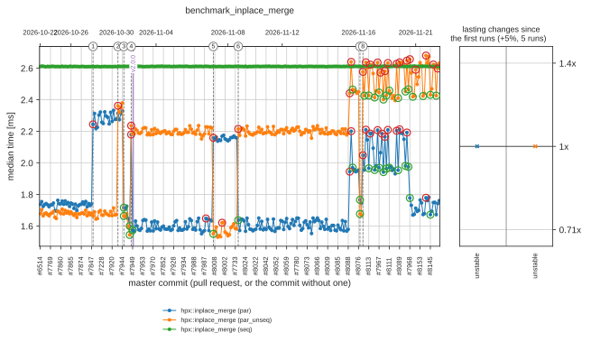

Medians that moved by more than 5% against the median of up to 3 runs before it, not reaching back past the last change (+ is slower); the numbers are those on the graph.

| # | Commit | Pull request | Measurement | Change |
| --- | --- | --- | --- | --- |
|  | [7b3a3f0fd05e](2026/medusa00/20261122T220537Z-7b3a3f0fd05e-b0/README.md) | [#8181](https://github.com/TheHPXProject/hpx/pull/8181) | hpx::inplace_merge (par_unseq) | -5% |
| 8 | [3af219b1e7b3](2026/medusa00/20261121T202714Z-3af219b1e7b3-b0/README.md) | [#8158](https://github.com/TheHPXProject/hpx/pull/8158) | hpx::inplace_merge (par) | +18% |
|  |  |  | hpx::inplace_merge (par_unseq) | -37% |
|  | [09263e22dae1](2026/medusa00/20261121T202055Z-09263e22dae1-b0/README.md) | [#8151](https://github.com/TheHPXProject/hpx/pull/8151) | hpx::inplace_merge (par_unseq) | +7% |
|  | [2ef6b6dbfb68](2026/medusa00/20261121T201146Z-2ef6b6dbfb68-b0/README.md) | [#8182](https://github.com/TheHPXProject/hpx/pull/8182) | hpx::inplace_merge (par_unseq) | -7% |
|  | [e662f93ee492](2026/medusa00/20261121T201000Z-e662f93ee492-b0/README.md) | [#8175](https://github.com/TheHPXProject/hpx/pull/8175) | hpx::inplace_merge (par_unseq) | +7% |
|  | [efa92d023cc3](2026/medusa00/20261121T200232Z-efa92d023cc3-b0/README.md) | [#8145](https://github.com/TheHPXProject/hpx/pull/8145) | hpx::inplace_merge (par) | -6% |
|  |  |  | hpx::inplace_merge (par_unseq) | -9% |
|  | [0410a131ea60](2026/medusa00/20261121T200021Z-0410a131ea60-b0/README.md) | [#8146](https://github.com/TheHPXProject/hpx/pull/8146) | hpx::inplace_merge (par) | +6% |
|  |  |  | hpx::inplace_merge (par_unseq) | +10% |
|  | [161df7fc6a85](2026/medusa00/20261121T020555Z-161df7fc6a85-b0/README.md) | [#8172](https://github.com/TheHPXProject/hpx/pull/8172) | hpx::inplace_merge (par_unseq) | -7% |
|  | [13283433a175](2026/medusa00/20261121T011251Z-13283433a175-b0/README.md) | [#8160](https://github.com/TheHPXProject/hpx/pull/8160) | hpx::inplace_merge (par_unseq) | +7% |
|  | [6db355aa30b9](2026/medusa00/20261119T152626Z-6db355aa30b9-b0/README.md) | [#8149](https://github.com/TheHPXProject/hpx/pull/8149) | hpx::inplace_merge (par_unseq) | -7% |
|  | [4aa61cac50e2](2026/medusa00/20261119T131655Z-4aa61cac50e2-b0/README.md) | [#7968](https://github.com/TheHPXProject/hpx/pull/7968) | hpx::inplace_merge (par) | -10% |
|  |  |  | hpx::inplace_merge (par_unseq) | +8% |
|  | [4d190f95f1fe](2026/medusa00/20261119T131631Z-4d190f95f1fe-b0/README.md) | [#8117](https://github.com/TheHPXProject/hpx/pull/8117) | hpx::inplace_merge (par) | -10% |
|  |  |  | hpx::inplace_merge (par_unseq) | -7% |
|  | [68987f390ee9](2026/medusa00/20261119T125208Z-68987f390ee9-b0/README.md) | [#8133](https://github.com/TheHPXProject/hpx/pull/8133) | hpx::inplace_merge (par) | +11% |
|  |  |  | hpx::inplace_merge (par_unseq) | +8% |
|  | [bf301bd9a7bb](2026/medusa00/20261119T125141Z-bf301bd9a7bb-b0/README.md) | [#8147](https://github.com/TheHPXProject/hpx/pull/8147) | hpx::inplace_merge (par) | -9% |
|  |  |  | hpx::inplace_merge (par_unseq) | -7% |
|  | [b00a4e68cc8e](2026/medusa00/20261118T170108Z-b00a4e68cc8e-b0/README.md) | [#8089](https://github.com/TheHPXProject/hpx/pull/8089) | hpx::inplace_merge (par) | +13% |
|  |  |  | hpx::inplace_merge (par_unseq) | +9% |
|  | [5169e70c5385](2026/medusa00/20261118T163123Z-5169e70c5385-b0/README.md) | [#8138](https://github.com/TheHPXProject/hpx/pull/8138) | hpx::inplace_merge (par) | -11% |
|  |  |  | hpx::inplace_merge (par_unseq) | -8% |
|  | [7d08d4adcc4d](2026/medusa00/20261118T162954Z-7d08d4adcc4d-b0/README.md) | [#8132](https://github.com/TheHPXProject/hpx/pull/8132) | hpx::inplace_merge (par) | +13% |
|  |  |  | hpx::inplace_merge (par_unseq) | +9% |
|  | [70dbd992fade](2026/medusa00/20261117T023759Z-70dbd992fade-b0/README.md) | [#8111](https://github.com/TheHPXProject/hpx/pull/8111) | hpx::inplace_merge (par) | -11% |
|  |  |  | hpx::inplace_merge (par_unseq) | -7% |
|  | [aabec893cbe6](2026/medusa00/20261117T023617Z-aabec893cbe6-b0/README.md) | [#8126](https://github.com/TheHPXProject/hpx/pull/8126) | hpx::inplace_merge (par) | +13% |
|  |  |  | hpx::inplace_merge (par_unseq) | +8% |
|  | [9b8facdd8144](2026/medusa00/20261117T023244Z-9b8facdd8144-b0/README.md) | [#7957](https://github.com/TheHPXProject/hpx/pull/7957) | hpx::inplace_merge (par) | -9% |
|  |  |  | hpx::inplace_merge (par_unseq) | -6% |
|  | [6a580cf3b81f](2026/medusa00/20261117T023117Z-6a580cf3b81f-b0/README.md) | [#8122](https://github.com/TheHPXProject/hpx/pull/8122) | hpx::inplace_merge (par) | +12% |
|  |  |  | hpx::inplace_merge (par_unseq) | +8% |
|  | [52804e03f4e7](2026/medusa00/20261117T022735Z-52804e03f4e7-b0/README.md) | [#7862](https://github.com/TheHPXProject/hpx/pull/7862) | hpx::inplace_merge (par) | -11% |
|  |  |  | hpx::inplace_merge (par_unseq) | -7% |
|  | [3bda6151b6d2](2026/medusa00/20261117T022429Z-3bda6151b6d2-b0/README.md) | [#8116](https://github.com/TheHPXProject/hpx/pull/8116) | hpx::inplace_merge (par) | +8% |
|  | [231ccc883b3d](2026/medusa00/20261117T010355Z-231ccc883b3d-b0/README.md) | [#8118](https://github.com/TheHPXProject/hpx/pull/8118) | hpx::inplace_merge (par_unseq) | +5% |
|  | [495fe11e52e0](2026/medusa00/20261117T002049Z-495fe11e52e0-b0/README.md) | [#7967](https://github.com/TheHPXProject/hpx/pull/7967) | hpx::inplace_merge (par) | -11% |
|  |  |  | hpx::inplace_merge (par_unseq) | -7% |
|  | [3489de476d47](2026/medusa00/20261116T235000Z-3489de476d47-b0/README.md) | [#8120](https://github.com/TheHPXProject/hpx/pull/8120) | hpx::inplace_merge (par) | +12% |
|  |  |  | hpx::inplace_merge (par_unseq) | +8% |
|  | [6c95cabf37c5](2026/medusa00/20261116T181453Z-6c95cabf37c5-b0/README.md) | [#8112](https://github.com/TheHPXProject/hpx/pull/8112) | hpx::inplace_merge (par) | -11% |
|  |  |  | hpx::inplace_merge (par_unseq) | -8% |
|  | [70316ed411f9](2026/medusa00/20261116T153629Z-70316ed411f9-b0/README.md) | [#8114](https://github.com/TheHPXProject/hpx/pull/8114) | hpx::inplace_merge (par) | +11% |
|  |  |  | hpx::inplace_merge (par_unseq) | +8% |
|  | [bf3a8192f178](2026/medusa00/20261116T145805Z-bf3a8192f178-b0/README.md) | [#8113](https://github.com/TheHPXProject/hpx/pull/8113) | hpx::inplace_merge (par) | -10% |
|  |  |  | hpx::inplace_merge (par_unseq) | -7% |
|  | [0a68e91ac048](2026/medusa00/20261116T130907Z-0a68e91ac048-b0/README.md) | [#8055](https://github.com/TheHPXProject/hpx/pull/8055) | hpx::inplace_merge (par) | +10% |
|  |  |  | hpx::inplace_merge (par_unseq) | +9% |
|  | [99b1c476fd75](2026/medusa00/20261116T130303Z-99b1c476fd75-b0/README.md) | [#8081](https://github.com/TheHPXProject/hpx/pull/8081) | hpx::inplace_merge (par_unseq) | -6% |
| 7 | [15ed7a32eda5](2026/medusa00/20261116T130126Z-15ed7a32eda5-b0/README.md) | [#8086](https://github.com/TheHPXProject/hpx/pull/8086) | hpx::inplace_merge (par) | +17% |
|  |  |  | hpx::inplace_merge (par_unseq) | +54% |
| 6 | [aae6119e6f00](2026/medusa00/20261116T003932Z-aae6119e6f00-b0/README.md) | [#8110](https://github.com/TheHPXProject/hpx/pull/8110) | hpx::inplace_merge (par) | -9% |
|  |  |  | hpx::inplace_merge (par_unseq) | -32% |
|  | [6d7dcc284f37](2026/medusa00/20261115T223105Z-6d7dcc284f37-b0/README.md) | [#7947](https://github.com/TheHPXProject/hpx/pull/7947) | hpx::inplace_merge (par) | -10% |
|  |  |  | hpx::inplace_merge (par_unseq) | -7% |
|  | [e5e6ba9670fd](2026/medusa00/20261115T205943Z-e5e6ba9670fd-b0/README.md) | [#8109](https://github.com/TheHPXProject/hpx/pull/8109) | hpx::inplace_merge (par) | +13% |
|  |  |  | hpx::inplace_merge (par_unseq) | +8% |
|  | [d46dcf54b998](2026/medusa00/20261115T164657Z-d46dcf54b998-b0/README.md) | [#8090](https://github.com/TheHPXProject/hpx/pull/8090) | hpx::inplace_merge (par) | +23% |
|  |  |  | hpx::inplace_merge (par_unseq) | +11% |
| 5 | [be63a9fb2cc9](2026/medusa00/20261108T204337Z-be63a9fb2cc9-b0/README.md) | [#7986](https://github.com/TheHPXProject/hpx/pull/7986) | hpx::inplace_merge (par) | -24% |
|  |  |  | hpx::inplace_merge (par_unseq) | +40% |
|  | [175529d41da8](2026/medusa00/20261107T202811Z-175529d41da8-b0/README.md) | [#7998](https://github.com/TheHPXProject/hpx/pull/7998) | hpx::inplace_merge (par_unseq) | +6% |
| 4 | [f7df98473ccc](2026/medusa00/20261107T201452Z-f7df98473ccc-b0/README.md) | [#7963](https://github.com/TheHPXProject/hpx/pull/7963) | hpx::inplace_merge (par) | +32% |
|  |  |  | hpx::inplace_merge (par_unseq) | -30% |
|  | [a25ea7880afe](2026/medusa00/20261106T154609Z-a25ea7880afe-b0/README.md) | [#7994](https://github.com/TheHPXProject/hpx/pull/7994) | hpx::inplace_merge (par) | +5% |
|  | [122f97511ef4](2026/medusa00/20261031T215646Z-122f97511ef4-b0/README.md) | [#7949](https://github.com/TheHPXProject/hpx/pull/7949) | hpx::inplace_merge (par) | -28% |
| 3 | [48e2d1ece9e7](2026/medusa00/20261031T215629Z-48e2d1ece9e7-b0/README.md) | [#7948](https://github.com/TheHPXProject/hpx/pull/7948) | hpx::inplace_merge (par) | +36% |
|  |  |  | hpx::inplace_merge (par_unseq) | +45% |
|  | [1e6e51150ec1](2026/medusa00/20261031T215553Z-1e6e51150ec1-b0/README.md) | [#7942](https://github.com/TheHPXProject/hpx/pull/7942) | hpx::inplace_merge (par) | -7% |
|  |  |  | hpx::inplace_merge (par_unseq) | -7% |
| 2 | [4b2db341e39e](2026/medusa00/20261031T113857Z-4b2db341e39e-b0/README.md) | [#7926](https://github.com/TheHPXProject/hpx/pull/7926) | hpx::inplace_merge (par) | -26% |
|  |  |  | hpx::inplace_merge (par_unseq) | -29% |
| 1 | [965e3686171a](2026/medusa00/20261030T131743Z-965e3686171a-b0/README.md) | [#7925](https://github.com/TheHPXProject/hpx/pull/7925) | hpx::inplace_merge (par_unseq) | +41% |
|  | [d13eb7506802](2026/medusa00/20261027T135959Z-d13eb7506802-b0/README.md) | [#7848](https://github.com/TheHPXProject/hpx/pull/7848) | hpx::inplace_merge (par) | +29% |

### benchmark_is_heap

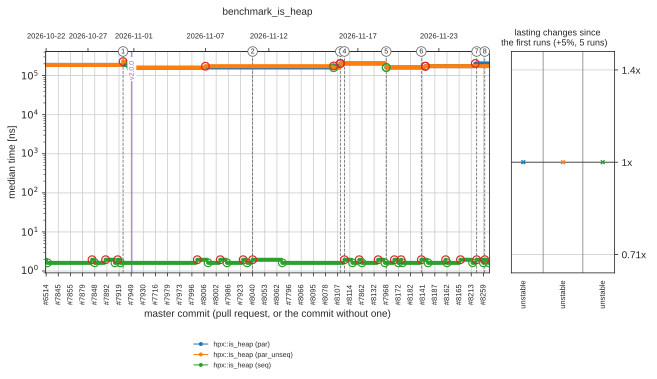

Medians that moved by more than 5% against the median of up to 3 runs before it, not reaching back past the last change (+ is slower); the numbers are those on the graph.

| # | Commit | Pull request | Measurement | Change |
| --- | --- | --- | --- | --- |
|  | [7dfcaca610c6](2026/medusa00/20261123T155526Z-7dfcaca610c6-b0/README.md) | [#8162](https://github.com/TheHPXProject/hpx/pull/8162) | hpx::is_heap (seq) | -17% |
|  | [30d07dfcd052](2026/medusa00/20261123T155346Z-30d07dfcd052-b0/README.md) | [#8170](https://github.com/TheHPXProject/hpx/pull/8170) | hpx::is_heap (seq) | +20% |
|  | [ef19302454ec](2026/medusa00/20261122T220732Z-ef19302454ec-b0/README.md) | [#8164](https://github.com/TheHPXProject/hpx/pull/8164) | hpx::is_heap (seq) | -17% |
|  | [7b3a3f0fd05e](2026/medusa00/20261122T220537Z-7b3a3f0fd05e-b0/README.md) | [#8181](https://github.com/TheHPXProject/hpx/pull/8181) | hpx::is_heap (par) | +8% |
|  |  |  | hpx::is_heap (par_unseq) | +7% |
| 8 | [4241485718db](2026/medusa00/20261122T015611Z-4241485718db-b0/README.md) | [#8134](https://github.com/TheHPXProject/hpx/pull/8134) | hpx::is_heap (seq) | +20% |
|  | [7f7a5193f14c](2026/medusa00/20261121T200117Z-7f7a5193f14c-b0/README.md) | [#8167](https://github.com/TheHPXProject/hpx/pull/8167) | hpx::is_heap (seq) | -17% |
|  | [0410a131ea60](2026/medusa00/20261121T200021Z-0410a131ea60-b0/README.md) | [#8146](https://github.com/TheHPXProject/hpx/pull/8146) | hpx::is_heap (seq) | +20% |
|  | [161df7fc6a85](2026/medusa00/20261121T020555Z-161df7fc6a85-b0/README.md) | [#8172](https://github.com/TheHPXProject/hpx/pull/8172) | hpx::is_heap (seq) | -17% |
|  | [c4ed06bad070](2026/medusa00/20261121T011431Z-c4ed06bad070-b0/README.md) | [#8140](https://github.com/TheHPXProject/hpx/pull/8140) | hpx::is_heap (seq) | +20% |
| 7 | [4aa61cac50e2](2026/medusa00/20261119T131655Z-4aa61cac50e2-b0/README.md) | [#7968](https://github.com/TheHPXProject/hpx/pull/7968) | hpx::is_heap (par) | -21% |
|  |  |  | hpx::is_heap (par_unseq) | -21% |
|  | [4d190f95f1fe](2026/medusa00/20261119T131631Z-4d190f95f1fe-b0/README.md) | [#8117](https://github.com/TheHPXProject/hpx/pull/8117) | hpx::is_heap (seq) | -17% |
|  | [2ad23f352fcc](2026/medusa00/20261118T173721Z-2ad23f352fcc-b0/README.md) | [#7952](https://github.com/TheHPXProject/hpx/pull/7952) | hpx::is_heap (seq) | +20% |
|  | [52804e03f4e7](2026/medusa00/20261117T022735Z-52804e03f4e7-b0/README.md) | [#7862](https://github.com/TheHPXProject/hpx/pull/7862) | hpx::is_heap (seq) | -17% |
|  | [231ccc883b3d](2026/medusa00/20261117T010355Z-231ccc883b3d-b0/README.md) | [#8118](https://github.com/TheHPXProject/hpx/pull/8118) | hpx::is_heap (seq) | +20% |
|  | [2de7d8546d6e](2026/medusa00/20261116T181442Z-2de7d8546d6e-b0/README.md) | [#8108](https://github.com/TheHPXProject/hpx/pull/8108) | hpx::is_heap (seq) | -17% |
| 6 | [99b1c476fd75](2026/medusa00/20261116T130303Z-99b1c476fd75-b0/README.md) | [#8081](https://github.com/TheHPXProject/hpx/pull/8081) | hpx::is_heap (seq) | +20% |
| 5 | [aae6119e6f00](2026/medusa00/20261116T003932Z-aae6119e6f00-b0/README.md) | [#8110](https://github.com/TheHPXProject/hpx/pull/8110) | hpx::is_heap (par) | +16% |
|  |  |  | hpx::is_heap (par_unseq) | +29% |
|  | [6d7dcc284f37](2026/medusa00/20261115T223105Z-6d7dcc284f37-b0/README.md) | [#7947](https://github.com/TheHPXProject/hpx/pull/7947) | hpx::is_heap (par) | +9% |
|  |  |  | hpx::is_heap (par_unseq) | -8% |
|  | [d5e76cb4cafa](2026/medusa00/20261112T175317Z-d5e76cb4cafa-b0/README.md) | [#7780](https://github.com/TheHPXProject/hpx/pull/7780) | hpx::is_heap (seq) | -17% |
| 4 | [2debed8192f0](2026/medusa00/20261111T013154Z-2debed8192f0-b0/README.md) | [#8040](https://github.com/TheHPXProject/hpx/pull/8040) | hpx::is_heap (seq) | +20% |
|  | [7757cdb5b188](2026/medusa00/20261111T010906Z-7757cdb5b188-b0/README.md) | [#7672](https://github.com/TheHPXProject/hpx/pull/7672) | hpx::is_heap (seq) | -17% |
|  | [ddcafa39ebcd](2026/medusa00/20261110T005848Z-ddcafa39ebcd-b0/README.md) | [#8018](https://github.com/TheHPXProject/hpx/pull/8018) | hpx::is_heap (seq) | +20% |
|  | [bc88ff5b8392](2026/medusa00/20261108T144211Z-bc88ff5b8392-b0/README.md) | [#7777](https://github.com/TheHPXProject/hpx/pull/7777) | hpx::is_heap (seq) | -17% |
|  | [d41f64c48c77](2026/medusa00/20261108T143240Z-d41f64c48c77-b0/README.md) | [#8012](https://github.com/TheHPXProject/hpx/pull/8012) | hpx::is_heap (seq) | +20% |
|  | [1ad403e0b145](2026/medusa00/20261107T202442Z-1ad403e0b145-b0/README.md) | [#7779](https://github.com/TheHPXProject/hpx/pull/7779) | hpx::is_heap (seq) | -17% |
|  | [f7df98473ccc](2026/medusa00/20261107T201452Z-f7df98473ccc-b0/README.md) | [#7963](https://github.com/TheHPXProject/hpx/pull/7963) | hpx::is_heap (par_unseq) | +9% |
|  | [56e9945e87f1](2026/medusa00/20261106T154554Z-56e9945e87f1-b0/README.md) | [#7987](https://github.com/TheHPXProject/hpx/pull/7987) | hpx::is_heap (seq) | +20% |
|  | [122f97511ef4](2026/medusa00/20261031T215646Z-122f97511ef4-b0/README.md) | [#7949](https://github.com/TheHPXProject/hpx/pull/7949) | hpx::is_heap (par) | -16% |
|  |  |  | hpx::is_heap (par_unseq) | -16% |
|  | [48e2d1ece9e7](2026/medusa00/20261031T215629Z-48e2d1ece9e7-b0/README.md) | [#7948](https://github.com/TheHPXProject/hpx/pull/7948) | hpx::is_heap (par_unseq) | -18% |
| 3 | [4b2db341e39e](2026/medusa00/20261031T113857Z-4b2db341e39e-b0/README.md) | [#7926](https://github.com/TheHPXProject/hpx/pull/7926) | hpx::is_heap (par_unseq) | +21% |
|  | [f27ce60ad6f0](2026/medusa00/20261030T181847Z-f27ce60ad6f0-b0/README.md) | [#7909](https://github.com/TheHPXProject/hpx/pull/7909) | hpx::is_heap (seq) | -17% |
|  | [965e3686171a](2026/medusa00/20261030T131743Z-965e3686171a-b0/README.md) | [#7925](https://github.com/TheHPXProject/hpx/pull/7925) | hpx::is_heap (seq) | +20% |
|  | [b8275fd3c4cd](2026/medusa00/20261029T211026Z-b8275fd3c4cd-b0/README.md) | [#7904](https://github.com/TheHPXProject/hpx/pull/7904) | hpx::is_heap (seq) | -17% |
| 2 | [f28fd29c4c7f](2026/medusa00/20261028T202642Z-f28fd29c4c7f-b0/README.md) | [#7899](https://github.com/TheHPXProject/hpx/pull/7899) | hpx::is_heap (seq) | +20% |
|  | [d13eb7506802](2026/medusa00/20261027T135959Z-d13eb7506802-b0/README.md) | [#7848](https://github.com/TheHPXProject/hpx/pull/7848) | hpx::is_heap (seq) | -17% |
| 1 | [d6cd9372b23e](2026/medusa00/20261027T113128Z-d6cd9372b23e-b0/README.md) | [#7872](https://github.com/TheHPXProject/hpx/pull/7872) | hpx::is_heap (seq) | +20% |
|  | [7ac1a1d7b2c8](2026/medusa00/20261022T210309Z-7ac1a1d7b2c8-b2/README.md) | [#7819](https://github.com/TheHPXProject/hpx/pull/7819) | hpx::is_heap (seq) | -17% |

### benchmark_is_heap_until

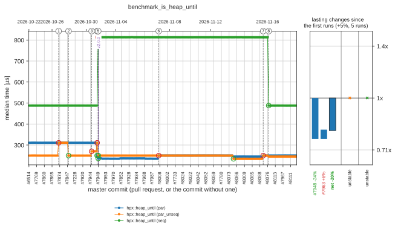

Medians that moved by more than 5% against the median of up to 3 runs before it, not reaching back past the last change (+ is slower); the numbers are those on the graph.

| # | Commit | Pull request | Measurement | Change |
| --- | --- | --- | --- | --- |
| 8 | [aae6119e6f00](2026/medusa00/20261116T003932Z-aae6119e6f00-b0/README.md) | [#8110](https://github.com/TheHPXProject/hpx/pull/8110) | hpx::heap_until (seq) | -40% |
| 7 | [6d7dcc284f37](2026/medusa00/20261115T223105Z-6d7dcc284f37-b0/README.md) | [#7947](https://github.com/TheHPXProject/hpx/pull/7947) | hpx::heap_until (par_unseq) | +7% |
|  | [7cfd4dd80a94](2026/medusa00/20261114T003142Z-7cfd4dd80a94-b0/README.md) | [#8004](https://github.com/TheHPXProject/hpx/pull/8004) | hpx::heap_until (par_unseq) | -6% |
| 6 | [f7df98473ccc](2026/medusa00/20261107T201452Z-f7df98473ccc-b0/README.md) | [#7963](https://github.com/TheHPXProject/hpx/pull/7963) | hpx::heap_until (par) | +6% |
| 5 | [122f97511ef4](2026/medusa00/20261031T215646Z-122f97511ef4-b0/README.md) | [#7949](https://github.com/TheHPXProject/hpx/pull/7949) | hpx::heap_until (par) | -5% |
|  |  |  | hpx::heap_until (par_unseq) | -20% |
|  |  |  | hpx::heap_until (seq) | +67% |
| 4 | [48e2d1ece9e7](2026/medusa00/20261031T215629Z-48e2d1ece9e7-b0/README.md) | [#7948](https://github.com/TheHPXProject/hpx/pull/7948) | hpx::heap_until (par) | -20% |
|  |  |  | hpx::heap_until (par_unseq) | +15% |
| 3 | [4b2db341e39e](2026/medusa00/20261031T113857Z-4b2db341e39e-b0/README.md) | [#7926](https://github.com/TheHPXProject/hpx/pull/7926) | hpx::heap_until (par_unseq) | +8% |
| 2 | [d13eb7506802](2026/medusa00/20261027T135959Z-d13eb7506802-b0/README.md) | [#7848](https://github.com/TheHPXProject/hpx/pull/7848) | hpx::heap_until (par_unseq) | -20% |
| 1 | [2acdd1c7de18](2026/medusa00/20261026T210937Z-2acdd1c7de18-b0/README.md) | [#7879](https://github.com/TheHPXProject/hpx/pull/7879) | hpx::heap_until (par_unseq) | +24% |

### benchmark_merge

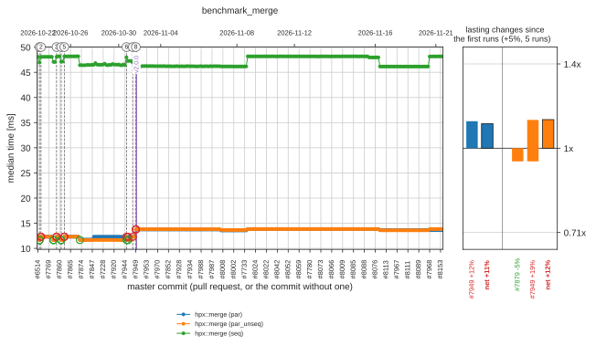

Medians that moved by more than 5% against the median of up to 3 runs before it, not reaching back past the last change (+ is slower); the numbers are those on the graph.

| # | Commit | Pull request | Measurement | Change |
| --- | --- | --- | --- | --- |
| 8 | [122f97511ef4](2026/medusa00/20261031T215646Z-122f97511ef4-b0/README.md) | [#7949](https://github.com/TheHPXProject/hpx/pull/7949) | hpx::merge (par) | +12% |
|  |  |  | hpx::merge (par_unseq) | +12% |
| 7 | [1e6e51150ec1](2026/medusa00/20261031T215553Z-1e6e51150ec1-b0/README.md) | [#7942](https://github.com/TheHPXProject/hpx/pull/7942) | hpx::merge (par_unseq) | +6% |
|  | [5401785b4f14](2026/medusa00/20261031T114013Z-5401785b4f14-b0/README.md) | [#7946](https://github.com/TheHPXProject/hpx/pull/7946) | hpx::merge (par) | +5% |
|  |  |  | hpx::merge (par_unseq) | -5% |
| 6 | [4b2db341e39e](2026/medusa00/20261031T113857Z-4b2db341e39e-b0/README.md) | [#7926](https://github.com/TheHPXProject/hpx/pull/7926) | hpx::merge (par) | -5% |
|  |  |  | hpx::merge (par_unseq) | +6% |
|  | [2acdd1c7de18](2026/medusa00/20261026T210937Z-2acdd1c7de18-b0/README.md) | [#7879](https://github.com/TheHPXProject/hpx/pull/7879) | hpx::merge (par_unseq) | -5% |
| 5 | [6b30e62af6bf](2026/medusa00/20261025T224510Z-6b30e62af6bf-b0/README.md) | [#7828](https://github.com/TheHPXProject/hpx/pull/7828) | hpx::merge (par) | +6% |
|  |  |  | hpx::merge (par_unseq) | +6% |
| 4 | [47aed4f6502a](2026/medusa00/20261025T154456Z-47aed4f6502a-b16/README.md) |  | hpx::merge (par) | -5% |
|  |  |  | hpx::merge (par_unseq) | -5% |
| 3 | [c9c9f3e1a70e](2026/medusa00/20261024T180141Z-c9c9f3e1a70e-b13/README.md) | [#7833](https://github.com/TheHPXProject/hpx/pull/7833) | hpx::merge (par) | +6% |
|  |  |  | hpx::merge (par_unseq) | +6% |
|  | [f251b51f33b2](2026/medusa00/20261024T141942Z-f251b51f33b2-b11/README.md) | [#7836](https://github.com/TheHPXProject/hpx/pull/7836) | hpx::merge (par) | -5% |
|  |  |  | hpx::merge (par_unseq) | -5% |
| 2 | [eaff5b9649bb](2026/medusa00/20261022T213041Z-eaff5b9649bb-b3/README.md) | [#7831](https://github.com/TheHPXProject/hpx/pull/7831) | hpx::merge (par) | +6% |
|  |  |  | hpx::merge (par_unseq) | +6% |
| 1 | [7ac1a1d7b2c8](2026/medusa00/20261022T210309Z-7ac1a1d7b2c8-b2/README.md) | [#7819](https://github.com/TheHPXProject/hpx/pull/7819) | hpx::merge (par) | -5% |
|  |  |  | hpx::merge (par_unseq) | -5% |

### benchmark_nth_element

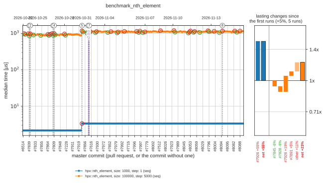

Medians that moved by more than 5% against the median of up to 3 runs before it, not reaching back past the last change (+ is slower); the numbers are those on the graph.

| # | Commit | Pull request | Measurement | Change |
| --- | --- | --- | --- | --- |
|  | [88df87fc49dd](2026/medusa00/20261123T153642Z-88df87fc49dd-b0/README.md) | [#8137](https://github.com/TheHPXProject/hpx/pull/8137) | hpx::nth_element, size: 100000, step: 5000 (seq) | -6% |
|  | [1dbb8ae9ca59](2026/medusa00/20261123T153616Z-1dbb8ae9ca59-b0/README.md) | [#8189](https://github.com/TheHPXProject/hpx/pull/8189) | hpx::nth_element, size: 100000, step: 5000 (seq) | +7% |
|  | [681ba8c18f8a](2026/medusa00/20261123T153548Z-681ba8c18f8a-b0/README.md) | [#8195](https://github.com/TheHPXProject/hpx/pull/8195) | hpx::nth_element, size: 100000, step: 5000 (seq) | -6% |
|  | [7a208e7d860f](2026/medusa00/20261122T224643Z-7a208e7d860f-b0/README.md) | [#8196](https://github.com/TheHPXProject/hpx/pull/8196) | hpx::nth_element, size: 100000, step: 5000 (seq) | +8% |
|  | [422b332dde5b](2026/medusa00/20261122T220910Z-422b332dde5b-b0/README.md) | [#8177](https://github.com/TheHPXProject/hpx/pull/8177) | hpx::nth_element, size: 100000, step: 5000 (seq) | +6% |
|  | [ef19302454ec](2026/medusa00/20261122T220732Z-ef19302454ec-b0/README.md) | [#8164](https://github.com/TheHPXProject/hpx/pull/8164) | hpx::nth_element, size: 100000, step: 5000 (seq) | -7% |
| 8 | [7b3a3f0fd05e](2026/medusa00/20261122T220537Z-7b3a3f0fd05e-b0/README.md) | [#8181](https://github.com/TheHPXProject/hpx/pull/8181) | hpx::nth_element, size: 1000, step: 1 (seq) | +43% |
|  |  |  | hpx::nth_element, size: 100000, step: 5000 (seq) | +10% |
|  | [31d207110942](2026/medusa00/20261122T015735Z-31d207110942-b0/README.md) | [#8150](https://github.com/TheHPXProject/hpx/pull/8150) | hpx::nth_element, size: 100000, step: 5000 (seq) | +6% |
|  | [0d3ecc3f8063](2026/medusa00/20261121T195932Z-0d3ecc3f8063-b0/README.md) | [#8144](https://github.com/TheHPXProject/hpx/pull/8144) | hpx::nth_element, size: 100000, step: 5000 (seq) | -6% |
|  | [161df7fc6a85](2026/medusa00/20261121T020555Z-161df7fc6a85-b0/README.md) | [#8172](https://github.com/TheHPXProject/hpx/pull/8172) | hpx::nth_element, size: 100000, step: 5000 (seq) | +6% |
|  | [0a77777d9eec](2026/medusa00/20261121T012246Z-0a77777d9eec-b0/README.md) | [#8169](https://github.com/TheHPXProject/hpx/pull/8169) | hpx::nth_element, size: 100000, step: 5000 (seq) | +6% |
|  | [c4ed06bad070](2026/medusa00/20261121T011431Z-c4ed06bad070-b0/README.md) | [#8140](https://github.com/TheHPXProject/hpx/pull/8140) | hpx::nth_element, size: 100000, step: 5000 (seq) | -7% |
|  | [4d190f95f1fe](2026/medusa00/20261119T131631Z-4d190f95f1fe-b0/README.md) | [#8117](https://github.com/TheHPXProject/hpx/pull/8117) | hpx::nth_element, size: 100000, step: 5000 (seq) | +8% |
|  | [68987f390ee9](2026/medusa00/20261119T125208Z-68987f390ee9-b0/README.md) | [#8133](https://github.com/TheHPXProject/hpx/pull/8133) | hpx::nth_element, size: 100000, step: 5000 (seq) | -7% |
|  | [2ad23f352fcc](2026/medusa00/20261118T173721Z-2ad23f352fcc-b0/README.md) | [#7952](https://github.com/TheHPXProject/hpx/pull/7952) | hpx::nth_element, size: 100000, step: 5000 (seq) | -6% |
|  | [b00a4e68cc8e](2026/medusa00/20261118T170108Z-b00a4e68cc8e-b0/README.md) | [#8089](https://github.com/TheHPXProject/hpx/pull/8089) | hpx::nth_element, size: 100000, step: 5000 (seq) | +9% |
|  | [9b8facdd8144](2026/medusa00/20261117T023244Z-9b8facdd8144-b0/README.md) | [#7957](https://github.com/TheHPXProject/hpx/pull/7957) | hpx::nth_element, size: 100000, step: 5000 (seq) | +8% |
|  | [6a580cf3b81f](2026/medusa00/20261117T023117Z-6a580cf3b81f-b0/README.md) | [#8122](https://github.com/TheHPXProject/hpx/pull/8122) | hpx::nth_element, size: 100000, step: 5000 (seq) | -10% |
| 7 | [3bda6151b6d2](2026/medusa00/20261117T022429Z-3bda6151b6d2-b0/README.md) | [#8116](https://github.com/TheHPXProject/hpx/pull/8116) | hpx::nth_element, size: 100000, step: 5000 (seq) | +12% |
|  | [0a68e91ac048](2026/medusa00/20261116T130907Z-0a68e91ac048-b0/README.md) | [#8055](https://github.com/TheHPXProject/hpx/pull/8055) | hpx::nth_element, size: 100000, step: 5000 (seq) | -5% |
| 6 | [15ed7a32eda5](2026/medusa00/20261116T130126Z-15ed7a32eda5-b0/README.md) | [#8086](https://github.com/TheHPXProject/hpx/pull/8086) | hpx::nth_element, size: 1000, step: 1 (seq) | -36% |
|  |  |  | hpx::nth_element, size: 100000, step: 5000 (seq) | -15% |
|  | [e717b479d43d](2026/medusa00/20261115T225634Z-e717b479d43d-b0/README.md) | [#8107](https://github.com/TheHPXProject/hpx/pull/8107) | hpx::nth_element, size: 100000, step: 5000 (seq) | -8% |
|  | [a7350342afdc](2026/medusa00/20261115T164525Z-a7350342afdc-b0/README.md) | [#8088](https://github.com/TheHPXProject/hpx/pull/8088) | hpx::nth_element, size: 100000, step: 5000 (seq) | +8% |
|  | [4bf667b566f1](2026/medusa00/20261115T151931Z-4bf667b566f1-b0/README.md) | [#8078](https://github.com/TheHPXProject/hpx/pull/8078) | hpx::nth_element, size: 100000, step: 5000 (seq) | -7% |
|  | [41b78d5465db](2026/medusa00/20261115T142802Z-41b78d5465db-b0/README.md) | [#8092](https://github.com/TheHPXProject/hpx/pull/8092) | hpx::nth_element, size: 100000, step: 5000 (seq) | +6% |
|  | [57aaa650e3dd](2026/medusa00/20261114T175645Z-57aaa650e3dd-b0/README.md) | [#7891](https://github.com/TheHPXProject/hpx/pull/7891) | hpx::nth_element, size: 100000, step: 5000 (seq) | +10% |
|  | [000d565a8a5e](2026/medusa00/20261114T175049Z-000d565a8a5e-b0/README.md) | [#8093](https://github.com/TheHPXProject/hpx/pull/8093) | hpx::nth_element, size: 100000, step: 5000 (seq) | -6% |
|  | [4df84c175b63](2026/medusa00/20261114T002158Z-4df84c175b63-b0/README.md) | [#8034](https://github.com/TheHPXProject/hpx/pull/8034) | hpx::nth_element, size: 100000, step: 5000 (seq) | +8% |
|  | [243f475632c2](2026/medusa00/20261112T232010Z-243f475632c2-b0/README.md) | [#7796](https://github.com/TheHPXProject/hpx/pull/7796) | hpx::nth_element, size: 100000, step: 5000 (seq) | -5% |
|  | [7b677db97986](2026/medusa00/20261112T225952Z-7b677db97986-b0/README.md) | [#8068](https://github.com/TheHPXProject/hpx/pull/8068) | hpx::nth_element, size: 100000, step: 5000 (seq) | +5% |
|  | [045ae9393f1b](2026/medusa00/20261112T170301Z-045ae9393f1b-b0/README.md) | [#8062](https://github.com/TheHPXProject/hpx/pull/8062) | hpx::nth_element, size: 100000, step: 5000 (seq) | -7% |
|  | [16d9ce3c46f2](2026/medusa00/20261112T004556Z-16d9ce3c46f2-b0/README.md) | [#8050](https://github.com/TheHPXProject/hpx/pull/8050) | hpx::nth_element, size: 100000, step: 5000 (seq) | +6% |
|  | [a3e7702599a1](2026/medusa00/20261112T004215Z-a3e7702599a1-b0/README.md) | [#8023](https://github.com/TheHPXProject/hpx/pull/8023) | hpx::nth_element, size: 100000, step: 5000 (seq) | -5% |
|  | [1b69deffe666](2026/medusa00/20261111T194824Z-1b69deffe666-b0/README.md) | [#8053](https://github.com/TheHPXProject/hpx/pull/8053) | hpx::nth_element, size: 100000, step: 5000 (seq) | +7% |
|  | [6e273f307bf8](2026/medusa00/20261111T194755Z-6e273f307bf8-b0/README.md) | [#8052](https://github.com/TheHPXProject/hpx/pull/8052) | hpx::nth_element, size: 100000, step: 5000 (seq) | +6% |
|  | [4214f73cac01](2026/medusa00/20261111T191512Z-4214f73cac01-b0/README.md) | [#8056](https://github.com/TheHPXProject/hpx/pull/8056) | hpx::nth_element, size: 100000, step: 5000 (seq) | -5% |
|  | [4eaeb00c2ce9](2026/medusa00/20261110T010849Z-4eaeb00c2ce9-b0/README.md) | [#8022](https://github.com/TheHPXProject/hpx/pull/8022) | hpx::nth_element, size: 100000, step: 5000 (seq) | -10% |
|  | [ddcafa39ebcd](2026/medusa00/20261110T005848Z-ddcafa39ebcd-b0/README.md) | [#8018](https://github.com/TheHPXProject/hpx/pull/8018) | hpx::nth_element, size: 100000, step: 5000 (seq) | +7% |
|  | [9d863061c599](2026/medusa00/20261108T144051Z-9d863061c599-b0/README.md) | [#7733](https://github.com/TheHPXProject/hpx/pull/7733) | hpx::nth_element, size: 100000, step: 5000 (seq) | +9% |
|  | [f7df98473ccc](2026/medusa00/20261107T201452Z-f7df98473ccc-b0/README.md) | [#7963](https://github.com/TheHPXProject/hpx/pull/7963) | hpx::nth_element, size: 100000, step: 5000 (seq) | +5% |
|  | [f3caaa84647f](2026/medusa00/20261106T161305Z-f3caaa84647f-b0/README.md) | [#7877](https://github.com/TheHPXProject/hpx/pull/7877) | hpx::nth_element, size: 100000, step: 5000 (seq) | -9% |
|  | [a25ea7880afe](2026/medusa00/20261106T154609Z-a25ea7880afe-b0/README.md) | [#7994](https://github.com/TheHPXProject/hpx/pull/7994) | hpx::nth_element, size: 100000, step: 5000 (seq) | +10% |
|  | [56e9945e87f1](2026/medusa00/20261106T154554Z-56e9945e87f1-b0/README.md) | [#7987](https://github.com/TheHPXProject/hpx/pull/7987) | hpx::nth_element, size: 100000, step: 5000 (seq) | -7% |
|  | [a9de023e4098](2026/medusa00/20261106T150520Z-a9de023e4098-b0/README.md) | [#7951](https://github.com/TheHPXProject/hpx/pull/7951) | hpx::nth_element, size: 100000, step: 5000 (seq) | +5% |
|  | [326fe34cf521](2026/medusa00/20261105T032145Z-326fe34cf521-b0/README.md) | [#7934](https://github.com/TheHPXProject/hpx/pull/7934) | hpx::nth_element, size: 100000, step: 5000 (seq) | +6% |
|  | [bb2649ad4a5c](2026/medusa00/20261104T201553Z-bb2649ad4a5c-b0/README.md) | [#7984](https://github.com/TheHPXProject/hpx/pull/7984) | hpx::nth_element, size: 100000, step: 5000 (seq) | +6% |
|  | [1c9e6dc93fa3](2026/medusa00/20261104T201219Z-1c9e6dc93fa3-b0/README.md) | [#7928](https://github.com/TheHPXProject/hpx/pull/7928) | hpx::nth_element, size: 100000, step: 5000 (seq) | -8% |
|  | [fce10534ffda](2026/medusa00/20261104T195148Z-fce10534ffda-b0/README.md) | [#7813](https://github.com/TheHPXProject/hpx/pull/7813) | hpx::nth_element, size: 100000, step: 5000 (seq) | +6% |
|  | [3ad5bb936852](2026/medusa00/20261104T194628Z-3ad5bb936852-b0/README.md) | [#7808](https://github.com/TheHPXProject/hpx/pull/7808) | hpx::nth_element, size: 100000, step: 5000 (seq) | -6% |
|  | [b4b1af62b064](2026/medusa00/20261102T194246Z-b4b1af62b064-b0/README.md) | [#7844](https://github.com/TheHPXProject/hpx/pull/7844) | hpx::nth_element, size: 100000, step: 5000 (seq) | +7% |
|  | [e7dcfa1a93b5](2026/medusa00/20261102T173509Z-e7dcfa1a93b5-b0/README.md) | [#7953](https://github.com/TheHPXProject/hpx/pull/7953) | hpx::nth_element, size: 100000, step: 5000 (seq) | -8% |
|  | [23292d59e39e](2026/medusa00/20261101T014642Z-23292d59e39e-b0/README.md) | [#7917](https://github.com/TheHPXProject/hpx/pull/7917) | hpx::nth_element, size: 100000, step: 5000 (seq) | +9% |
|  | [7dbfb3a5067f](2026/medusa00/20261031T225539Z-7dbfb3a5067f-b0/README.md) | [#7560](https://github.com/TheHPXProject/hpx/pull/7560) | hpx::nth_element, size: 100000, step: 5000 (seq) | -10% |
| 5 | [122f97511ef4](2026/medusa00/20261031T215646Z-122f97511ef4-b0/README.md) | [#7949](https://github.com/TheHPXProject/hpx/pull/7949) | hpx::nth_element, size: 100000, step: 5000 (seq) | +14% |
|  | [48e2d1ece9e7](2026/medusa00/20261031T215629Z-48e2d1ece9e7-b0/README.md) | [#7948](https://github.com/TheHPXProject/hpx/pull/7948) | hpx::nth_element, size: 100000, step: 5000 (seq) | -8% |
|  | [5401785b4f14](2026/medusa00/20261031T114013Z-5401785b4f14-b0/README.md) | [#7946](https://github.com/TheHPXProject/hpx/pull/7946) | hpx::nth_element, size: 100000, step: 5000 (seq) | -6% |
| 4 | [4b2db341e39e](2026/medusa00/20261031T113857Z-4b2db341e39e-b0/README.md) | [#7926](https://github.com/TheHPXProject/hpx/pull/7926) | hpx::nth_element, size: 1000, step: 1 (seq) | +55% |
|  |  |  | hpx::nth_element, size: 100000, step: 5000 (seq) | +32% |
|  | [280a90ed311b](2026/medusa00/20261028T142049Z-280a90ed311b-b0/README.md) | [#7901](https://github.com/TheHPXProject/hpx/pull/7901) | hpx::nth_element, size: 100000, step: 5000 (seq) | -8% |
|  | [3094e4aae085](2026/medusa00/20261028T001141Z-3094e4aae085-b0/README.md) | [#7888](https://github.com/TheHPXProject/hpx/pull/7888) | hpx::nth_element, size: 100000, step: 5000 (seq) | +6% |
|  | [9508ff15ff41](2026/medusa00/20261027T112827Z-9508ff15ff41-b0/README.md) | [#7711](https://github.com/TheHPXProject/hpx/pull/7711) | hpx::nth_element, size: 100000, step: 5000 (seq) | -9% |
| 3 | [0bb4fe759234](2026/medusa00/20261026T212323Z-0bb4fe759234-b0/README.md) | [#7809](https://github.com/TheHPXProject/hpx/pull/7809) | hpx::nth_element, size: 100000, step: 5000 (seq) | +12% |
|  | [9925ce705b23](2026/medusa00/20261026T211303Z-9925ce705b23-b0/README.md) | [#7886](https://github.com/TheHPXProject/hpx/pull/7886) | hpx::nth_element, size: 100000, step: 5000 (seq) | -11% |
|  | [924c62330602](2026/medusa00/20261026T211221Z-924c62330602-b0/README.md) | [#7874](https://github.com/TheHPXProject/hpx/pull/7874) | hpx::nth_element, size: 100000, step: 5000 (seq) | +8% |
|  | [b07138598e83](2026/medusa00/20261026T210849Z-b07138598e83-b0/README.md) | [#7883](https://github.com/TheHPXProject/hpx/pull/7883) | hpx::nth_element, size: 100000, step: 5000 (seq) | +8% |
|  | [55ef914598c3](2026/medusa00/20261026T104728Z-55ef914598c3-b0/README.md) | [#7784](https://github.com/TheHPXProject/hpx/pull/7784) | hpx::nth_element, size: 100000, step: 5000 (seq) | -7% |
|  | [ff9e673a5887](2026/medusa00/20261026T102649Z-ff9e673a5887-b0/README.md) | [#7864](https://github.com/TheHPXProject/hpx/pull/7864) | hpx::nth_element, size: 100000, step: 5000 (seq) | +8% |
|  | [6b30e62af6bf](2026/medusa00/20261025T224510Z-6b30e62af6bf-b0/README.md) | [#7828](https://github.com/TheHPXProject/hpx/pull/7828) | hpx::nth_element, size: 100000, step: 5000 (seq) | -7% |
|  | [f251b51f33b2](2026/medusa00/20261024T141942Z-f251b51f33b2-b11/README.md) | [#7836](https://github.com/TheHPXProject/hpx/pull/7836) | hpx::nth_element, size: 100000, step: 5000 (seq) | -6% |
| 2 | [076e45a6ceb9](2026/medusa00/20261023T191320Z-076e45a6ceb9-b8/README.md) | [#7769](https://github.com/TheHPXProject/hpx/pull/7769) | hpx::nth_element, size: 100000, step: 5000 (seq) | +15% |
| 1 | [b5f65f9bbb3f](2026/medusa00/20261023T182839Z-b5f65f9bbb3f-b7/README.md) | [#7839](https://github.com/TheHPXProject/hpx/pull/7839) | hpx::nth_element, size: 100000, step: 5000 (seq) | -14% |
|  | [527180d0b6af](2026/medusa00/20261023T163358Z-527180d0b6af-b6/README.md) |  | hpx::nth_element, size: 100000, step: 5000 (seq) | +5% |
|  | [eaff5b9649bb](2026/medusa00/20261022T213041Z-eaff5b9649bb-b3/README.md) | [#7831](https://github.com/TheHPXProject/hpx/pull/7831) | hpx::nth_element, size: 100000, step: 5000 (seq) | -5% |
|  | [7ac1a1d7b2c8](2026/medusa00/20261022T210309Z-7ac1a1d7b2c8-b2/README.md) | [#7819](https://github.com/TheHPXProject/hpx/pull/7819) | hpx::nth_element, size: 100000, step: 5000 (seq) | +9% |

### benchmark_nth_element_parallel

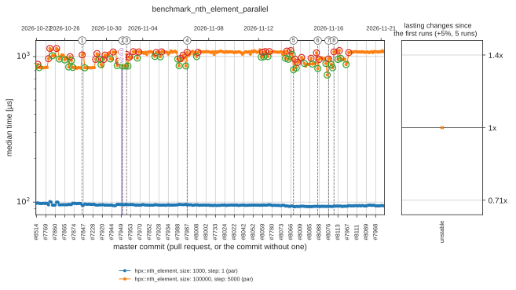

Medians that moved by more than 5% against the median of up to 3 runs before it, not reaching back past the last change (+ is slower); the numbers are those on the graph.

| # | Commit | Pull request | Measurement | Change |
| --- | --- | --- | --- | --- |
|  | [7dfcaca610c6](2026/medusa00/20261123T155526Z-7dfcaca610c6-b0/README.md) | [#8162](https://github.com/TheHPXProject/hpx/pull/8162) | hpx::nth_element, size: 100000, step: 5000 (par) | +11% |
|  | [a22c833fb46b](2026/medusa00/20261123T155042Z-a22c833fb46b-b0/README.md) | [#8191](https://github.com/TheHPXProject/hpx/pull/8191) | hpx::nth_element, size: 100000, step: 5000 (par) | +11% |
|  | [1dbb8ae9ca59](2026/medusa00/20261123T153616Z-1dbb8ae9ca59-b0/README.md) | [#8189](https://github.com/TheHPXProject/hpx/pull/8189) | hpx::nth_element, size: 100000, step: 5000 (par) | -16% |
|  | [681ba8c18f8a](2026/medusa00/20261123T153548Z-681ba8c18f8a-b0/README.md) | [#8195](https://github.com/TheHPXProject/hpx/pull/8195) | hpx::nth_element, size: 100000, step: 5000 (par) | +6% |
|  | [5d08dcd12bd1](2026/medusa00/20261122T230647Z-5d08dcd12bd1-b0/README.md) | [#8197](https://github.com/TheHPXProject/hpx/pull/8197) | hpx::nth_element, size: 100000, step: 5000 (par) | +15% |
|  | [7a208e7d860f](2026/medusa00/20261122T224643Z-7a208e7d860f-b0/README.md) | [#8196](https://github.com/TheHPXProject/hpx/pull/8196) | hpx::nth_element, size: 100000, step: 5000 (par) | -15% |
|  | [68c527c67bfa](2026/medusa00/20261122T221913Z-68c527c67bfa-b0/README.md) | [#8187](https://github.com/TheHPXProject/hpx/pull/8187) | hpx::nth_element, size: 100000, step: 5000 (par) | +18% |
|  | [efd0a39c12db](2026/medusa00/20261122T221816Z-efd0a39c12db-b0/README.md) | [#8194](https://github.com/TheHPXProject/hpx/pull/8194) | hpx::nth_element, size: 100000, step: 5000 (par) | -19% |
| 8 | [c6ad4d1437be](2026/medusa00/20261122T221036Z-c6ad4d1437be-b0/README.md) | [#8163](https://github.com/TheHPXProject/hpx/pull/8163) | hpx::nth_element, size: 100000, step: 5000 (par) | +23% |
|  | [7b3a3f0fd05e](2026/medusa00/20261122T220537Z-7b3a3f0fd05e-b0/README.md) | [#8181](https://github.com/TheHPXProject/hpx/pull/8181) | hpx::nth_element, size: 100000, step: 5000 (par) | -19% |
|  | [6f2695234a7b](2026/medusa00/20261122T015553Z-6f2695234a7b-b0/README.md) | [#8190](https://github.com/TheHPXProject/hpx/pull/8190) | hpx::nth_element, size: 100000, step: 5000 (par) | +9% |
|  | [256f17bf7762](2026/medusa00/20261122T014609Z-256f17bf7762-b0/README.md) | [#8185](https://github.com/TheHPXProject/hpx/pull/8185) | hpx::nth_element, size: 100000, step: 5000 (par) | -7% |
|  | [3af219b1e7b3](2026/medusa00/20261121T202714Z-3af219b1e7b3-b0/README.md) | [#8158](https://github.com/TheHPXProject/hpx/pull/8158) | hpx::nth_element, size: 100000, step: 5000 (par) | +9% |
|  | [8745b241fa76](2026/medusa00/20261121T202144Z-8745b241fa76-b0/README.md) | [#8043](https://github.com/TheHPXProject/hpx/pull/8043) | hpx::nth_element, size: 100000, step: 5000 (par) | -7% |
|  | [231ccc883b3d](2026/medusa00/20261117T010355Z-231ccc883b3d-b0/README.md) | [#8118](https://github.com/TheHPXProject/hpx/pull/8118) | hpx::nth_element, size: 100000, step: 5000 (par) | +19% |
|  | [3489de476d47](2026/medusa00/20261116T235000Z-3489de476d47-b0/README.md) | [#8120](https://github.com/TheHPXProject/hpx/pull/8120) | hpx::nth_element, size: 100000, step: 5000 (par) | -8% |
|  | [8df2d4c1dc0b](2026/medusa00/20261116T175421Z-8df2d4c1dc0b-b0/README.md) | [#8091](https://github.com/TheHPXProject/hpx/pull/8091) | hpx::nth_element, size: 100000, step: 5000 (par) | -12% |
|  | [70316ed411f9](2026/medusa00/20261116T153629Z-70316ed411f9-b0/README.md) | [#8114](https://github.com/TheHPXProject/hpx/pull/8114) | hpx::nth_element, size: 100000, step: 5000 (par) | +15% |
|  | [bf3a8192f178](2026/medusa00/20261116T145805Z-bf3a8192f178-b0/README.md) | [#8113](https://github.com/TheHPXProject/hpx/pull/8113) | hpx::nth_element, size: 100000, step: 5000 (par) | -11% |
| 7 | [99b1c476fd75](2026/medusa00/20261116T130303Z-99b1c476fd75-b0/README.md) | [#8081](https://github.com/TheHPXProject/hpx/pull/8081) | hpx::nth_element, size: 100000, step: 5000 (par) | +29% |
|  | [15ed7a32eda5](2026/medusa00/20261116T130126Z-15ed7a32eda5-b0/README.md) | [#8086](https://github.com/TheHPXProject/hpx/pull/8086) | hpx::nth_element, size: 100000, step: 5000 (par) | -5% |
|  | [cf90cc2f3d81](2026/medusa00/20261116T130107Z-cf90cc2f3d81-b0/README.md) | [#8087](https://github.com/TheHPXProject/hpx/pull/8087) | hpx::nth_element, size: 100000, step: 5000 (par) | -9% |
| 6 | [91e09fba73d9](2026/medusa00/20261116T003702Z-91e09fba73d9-b0/README.md) | [#8076](https://github.com/TheHPXProject/hpx/pull/8076) | hpx::nth_element, size: 100000, step: 5000 (par) | +29% |
|  | [e717b479d43d](2026/medusa00/20261115T225634Z-e717b479d43d-b0/README.md) | [#8107](https://github.com/TheHPXProject/hpx/pull/8107) | hpx::nth_element, size: 100000, step: 5000 (par) | -17% |
|  | [1fee59874aa1](2026/medusa00/20261115T225610Z-1fee59874aa1-b0/README.md) | [#8101](https://github.com/TheHPXProject/hpx/pull/8101) | hpx::nth_element, size: 100000, step: 5000 (par) | -8% |
|  | [a7350342afdc](2026/medusa00/20261115T164525Z-a7350342afdc-b0/README.md) | [#8088](https://github.com/TheHPXProject/hpx/pull/8088) | hpx::nth_element, size: 100000, step: 5000 (par) | +16% |
| 5 | [f775e8f802b0](2026/medusa00/20261115T152208Z-f775e8f802b0-b0/README.md) | [#8102](https://github.com/TheHPXProject/hpx/pull/8102) | hpx::nth_element, size: 100000, step: 5000 (par) | -22% |
|  | [b2d95808a789](2026/medusa00/20261115T152026Z-b2d95808a789-b0/README.md) | [#8097](https://github.com/TheHPXProject/hpx/pull/8097) | hpx::nth_element, size: 100000, step: 5000 (par) | +19% |
|  | [41b78d5465db](2026/medusa00/20261115T142802Z-41b78d5465db-b0/README.md) | [#8092](https://github.com/TheHPXProject/hpx/pull/8092) | hpx::nth_element, size: 100000, step: 5000 (par) | -9% |
|  | [5aaa0707ef5f](2026/medusa00/20261115T142636Z-5aaa0707ef5f-b0/README.md) | [#8082](https://github.com/TheHPXProject/hpx/pull/8082) | hpx::nth_element, size: 100000, step: 5000 (par) | +10% |
|  | [829ce5c6e184](2026/medusa00/20261115T002129Z-829ce5c6e184-b0/README.md) | [#8072](https://github.com/TheHPXProject/hpx/pull/8072) | hpx::nth_element, size: 100000, step: 5000 (par) | -8% |
|  | [a3c0afd33556](2026/medusa00/20261114T194707Z-a3c0afd33556-b0/README.md) | [#8000](https://github.com/TheHPXProject/hpx/pull/8000) | hpx::nth_element, size: 100000, step: 5000 (par) | +7% |
|  | [237024ea67c8](2026/medusa00/20261114T180039Z-237024ea67c8-b0/README.md) | [#8080](https://github.com/TheHPXProject/hpx/pull/8080) | hpx::nth_element, size: 100000, step: 5000 (par) | +9% |
|  | [57aaa650e3dd](2026/medusa00/20261114T175645Z-57aaa650e3dd-b0/README.md) | [#7891](https://github.com/TheHPXProject/hpx/pull/7891) | hpx::nth_element, size: 100000, step: 5000 (par) | -13% |
|  | [4e389f5b3fe2](2026/medusa00/20261114T175328Z-4e389f5b3fe2-b0/README.md) | [#8094](https://github.com/TheHPXProject/hpx/pull/8094) | hpx::nth_element, size: 100000, step: 5000 (par) | +18% |
| 4 | [0d2af6ca7814](2026/medusa00/20261114T175249Z-0d2af6ca7814-b0/README.md) | [#8028](https://github.com/TheHPXProject/hpx/pull/8028) | hpx::nth_element, size: 100000, step: 5000 (par) | -21% |
|  | [000d565a8a5e](2026/medusa00/20261114T175049Z-000d565a8a5e-b0/README.md) | [#8093](https://github.com/TheHPXProject/hpx/pull/8093) | hpx::nth_element, size: 100000, step: 5000 (par) | -6% |
|  | [4bee1ae72437](2026/medusa00/20261114T020954Z-4bee1ae72437-b0/README.md) | [#8066](https://github.com/TheHPXProject/hpx/pull/8066) | hpx::nth_element, size: 100000, step: 5000 (par) | +14% |
|  | [1e47bfebd8ff](2026/medusa00/20261114T003237Z-1e47bfebd8ff-b0/README.md) | [#7910](https://github.com/TheHPXProject/hpx/pull/7910) | hpx::nth_element, size: 100000, step: 5000 (par) | -12% |
|  | [7cfd4dd80a94](2026/medusa00/20261114T003142Z-7cfd4dd80a94-b0/README.md) | [#8004](https://github.com/TheHPXProject/hpx/pull/8004) | hpx::nth_element, size: 100000, step: 5000 (par) | +12% |
|  | [4df84c175b63](2026/medusa00/20261114T002158Z-4df84c175b63-b0/README.md) | [#8034](https://github.com/TheHPXProject/hpx/pull/8034) | hpx::nth_element, size: 100000, step: 5000 (par) | -10% |
|  | [d8f44c37a9c6](2026/medusa00/20261112T173935Z-d8f44c37a9c6-b0/README.md) | [#8048](https://github.com/TheHPXProject/hpx/pull/8048) | hpx::nth_element, size: 100000, step: 5000 (par) | +8% |
|  | [c82bbf1a72cc](2026/medusa00/20261112T170314Z-c82bbf1a72cc-b0/README.md) | [#8063](https://github.com/TheHPXProject/hpx/pull/8063) | hpx::nth_element, size: 100000, step: 5000 (par) | -6% |
|  | [020d9c093297](2026/medusa00/20261112T021401Z-020d9c093297-b0/README.md) | [#8057](https://github.com/TheHPXProject/hpx/pull/8057) | hpx::nth_element, size: 100000, step: 5000 (par) | +9% |
|  | [c667669e477e](2026/medusa00/20261112T015913Z-c667669e477e-b0/README.md) | [#8061](https://github.com/TheHPXProject/hpx/pull/8061) | hpx::nth_element, size: 100000, step: 5000 (par) | -7% |
|  | [336aac617ec7](2026/medusa00/20261112T015319Z-336aac617ec7-b0/README.md) | [#8059](https://github.com/TheHPXProject/hpx/pull/8059) | hpx::nth_element, size: 100000, step: 5000 (par) | +8% |
|  | [1cb76f719d73](2026/medusa00/20261112T015251Z-1cb76f719d73-b0/README.md) | [#8058](https://github.com/TheHPXProject/hpx/pull/8058) | hpx::nth_element, size: 100000, step: 5000 (par) | -8% |
|  | [1ad403e0b145](2026/medusa00/20261107T202442Z-1ad403e0b145-b0/README.md) | [#7779](https://github.com/TheHPXProject/hpx/pull/7779) | hpx::nth_element, size: 100000, step: 5000 (par) | +7% |
|  | [61739d45974f](2026/medusa00/20261107T202123Z-61739d45974f-b0/README.md) | [#8008](https://github.com/TheHPXProject/hpx/pull/8008) | hpx::nth_element, size: 100000, step: 5000 (par) | -7% |
| 3 | [56e9945e87f1](2026/medusa00/20261106T154554Z-56e9945e87f1-b0/README.md) | [#7987](https://github.com/TheHPXProject/hpx/pull/7987) | hpx::nth_element, size: 100000, step: 5000 (par) | +24% |
|  | [712eea2399f9](2026/medusa00/20261106T150625Z-712eea2399f9-b0/README.md) | [#7648](https://github.com/TheHPXProject/hpx/pull/7648) | hpx::nth_element, size: 100000, step: 5000 (par) | -14% |
|  | [ec3b59b1fa0b](2026/medusa00/20261106T150024Z-ec3b59b1fa0b-b0/README.md) | [#8001](https://github.com/TheHPXProject/hpx/pull/8001) | hpx::nth_element, size: 100000, step: 5000 (par) | +7% |
|  | [b8dc6233ffc3](2026/medusa00/20261106T145549Z-b8dc6233ffc3-b0/README.md) | [#7977](https://github.com/TheHPXProject/hpx/pull/7977) | hpx::nth_element, size: 100000, step: 5000 (par) | +12% |
|  | [2aba6877abca](2026/medusa00/20261106T145306Z-2aba6877abca-b0/README.md) | [#7778](https://github.com/TheHPXProject/hpx/pull/7778) | hpx::nth_element, size: 100000, step: 5000 (par) | -10% |
|  | [c0457a471a6f](2026/medusa00/20261105T140224Z-c0457a471a6f-b0/README.md) | [#7988](https://github.com/TheHPXProject/hpx/pull/7988) | hpx::nth_element, size: 100000, step: 5000 (par) | -11% |
|  | [2469176f1309](2026/medusa00/20261104T201606Z-2469176f1309-b0/README.md) | [#7985](https://github.com/TheHPXProject/hpx/pull/7985) | hpx::nth_element, size: 100000, step: 5000 (par) | +8% |
|  | [bb2649ad4a5c](2026/medusa00/20261104T201553Z-bb2649ad4a5c-b0/README.md) | [#7984](https://github.com/TheHPXProject/hpx/pull/7984) | hpx::nth_element, size: 100000, step: 5000 (par) | -7% |
|  | [97e5672ca089](2026/medusa00/20261104T195947Z-97e5672ca089-b0/README.md) | [#7981](https://github.com/TheHPXProject/hpx/pull/7981) | hpx::nth_element, size: 100000, step: 5000 (par) | +6% |
|  | [88071b955a3f](2026/medusa00/20261104T195847Z-88071b955a3f-b0/README.md) | [#7670](https://github.com/TheHPXProject/hpx/pull/7670) | hpx::nth_element, size: 100000, step: 5000 (par) | -6% |
|  | [2535af607aa7](2026/medusa00/20261102T195816Z-2535af607aa7-b0/README.md) | [#7975](https://github.com/TheHPXProject/hpx/pull/7975) | hpx::nth_element, size: 100000, step: 5000 (par) | +10% |
|  | [2506beb245a8](2026/medusa00/20261102T195747Z-2506beb245a8-b0/README.md) | [#7922](https://github.com/TheHPXProject/hpx/pull/7922) | hpx::nth_element, size: 100000, step: 5000 (par) | -10% |
|  | [a71ab88dfd37](2026/medusa00/20261102T194939Z-a71ab88dfd37-b0/README.md) | [#7930](https://github.com/TheHPXProject/hpx/pull/7930) | hpx::nth_element, size: 100000, step: 5000 (par) | +9% |
|  | [0194d98a466d](2026/medusa00/20261102T153810Z-0194d98a466d-b0/README.md) | [#7959](https://github.com/TheHPXProject/hpx/pull/7959) | hpx::nth_element, size: 100000, step: 5000 (par) | +15% |
|  | [027de27ac2db](2026/medusa00/20261102T153015Z-027de27ac2db-b0/README.md) | [#7958](https://github.com/TheHPXProject/hpx/pull/7958) | hpx::nth_element, size: 100000, step: 5000 (par) | -17% |
| 2 | [e8b595c1764d](2026/medusa00/20261102T152924Z-e8b595c1764d-b0/README.md) | [#7964](https://github.com/TheHPXProject/hpx/pull/7964) | hpx::nth_element, size: 100000, step: 5000 (par) | +20% |
|  | [974ae9d09aad](2026/medusa00/20261102T125313Z-974ae9d09aad-b0/README.md) | [#7616](https://github.com/TheHPXProject/hpx/pull/7616) | hpx::nth_element, size: 100000, step: 5000 (par) | -13% |
|  | [23292d59e39e](2026/medusa00/20261101T014642Z-23292d59e39e-b0/README.md) | [#7917](https://github.com/TheHPXProject/hpx/pull/7917) | hpx::nth_element, size: 100000, step: 5000 (par) | +15% |
|  | [7dbfb3a5067f](2026/medusa00/20261031T225539Z-7dbfb3a5067f-b0/README.md) | [#7560](https://github.com/TheHPXProject/hpx/pull/7560) | hpx::nth_element, size: 100000, step: 5000 (par) | -20% |
|  | [122f97511ef4](2026/medusa00/20261031T215646Z-122f97511ef4-b0/README.md) | [#7949](https://github.com/TheHPXProject/hpx/pull/7949) | hpx::nth_element, size: 100000, step: 5000 (par) | +16% |
|  | [1e6e51150ec1](2026/medusa00/20261031T215553Z-1e6e51150ec1-b0/README.md) | [#7942](https://github.com/TheHPXProject/hpx/pull/7942) | hpx::nth_element, size: 100000, step: 5000 (par) | +7% |
|  | [1a5b15496b23](2026/medusa00/20261031T151324Z-1a5b15496b23-b0/README.md) | [#7856](https://github.com/TheHPXProject/hpx/pull/7856) | hpx::nth_element, size: 100000, step: 5000 (par) | -19% |
|  | [4b2db341e39e](2026/medusa00/20261031T113857Z-4b2db341e39e-b0/README.md) | [#7926](https://github.com/TheHPXProject/hpx/pull/7926) | hpx::nth_element, size: 100000, step: 5000 (par) | +12% |
|  | [f27ce60ad6f0](2026/medusa00/20261030T181847Z-f27ce60ad6f0-b0/README.md) | [#7909](https://github.com/TheHPXProject/hpx/pull/7909) | hpx::nth_element, size: 100000, step: 5000 (par) | -6% |
|  | [b8275fd3c4cd](2026/medusa00/20261029T211026Z-b8275fd3c4cd-b0/README.md) | [#7904](https://github.com/TheHPXProject/hpx/pull/7904) | hpx::nth_element, size: 100000, step: 5000 (par) | +7% |
|  | [e8727ab5a0e9](2026/medusa00/20261029T205016Z-e8727ab5a0e9-b0/README.md) | [#7900](https://github.com/TheHPXProject/hpx/pull/7900) | hpx::nth_element, size: 100000, step: 5000 (par) | +10% |
|  | [2553fc02be5f](2026/medusa00/20261029T133557Z-2553fc02be5f-b0/README.md) | [#7911](https://github.com/TheHPXProject/hpx/pull/7911) | hpx::nth_element, size: 100000, step: 5000 (par) | -8% |
|  | [6e71866f21da](2026/medusa00/20261029T133530Z-6e71866f21da-b0/README.md) | [#7912](https://github.com/TheHPXProject/hpx/pull/7912) | hpx::nth_element, size: 100000, step: 5000 (par) | -8% |
|  | [0881d8d566de](2026/medusa00/20261028T202717Z-0881d8d566de-b0/README.md) | [#7892](https://github.com/TheHPXProject/hpx/pull/7892) | hpx::nth_element, size: 100000, step: 5000 (par) | +10% |
|  | [f28fd29c4c7f](2026/medusa00/20261028T202642Z-f28fd29c4c7f-b0/README.md) | [#7899](https://github.com/TheHPXProject/hpx/pull/7899) | hpx::nth_element, size: 100000, step: 5000 (par) | +14% |
|  | [d13eb7506802](2026/medusa00/20261027T135959Z-d13eb7506802-b0/README.md) | [#7848](https://github.com/TheHPXProject/hpx/pull/7848) | hpx::nth_element, size: 100000, step: 5000 (par) | -19% |
| 1 | [d6cd9372b23e](2026/medusa00/20261027T113128Z-d6cd9372b23e-b0/README.md) | [#7872](https://github.com/TheHPXProject/hpx/pull/7872) | hpx::nth_element, size: 100000, step: 5000 (par) | +23% |
|  | [2acdd1c7de18](2026/medusa00/20261026T210937Z-2acdd1c7de18-b0/README.md) | [#7879](https://github.com/TheHPXProject/hpx/pull/7879) | hpx::nth_element, size: 100000, step: 5000 (par) | -10% |
|  | [b07138598e83](2026/medusa00/20261026T210849Z-b07138598e83-b0/README.md) | [#7883](https://github.com/TheHPXProject/hpx/pull/7883) | hpx::nth_element, size: 100000, step: 5000 (par) | -6% |
|  | [55ef914598c3](2026/medusa00/20261026T104728Z-55ef914598c3-b0/README.md) | [#7784](https://github.com/TheHPXProject/hpx/pull/7784) | hpx::nth_element, size: 100000, step: 5000 (par) | +18% |
|  | [ff9e673a5887](2026/medusa00/20261026T102649Z-ff9e673a5887-b0/README.md) | [#7864](https://github.com/TheHPXProject/hpx/pull/7864) | hpx::nth_element, size: 100000, step: 5000 (par) | -12% |
|  | [fef31456e98a](2026/medusa00/20261026T102437Z-fef31456e98a-b0/README.md) | [#7865](https://github.com/TheHPXProject/hpx/pull/7865) | hpx::nth_element, size: 100000, step: 5000 (par) | -7% |
|  | [6b30e62af6bf](2026/medusa00/20261025T224510Z-6b30e62af6bf-b0/README.md) | [#7828](https://github.com/TheHPXProject/hpx/pull/7828) | hpx::nth_element, size: 100000, step: 5000 (par) | -15% |
|  | [47aed4f6502a](2026/medusa00/20261025T154456Z-47aed4f6502a-b16/README.md) |  | hpx::nth_element, size: 100000, step: 5000 (par) | +12% |
|  | [c9c9f3e1a70e](2026/medusa00/20261024T180141Z-c9c9f3e1a70e-b13/README.md) | [#7833](https://github.com/TheHPXProject/hpx/pull/7833) | hpx::nth_element, size: 100000, step: 5000 (par) | -10% |
|  | [f251b51f33b2](2026/medusa00/20261024T141942Z-f251b51f33b2-b11/README.md) | [#7836](https://github.com/TheHPXProject/hpx/pull/7836) | hpx::nth_element, size: 100000, step: 5000 (par) | +17% |
|  | [5741795e5c3a](2026/medusa00/20261024T140557Z-5741795e5c3a-b10/README.md) | [#7845](https://github.com/TheHPXProject/hpx/pull/7845) | hpx::nth_element, size: 100000, step: 5000 (par) | +15% |
|  | [eaff5b9649bb](2026/medusa00/20261022T213041Z-eaff5b9649bb-b3/README.md) | [#7831](https://github.com/TheHPXProject/hpx/pull/7831) | hpx::nth_element, size: 100000, step: 5000 (par) | -5% |
|  | [7ac1a1d7b2c8](2026/medusa00/20261022T210309Z-7ac1a1d7b2c8-b2/README.md) | [#7819](https://github.com/TheHPXProject/hpx/pull/7819) | hpx::nth_element, size: 100000, step: 5000 (par) | +6% |

### benchmark_partial_sort

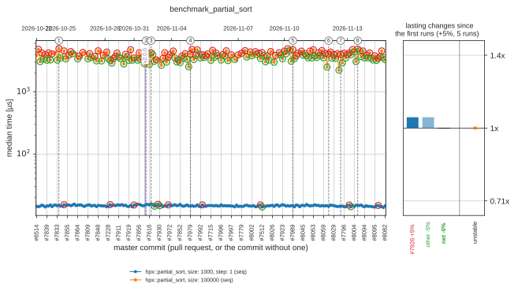

Medians that moved by more than 5% against the median of up to 3 runs before it, not reaching back past the last change (+ is slower); the numbers are those on the graph.

| # | Commit | Pull request | Measurement | Change |
| --- | --- | --- | --- | --- |
|  | [30d07dfcd052](2026/medusa00/20261123T155346Z-30d07dfcd052-b0/README.md) | [#8170](https://github.com/TheHPXProject/hpx/pull/8170) | hpx::partial_sort, size: 100000 (seq) | -7% |
|  | [a22c833fb46b](2026/medusa00/20261123T155042Z-a22c833fb46b-b0/README.md) | [#8191](https://github.com/TheHPXProject/hpx/pull/8191) | hpx::partial_sort, size: 100000 (seq) | -14% |
|  | [120f527c0e33](2026/medusa00/20261123T155001Z-120f527c0e33-b0/README.md) | [#8193](https://github.com/TheHPXProject/hpx/pull/8193) | hpx::partial_sort, size: 100000 (seq) | +15% |
|  | [1dbb8ae9ca59](2026/medusa00/20261123T153616Z-1dbb8ae9ca59-b0/README.md) | [#8189](https://github.com/TheHPXProject/hpx/pull/8189) | hpx::partial_sort, size: 1000, step: 1 (seq) | +5% |
|  |  |  | hpx::partial_sort, size: 100000 (seq) | -18% |
| 8 | [681ba8c18f8a](2026/medusa00/20261123T153548Z-681ba8c18f8a-b0/README.md) | [#8195](https://github.com/TheHPXProject/hpx/pull/8195) | hpx::partial_sort, size: 1000, step: 1 (seq) | -8% |
|  |  |  | hpx::partial_sort, size: 100000 (seq) | +68% |
|  | [5d08dcd12bd1](2026/medusa00/20261122T230647Z-5d08dcd12bd1-b0/README.md) | [#8197](https://github.com/TheHPXProject/hpx/pull/8197) | hpx::partial_sort, size: 100000 (seq) | -31% |
|  | [7a208e7d860f](2026/medusa00/20261122T224643Z-7a208e7d860f-b0/README.md) | [#8196](https://github.com/TheHPXProject/hpx/pull/8196) | hpx::partial_sort, size: 1000, step: 1 (seq) | +6% |
|  |  |  | hpx::partial_sort, size: 100000 (seq) | +19% |
|  | [68c527c67bfa](2026/medusa00/20261122T221913Z-68c527c67bfa-b0/README.md) | [#8187](https://github.com/TheHPXProject/hpx/pull/8187) | hpx::partial_sort, size: 100000 (seq) | -25% |
|  | [efd0a39c12db](2026/medusa00/20261122T221816Z-efd0a39c12db-b0/README.md) | [#8194](https://github.com/TheHPXProject/hpx/pull/8194) | hpx::partial_sort, size: 1000, step: 1 (seq) | -7% |
|  |  |  | hpx::partial_sort, size: 100000 (seq) | +46% |
|  | [c6ad4d1437be](2026/medusa00/20261122T221036Z-c6ad4d1437be-b0/README.md) | [#8163](https://github.com/TheHPXProject/hpx/pull/8163) | hpx::partial_sort, size: 100000 (seq) | -17% |
|  | [422b332dde5b](2026/medusa00/20261122T220910Z-422b332dde5b-b0/README.md) | [#8177](https://github.com/TheHPXProject/hpx/pull/8177) | hpx::partial_sort, size: 100000 (seq) | -9% |
|  | [ef19302454ec](2026/medusa00/20261122T220732Z-ef19302454ec-b0/README.md) | [#8164](https://github.com/TheHPXProject/hpx/pull/8164) | hpx::partial_sort, size: 1000, step: 1 (seq) | +6% |
|  | [56ce50eba39d](2026/medusa00/20261122T220633Z-56ce50eba39d-b0/README.md) | [#8184](https://github.com/TheHPXProject/hpx/pull/8184) | hpx::partial_sort, size: 1000, step: 1 (seq) | -5% |
|  | [7b3a3f0fd05e](2026/medusa00/20261122T220537Z-7b3a3f0fd05e-b0/README.md) | [#8181](https://github.com/TheHPXProject/hpx/pull/8181) | hpx::partial_sort, size: 100000 (seq) | +12% |
|  | [31d207110942](2026/medusa00/20261122T015735Z-31d207110942-b0/README.md) | [#8150](https://github.com/TheHPXProject/hpx/pull/8150) | hpx::partial_sort, size: 100000 (seq) | -25% |
|  | [4508fb7a5826](2026/medusa00/20261122T015649Z-4508fb7a5826-b0/README.md) | [#8141](https://github.com/TheHPXProject/hpx/pull/8141) | hpx::partial_sort, size: 100000 (seq) | +43% |
|  | [4241485718db](2026/medusa00/20261122T015611Z-4241485718db-b0/README.md) | [#8134](https://github.com/TheHPXProject/hpx/pull/8134) | hpx::partial_sort, size: 100000 (seq) | -6% |
|  | [256f17bf7762](2026/medusa00/20261122T014609Z-256f17bf7762-b0/README.md) | [#8185](https://github.com/TheHPXProject/hpx/pull/8185) | hpx::partial_sort, size: 100000 (seq) | -9% |
|  | [d651126bb71a](2026/medusa00/20261122T014524Z-d651126bb71a-b0/README.md) | [#8178](https://github.com/TheHPXProject/hpx/pull/8178) | hpx::partial_sort, size: 100000 (seq) | -12% |
|  | [3af219b1e7b3](2026/medusa00/20261121T202714Z-3af219b1e7b3-b0/README.md) | [#8158](https://github.com/TheHPXProject/hpx/pull/8158) | hpx::partial_sort, size: 100000 (seq) | +30% |
|  | [8745b241fa76](2026/medusa00/20261121T202144Z-8745b241fa76-b0/README.md) | [#8043](https://github.com/TheHPXProject/hpx/pull/8043) | hpx::partial_sort, size: 100000 (seq) | +8% |
|  | [09263e22dae1](2026/medusa00/20261121T202055Z-09263e22dae1-b0/README.md) | [#8151](https://github.com/TheHPXProject/hpx/pull/8151) | hpx::partial_sort, size: 100000 (seq) | -28% |
|  | [2ef6b6dbfb68](2026/medusa00/20261121T201146Z-2ef6b6dbfb68-b0/README.md) | [#8182](https://github.com/TheHPXProject/hpx/pull/8182) | hpx::partial_sort, size: 100000 (seq) | +23% |
|  | [374d2bcce4d2](2026/medusa00/20261121T201025Z-374d2bcce4d2-b0/README.md) | [#8180](https://github.com/TheHPXProject/hpx/pull/8180) | hpx::partial_sort, size: 100000 (seq) | -9% |
|  | [e662f93ee492](2026/medusa00/20261121T201000Z-e662f93ee492-b0/README.md) | [#8175](https://github.com/TheHPXProject/hpx/pull/8175) | hpx::partial_sort, size: 100000 (seq) | +38% |
|  | [e279227b256e](2026/medusa00/20261121T200313Z-e279227b256e-b0/README.md) | [#8171](https://github.com/TheHPXProject/hpx/pull/8171) | hpx::partial_sort, size: 100000 (seq) | -27% |
|  | [efa92d023cc3](2026/medusa00/20261121T200232Z-efa92d023cc3-b0/README.md) | [#8145](https://github.com/TheHPXProject/hpx/pull/8145) | hpx::partial_sort, size: 100000 (seq) | -15% |
|  | [9b1249638b03](2026/medusa00/20261121T200204Z-9b1249638b03-b0/README.md) | [#8143](https://github.com/TheHPXProject/hpx/pull/8143) | hpx::partial_sort, size: 100000 (seq) | +26% |
|  | [7f7a5193f14c](2026/medusa00/20261121T200117Z-7f7a5193f14c-b0/README.md) | [#8167](https://github.com/TheHPXProject/hpx/pull/8167) | hpx::partial_sort, size: 100000 (seq) | -18% |
|  | [0410a131ea60](2026/medusa00/20261121T200021Z-0410a131ea60-b0/README.md) | [#8146](https://github.com/TheHPXProject/hpx/pull/8146) | hpx::partial_sort, size: 100000 (seq) | +14% |
|  | [0d3ecc3f8063](2026/medusa00/20261121T195932Z-0d3ecc3f8063-b0/README.md) | [#8144](https://github.com/TheHPXProject/hpx/pull/8144) | hpx::partial_sort, size: 1000, step: 1 (seq) | +6% |
|  | [0a77777d9eec](2026/medusa00/20261121T012246Z-0a77777d9eec-b0/README.md) | [#8169](https://github.com/TheHPXProject/hpx/pull/8169) | hpx::partial_sort, size: 100000 (seq) | +7% |
|  | [7ff76b042961](2026/medusa00/20261121T011743Z-7ff76b042961-b0/README.md) | [#8153](https://github.com/TheHPXProject/hpx/pull/8153) | hpx::partial_sort, size: 100000 (seq) | +6% |
|  | [c4ed06bad070](2026/medusa00/20261121T011431Z-c4ed06bad070-b0/README.md) | [#8140](https://github.com/TheHPXProject/hpx/pull/8140) | hpx::partial_sort, size: 100000 (seq) | +8% |
|  | [4c8b5abc458a](2026/medusa00/20261121T011354Z-4c8b5abc458a-b0/README.md) | [#8148](https://github.com/TheHPXProject/hpx/pull/8148) | hpx::partial_sort, size: 100000 (seq) | -31% |
|  | [13283433a175](2026/medusa00/20261121T011251Z-13283433a175-b0/README.md) | [#8160](https://github.com/TheHPXProject/hpx/pull/8160) | hpx::partial_sort, size: 100000 (seq) | +22% |
|  | [0ef6f227f123](2026/medusa00/20261119T152700Z-0ef6f227f123-b0/README.md) | [#8128](https://github.com/TheHPXProject/hpx/pull/8128) | hpx::partial_sort, size: 100000 (seq) | +13% |
|  | [0c1814f9f26b](2026/medusa00/20261119T145532Z-0c1814f9f26b-b0/README.md) | [#8139](https://github.com/TheHPXProject/hpx/pull/8139) | hpx::partial_sort, size: 100000 (seq) | -17% |
|  | [4aa61cac50e2](2026/medusa00/20261119T131655Z-4aa61cac50e2-b0/README.md) | [#7968](https://github.com/TheHPXProject/hpx/pull/7968) | hpx::partial_sort, size: 100000 (seq) | +36% |
|  | [4d190f95f1fe](2026/medusa00/20261119T131631Z-4d190f95f1fe-b0/README.md) | [#8117](https://github.com/TheHPXProject/hpx/pull/8117) | hpx::partial_sort, size: 100000 (seq) | -20% |
|  | [bf301bd9a7bb](2026/medusa00/20261119T125141Z-bf301bd9a7bb-b0/README.md) | [#8147](https://github.com/TheHPXProject/hpx/pull/8147) | hpx::partial_sort, size: 100000 (seq) | +6% |
|  | [0361b3c3a0e5](2026/medusa00/20261118T175138Z-0361b3c3a0e5-b0/README.md) | [#8007](https://github.com/TheHPXProject/hpx/pull/8007) | hpx::partial_sort, size: 100000 (seq) | +32% |
|  | [2ad23f352fcc](2026/medusa00/20261118T173721Z-2ad23f352fcc-b0/README.md) | [#7952](https://github.com/TheHPXProject/hpx/pull/7952) | hpx::partial_sort, size: 100000 (seq) | -29% |
|  | [7d08d4adcc4d](2026/medusa00/20261118T162954Z-7d08d4adcc4d-b0/README.md) | [#8132](https://github.com/TheHPXProject/hpx/pull/8132) | hpx::partial_sort, size: 100000 (seq) | +12% |
|  | [5e54cb5e09d5](2026/medusa00/20261118T160137Z-5e54cb5e09d5-b0/README.md) | [#8123](https://github.com/TheHPXProject/hpx/pull/8123) | hpx::partial_sort, size: 100000 (seq) | -9% |
|  | [94575e517460](2026/medusa00/20261118T155757Z-94575e517460-b0/README.md) | [#8125](https://github.com/TheHPXProject/hpx/pull/8125) | hpx::partial_sort, size: 1000, step: 1 (seq) | -6% |
|  | [70dbd992fade](2026/medusa00/20261117T023759Z-70dbd992fade-b0/README.md) | [#8111](https://github.com/TheHPXProject/hpx/pull/8111) | hpx::partial_sort, size: 1000, step: 1 (seq) | +6% |
|  |  |  | hpx::partial_sort, size: 100000 (seq) | +16% |
|  | [aabec893cbe6](2026/medusa00/20261117T023617Z-aabec893cbe6-b0/README.md) | [#8126](https://github.com/TheHPXProject/hpx/pull/8126) | hpx::partial_sort, size: 100000 (seq) | -7% |
|  | [9b8facdd8144](2026/medusa00/20261117T023244Z-9b8facdd8144-b0/README.md) | [#7957](https://github.com/TheHPXProject/hpx/pull/7957) | hpx::partial_sort, size: 100000 (seq) | -7% |
|  | [6a580cf3b81f](2026/medusa00/20261117T023117Z-6a580cf3b81f-b0/README.md) | [#8122](https://github.com/TheHPXProject/hpx/pull/8122) | hpx::partial_sort, size: 100000 (seq) | -6% |
|  | [52804e03f4e7](2026/medusa00/20261117T022735Z-52804e03f4e7-b0/README.md) | [#7862](https://github.com/TheHPXProject/hpx/pull/7862) | hpx::partial_sort, size: 100000 (seq) | -14% |
|  | [3bda6151b6d2](2026/medusa00/20261117T022429Z-3bda6151b6d2-b0/README.md) | [#8116](https://github.com/TheHPXProject/hpx/pull/8116) | hpx::partial_sort, size: 100000 (seq) | +14% |
|  | [231ccc883b3d](2026/medusa00/20261117T010355Z-231ccc883b3d-b0/README.md) | [#8118](https://github.com/TheHPXProject/hpx/pull/8118) | hpx::partial_sort, size: 100000 (seq) | +15% |
|  | [495fe11e52e0](2026/medusa00/20261117T002049Z-495fe11e52e0-b0/README.md) | [#7967](https://github.com/TheHPXProject/hpx/pull/7967) | hpx::partial_sort, size: 100000 (seq) | +12% |
|  | [3489de476d47](2026/medusa00/20261116T235000Z-3489de476d47-b0/README.md) | [#8120](https://github.com/TheHPXProject/hpx/pull/8120) | hpx::partial_sort, size: 100000 (seq) | -25% |
|  | [4773beb14c95](2026/medusa00/20261116T234921Z-4773beb14c95-b0/README.md) | [#8121](https://github.com/TheHPXProject/hpx/pull/8121) | hpx::partial_sort, size: 100000 (seq) | +13% |
|  | [6c95cabf37c5](2026/medusa00/20261116T181453Z-6c95cabf37c5-b0/README.md) | [#8112](https://github.com/TheHPXProject/hpx/pull/8112) | hpx::partial_sort, size: 1000, step: 1 (seq) | +7% |
|  |  |  | hpx::partial_sort, size: 100000 (seq) | -13% |
|  | [2de7d8546d6e](2026/medusa00/20261116T181442Z-2de7d8546d6e-b0/README.md) | [#8108](https://github.com/TheHPXProject/hpx/pull/8108) | hpx::partial_sort, size: 100000 (seq) | +19% |
|  | [8df2d4c1dc0b](2026/medusa00/20261116T175421Z-8df2d4c1dc0b-b0/README.md) | [#8091](https://github.com/TheHPXProject/hpx/pull/8091) | hpx::partial_sort, size: 100000 (seq) | -8% |
|  | [70316ed411f9](2026/medusa00/20261116T153629Z-70316ed411f9-b0/README.md) | [#8114](https://github.com/TheHPXProject/hpx/pull/8114) | hpx::partial_sort, size: 100000 (seq) | +47% |
|  | [bf3a8192f178](2026/medusa00/20261116T145805Z-bf3a8192f178-b0/README.md) | [#8113](https://github.com/TheHPXProject/hpx/pull/8113) | hpx::partial_sort, size: 100000 (seq) | -24% |
|  | [59cf06a8e59e](2026/medusa00/20261116T135051Z-59cf06a8e59e-b0/README.md) | [#7966](https://github.com/TheHPXProject/hpx/pull/7966) | hpx::partial_sort, size: 100000 (seq) | +7% |
|  | [0a68e91ac048](2026/medusa00/20261116T130907Z-0a68e91ac048-b0/README.md) | [#8055](https://github.com/TheHPXProject/hpx/pull/8055) | hpx::partial_sort, size: 100000 (seq) | -5% |
|  | [15ed7a32eda5](2026/medusa00/20261116T130126Z-15ed7a32eda5-b0/README.md) | [#8086](https://github.com/TheHPXProject/hpx/pull/8086) | hpx::partial_sort, size: 1000, step: 1 (seq) | +9% |
|  |  |  | hpx::partial_sort, size: 100000 (seq) | +14% |
|  | [cf90cc2f3d81](2026/medusa00/20261116T130107Z-cf90cc2f3d81-b0/README.md) | [#8087](https://github.com/TheHPXProject/hpx/pull/8087) | hpx::partial_sort, size: 1000, step: 1 (seq) | -5% |
|  |  |  | hpx::partial_sort, size: 100000 (seq) | -16% |
|  | [91e09fba73d9](2026/medusa00/20261116T003702Z-91e09fba73d9-b0/README.md) | [#8076](https://github.com/TheHPXProject/hpx/pull/8076) | hpx::partial_sort, size: 100000 (seq) | -11% |
|  | [e717b479d43d](2026/medusa00/20261115T225634Z-e717b479d43d-b0/README.md) | [#8107](https://github.com/TheHPXProject/hpx/pull/8107) | hpx::partial_sort, size: 1000, step: 1 (seq) | +5% |
|  | [1fee59874aa1](2026/medusa00/20261115T225610Z-1fee59874aa1-b0/README.md) | [#8101](https://github.com/TheHPXProject/hpx/pull/8101) | hpx::partial_sort, size: 100000 (seq) | +21% |
|  | [6be0641255d1](2026/medusa00/20261115T225547Z-6be0641255d1-b0/README.md) | [#8035](https://github.com/TheHPXProject/hpx/pull/8035) | hpx::partial_sort, size: 100000 (seq) | -24% |
|  | [6d7dcc284f37](2026/medusa00/20261115T223105Z-6d7dcc284f37-b0/README.md) | [#7947](https://github.com/TheHPXProject/hpx/pull/7947) | hpx::partial_sort, size: 100000 (seq) | +37% |
|  | [e5e6ba9670fd](2026/medusa00/20261115T205943Z-e5e6ba9670fd-b0/README.md) | [#8109](https://github.com/TheHPXProject/hpx/pull/8109) | hpx::partial_sort, size: 100000 (seq) | +5% |
|  | [d46dcf54b998](2026/medusa00/20261115T164657Z-d46dcf54b998-b0/README.md) | [#8090](https://github.com/TheHPXProject/hpx/pull/8090) | hpx::partial_sort, size: 100000 (seq) | -24% |
|  | [a7350342afdc](2026/medusa00/20261115T164525Z-a7350342afdc-b0/README.md) | [#8088](https://github.com/TheHPXProject/hpx/pull/8088) | hpx::partial_sort, size: 100000 (seq) | +8% |
|  | [f775e8f802b0](2026/medusa00/20261115T152208Z-f775e8f802b0-b0/README.md) | [#8102](https://github.com/TheHPXProject/hpx/pull/8102) | hpx::partial_sort, size: 100000 (seq) | -11% |
|  | [b2d95808a789](2026/medusa00/20261115T152026Z-b2d95808a789-b0/README.md) | [#8097](https://github.com/TheHPXProject/hpx/pull/8097) | hpx::partial_sort, size: 100000 (seq) | +12% |
|  | [4bf667b566f1](2026/medusa00/20261115T151931Z-4bf667b566f1-b0/README.md) | [#8078](https://github.com/TheHPXProject/hpx/pull/8078) | hpx::partial_sort, size: 100000 (seq) | +29% |
|  | [b84e62e55352](2026/medusa00/20261115T151853Z-b84e62e55352-b0/README.md) | [#8100](https://github.com/TheHPXProject/hpx/pull/8100) | hpx::partial_sort, size: 100000 (seq) | -15% |
|  | [41b78d5465db](2026/medusa00/20261115T142802Z-41b78d5465db-b0/README.md) | [#8092](https://github.com/TheHPXProject/hpx/pull/8092) | hpx::partial_sort, size: 100000 (seq) | +14% |
|  | [5aaa0707ef5f](2026/medusa00/20261115T142636Z-5aaa0707ef5f-b0/README.md) | [#8082](https://github.com/TheHPXProject/hpx/pull/8082) | hpx::partial_sort, size: 100000 (seq) | -7% |
|  | [242936bcfa30](2026/medusa00/20261115T142324Z-242936bcfa30-b0/README.md) | [#8085](https://github.com/TheHPXProject/hpx/pull/8085) | hpx::partial_sort, size: 100000 (seq) | -22% |
|  | [c56cc03bbe20](2026/medusa00/20261115T142249Z-c56cc03bbe20-b0/README.md) | [#8084](https://github.com/TheHPXProject/hpx/pull/8084) | hpx::partial_sort, size: 100000 (seq) | +24% |
|  | [e4271b2fd61e](2026/medusa00/20261115T142037Z-e4271b2fd61e-b0/README.md) | [#8083](https://github.com/TheHPXProject/hpx/pull/8083) | hpx::partial_sort, size: 100000 (seq) | +6% |
|  | [23543756c6fc](2026/medusa00/20261115T141852Z-23543756c6fc-b0/README.md) | [#8079](https://github.com/TheHPXProject/hpx/pull/8079) | hpx::partial_sort, size: 1000, step: 1 (seq) | +5% |
|  |  |  | hpx::partial_sort, size: 100000 (seq) | +8% |
|  | [829ce5c6e184](2026/medusa00/20261115T002129Z-829ce5c6e184-b0/README.md) | [#8072](https://github.com/TheHPXProject/hpx/pull/8072) | hpx::partial_sort, size: 100000 (seq) | -16% |
|  | [491348b35a06](2026/medusa00/20261115T001534Z-491348b35a06-b0/README.md) | [#8095](https://github.com/TheHPXProject/hpx/pull/8095) | hpx::partial_sort, size: 100000 (seq) | +17% |
|  | [a3c0afd33556](2026/medusa00/20261114T194707Z-a3c0afd33556-b0/README.md) | [#8000](https://github.com/TheHPXProject/hpx/pull/8000) | hpx::partial_sort, size: 100000 (seq) | -7% |
|  | [c3640f63f0af](2026/medusa00/20261114T180323Z-c3640f63f0af-b0/README.md) | [#8009](https://github.com/TheHPXProject/hpx/pull/8009) | hpx::partial_sort, size: 100000 (seq) | -17% |
|  | [5d6175b36fa0](2026/medusa00/20261114T180236Z-5d6175b36fa0-b0/README.md) | [#8005](https://github.com/TheHPXProject/hpx/pull/8005) | hpx::partial_sort, size: 100000 (seq) | +20% |
|  | [237024ea67c8](2026/medusa00/20261114T180039Z-237024ea67c8-b0/README.md) | [#8080](https://github.com/TheHPXProject/hpx/pull/8080) | hpx::partial_sort, size: 100000 (seq) | -9% |
|  | [57aaa650e3dd](2026/medusa00/20261114T175645Z-57aaa650e3dd-b0/README.md) | [#7891](https://github.com/TheHPXProject/hpx/pull/7891) | hpx::partial_sort, size: 100000 (seq) | +11% |
|  | [4e389f5b3fe2](2026/medusa00/20261114T175328Z-4e389f5b3fe2-b0/README.md) | [#8094](https://github.com/TheHPXProject/hpx/pull/8094) | hpx::partial_sort, size: 100000 (seq) | -23% |
|  | [0d2af6ca7814](2026/medusa00/20261114T175249Z-0d2af6ca7814-b0/README.md) | [#8028](https://github.com/TheHPXProject/hpx/pull/8028) | hpx::partial_sort, size: 100000 (seq) | +23% |
|  | [000d565a8a5e](2026/medusa00/20261114T175049Z-000d565a8a5e-b0/README.md) | [#8093](https://github.com/TheHPXProject/hpx/pull/8093) | hpx::partial_sort, size: 100000 (seq) | -19% |
|  | [4bee1ae72437](2026/medusa00/20261114T020954Z-4bee1ae72437-b0/README.md) | [#8066](https://github.com/TheHPXProject/hpx/pull/8066) | hpx::partial_sort, size: 100000 (seq) | -6% |
| 7 | [678a4a862858](2026/medusa00/20261114T003403Z-678a4a862858-b0/README.md) | [#7983](https://github.com/TheHPXProject/hpx/pull/7983) | hpx::partial_sort, size: 100000 (seq) | +59% |
|  | [1e47bfebd8ff](2026/medusa00/20261114T003237Z-1e47bfebd8ff-b0/README.md) | [#7910](https://github.com/TheHPXProject/hpx/pull/7910) | hpx::partial_sort, size: 100000 (seq) | -30% |
|  | [7cfd4dd80a94](2026/medusa00/20261114T003142Z-7cfd4dd80a94-b0/README.md) | [#8004](https://github.com/TheHPXProject/hpx/pull/8004) | hpx::partial_sort, size: 100000 (seq) | -8% |
|  | [4df84c175b63](2026/medusa00/20261114T002158Z-4df84c175b63-b0/README.md) | [#8034](https://github.com/TheHPXProject/hpx/pull/8034) | hpx::partial_sort, size: 100000 (seq) | +21% |
|  | [0c8474c3b4b9](2026/medusa00/20261113T223434Z-0c8474c3b4b9-b0/README.md) | [#8077](https://github.com/TheHPXProject/hpx/pull/8077) | hpx::partial_sort, size: 1000, step: 1 (seq) | -6% |
|  |  |  | hpx::partial_sort, size: 100000 (seq) | -6% |
|  | [4cff0512612d](2026/medusa00/20261113T223118Z-4cff0512612d-b0/README.md) | [#8069](https://github.com/TheHPXProject/hpx/pull/8069) | hpx::partial_sort, size: 1000, step: 1 (seq) | +7% |
|  |  |  | hpx::partial_sort, size: 100000 (seq) | +5% |
|  | [0b08cfe93715](2026/medusa00/20261113T222043Z-0b08cfe93715-b0/README.md) | [#8073](https://github.com/TheHPXProject/hpx/pull/8073) | hpx::partial_sort, size: 100000 (seq) | +14% |
|  | [5fa150382b72](2026/medusa00/20261112T232311Z-5fa150382b72-b0/README.md) | [#8065](https://github.com/TheHPXProject/hpx/pull/8065) | hpx::partial_sort, size: 100000 (seq) | -16% |
|  | [243f475632c2](2026/medusa00/20261112T232010Z-243f475632c2-b0/README.md) | [#7796](https://github.com/TheHPXProject/hpx/pull/7796) | hpx::partial_sort, size: 100000 (seq) | +44% |
|  | [7b677db97986](2026/medusa00/20261112T225952Z-7b677db97986-b0/README.md) | [#8068](https://github.com/TheHPXProject/hpx/pull/8068) | hpx::partial_sort, size: 100000 (seq) | -27% |
| 6 | [9dda1e8f95ce](2026/medusa00/20261112T225939Z-9dda1e8f95ce-b0/README.md) | [#8067](https://github.com/TheHPXProject/hpx/pull/8067) | hpx::partial_sort, size: 100000 (seq) | +80% |
|  | [8793e4fb0220](2026/medusa00/20261112T175410Z-8793e4fb0220-b0/README.md) | [#8025](https://github.com/TheHPXProject/hpx/pull/8025) | hpx::partial_sort, size: 100000 (seq) | -46% |
|  | [bfeeb6c95c1a](2026/medusa00/20261112T175350Z-bfeeb6c95c1a-b0/README.md) | [#7882](https://github.com/TheHPXProject/hpx/pull/7882) | hpx::partial_sort, size: 100000 (seq) | +19% |
|  | [d5e76cb4cafa](2026/medusa00/20261112T175317Z-d5e76cb4cafa-b0/README.md) | [#7780](https://github.com/TheHPXProject/hpx/pull/7780) | hpx::partial_sort, size: 100000 (seq) | -13% |
|  | [dfa8c891248b](2026/medusa00/20261112T174511Z-dfa8c891248b-b0/README.md) | [#8029](https://github.com/TheHPXProject/hpx/pull/8029) | hpx::partial_sort, size: 100000 (seq) | +14% |
|  | [d8f44c37a9c6](2026/medusa00/20261112T173935Z-d8f44c37a9c6-b0/README.md) | [#8048](https://github.com/TheHPXProject/hpx/pull/8048) | hpx::partial_sort, size: 100000 (seq) | -20% |
|  | [c82bbf1a72cc](2026/medusa00/20261112T170314Z-c82bbf1a72cc-b0/README.md) | [#8063](https://github.com/TheHPXProject/hpx/pull/8063) | hpx::partial_sort, size: 100000 (seq) | +8% |
| 5 | [045ae9393f1b](2026/medusa00/20261112T170301Z-045ae9393f1b-b0/README.md) | [#8062](https://github.com/TheHPXProject/hpx/pull/8062) | hpx::partial_sort, size: 100000 (seq) | +62% |
|  | [020d9c093297](2026/medusa00/20261112T021401Z-020d9c093297-b0/README.md) | [#8057](https://github.com/TheHPXProject/hpx/pull/8057) | hpx::partial_sort, size: 100000 (seq) | -40% |
|  | [c667669e477e](2026/medusa00/20261112T015913Z-c667669e477e-b0/README.md) | [#8061](https://github.com/TheHPXProject/hpx/pull/8061) | hpx::partial_sort, size: 100000 (seq) | +18% |
|  | [336aac617ec7](2026/medusa00/20261112T015319Z-336aac617ec7-b0/README.md) | [#8059](https://github.com/TheHPXProject/hpx/pull/8059) | hpx::partial_sort, size: 100000 (seq) | -24% |
|  | [1cb76f719d73](2026/medusa00/20261112T015251Z-1cb76f719d73-b0/README.md) | [#8058](https://github.com/TheHPXProject/hpx/pull/8058) | hpx::partial_sort, size: 100000 (seq) | +20% |
|  | [16d9ce3c46f2](2026/medusa00/20261112T004556Z-16d9ce3c46f2-b0/README.md) | [#8050](https://github.com/TheHPXProject/hpx/pull/8050) | hpx::partial_sort, size: 100000 (seq) | -10% |
|  | [a3e7702599a1](2026/medusa00/20261112T004215Z-a3e7702599a1-b0/README.md) | [#8023](https://github.com/TheHPXProject/hpx/pull/8023) | hpx::partial_sort, size: 100000 (seq) | +19% |
|  | [e25e802fc8fc](2026/medusa00/20261111T205232Z-e25e802fc8fc-b0/README.md) | [#7961](https://github.com/TheHPXProject/hpx/pull/7961) | hpx::partial_sort, size: 100000 (seq) | -6% |
|  | [6e8e51d75331](2026/medusa00/20261111T194902Z-6e8e51d75331-b0/README.md) | [#8054](https://github.com/TheHPXProject/hpx/pull/8054) | hpx::partial_sort, size: 100000 (seq) | -20% |
|  | [1b69deffe666](2026/medusa00/20261111T194824Z-1b69deffe666-b0/README.md) | [#8053](https://github.com/TheHPXProject/hpx/pull/8053) | hpx::partial_sort, size: 100000 (seq) | +36% |
|  | [6e273f307bf8](2026/medusa00/20261111T194755Z-6e273f307bf8-b0/README.md) | [#8052](https://github.com/TheHPXProject/hpx/pull/8052) | hpx::partial_sort, size: 100000 (seq) | -22% |
|  | [4214f73cac01](2026/medusa00/20261111T191512Z-4214f73cac01-b0/README.md) | [#8056](https://github.com/TheHPXProject/hpx/pull/8056) | hpx::partial_sort, size: 100000 (seq) | +28% |
|  | [bada5735d0f9](2026/medusa00/20261111T191259Z-bada5735d0f9-b0/README.md) | [#8051](https://github.com/TheHPXProject/hpx/pull/8051) | hpx::partial_sort, size: 100000 (seq) | -8% |
|  | [d6f507de17d6](2026/medusa00/20261111T130955Z-d6f507de17d6-b0/README.md) | [#8031](https://github.com/TheHPXProject/hpx/pull/8031) | hpx::partial_sort, size: 100000 (seq) | -7% |
|  | [4366092a0803](2026/medusa00/20261111T130906Z-4366092a0803-b0/README.md) | [#8047](https://github.com/TheHPXProject/hpx/pull/8047) | hpx::partial_sort, size: 100000 (seq) | +6% |
|  | [756d4746cffb](2026/medusa00/20261111T013712Z-756d4746cffb-b0/README.md) | [#8045](https://github.com/TheHPXProject/hpx/pull/8045) | hpx::partial_sort, size: 100000 (seq) | -14% |
|  | [c41788f6dddc](2026/medusa00/20261111T013231Z-c41788f6dddc-b0/README.md) | [#8044](https://github.com/TheHPXProject/hpx/pull/8044) | hpx::partial_sort, size: 100000 (seq) | +7% |
|  | [2debed8192f0](2026/medusa00/20261111T013154Z-2debed8192f0-b0/README.md) | [#8040](https://github.com/TheHPXProject/hpx/pull/8040) | hpx::partial_sort, size: 100000 (seq) | +10% |
|  | [18a611fc67a6](2026/medusa00/20261111T013124Z-18a611fc67a6-b0/README.md) | [#8027](https://github.com/TheHPXProject/hpx/pull/8027) | hpx::partial_sort, size: 100000 (seq) | +11% |
|  | [0f36a4a09242](2026/medusa00/20261111T013105Z-0f36a4a09242-b0/README.md) | [#7965](https://github.com/TheHPXProject/hpx/pull/7965) | hpx::partial_sort, size: 100000 (seq) | -29% |
| 4 | [88925dfc0c20](2026/medusa00/20261111T010929Z-88925dfc0c20-b0/README.md) | [#7989](https://github.com/TheHPXProject/hpx/pull/7989) | hpx::partial_sort, size: 100000 (seq) | +55% |
|  | [7757cdb5b188](2026/medusa00/20261111T010906Z-7757cdb5b188-b0/README.md) | [#7672](https://github.com/TheHPXProject/hpx/pull/7672) | hpx::partial_sort, size: 100000 (seq) | -33% |
|  | [497de4a5b217](2026/medusa00/20261110T010943Z-497de4a5b217-b0/README.md) | [#7475](https://github.com/TheHPXProject/hpx/pull/7475) | hpx::partial_sort, size: 100000 (seq) | -7% |
|  | [4eaeb00c2ce9](2026/medusa00/20261110T010849Z-4eaeb00c2ce9-b0/README.md) | [#8022](https://github.com/TheHPXProject/hpx/pull/8022) | hpx::partial_sort, size: 100000 (seq) | +21% |
|  | [ddcafa39ebcd](2026/medusa00/20261110T005848Z-ddcafa39ebcd-b0/README.md) | [#8018](https://github.com/TheHPXProject/hpx/pull/8018) | hpx::partial_sort, size: 100000 (seq) | -10% |
|  | [1cb414b6cfbb](2026/medusa00/20261110T005757Z-1cb414b6cfbb-b0/README.md) | [#8021](https://github.com/TheHPXProject/hpx/pull/8021) | hpx::partial_sort, size: 100000 (seq) | +33% |
|  | [9479d240ceb3](2026/medusa00/20261109T230011Z-9479d240ceb3-b0/README.md) | [#7923](https://github.com/TheHPXProject/hpx/pull/7923) | hpx::partial_sort, size: 100000 (seq) | -14% |
|  | [b2733a95fa81](2026/medusa00/20261109T162325Z-b2733a95fa81-b0/README.md) | [#8016](https://github.com/TheHPXProject/hpx/pull/8016) | hpx::partial_sort, size: 100000 (seq) | -7% |
|  | [73afdb5761aa](2026/medusa00/20261109T154719Z-73afdb5761aa-b0/README.md) | [#7578](https://github.com/TheHPXProject/hpx/pull/7578) | hpx::partial_sort, size: 100000 (seq) | +11% |
|  | [953e6823658a](2026/medusa00/20261109T154348Z-953e6823658a-b0/README.md) | [#8024](https://github.com/TheHPXProject/hpx/pull/8024) | hpx::partial_sort, size: 100000 (seq) | +28% |
|  | [2c449c50b3a4](2026/medusa00/20261109T153600Z-2c449c50b3a4-b0/README.md) | [#8015](https://github.com/TheHPXProject/hpx/pull/8015) | hpx::partial_sort, size: 100000 (seq) | -32% |
|  | [9df0c28bd288](2026/medusa00/20261109T134836Z-9df0c28bd288-b0/README.md) |  | hpx::partial_sort, size: 100000 (seq) | +37% |
|  | [29e648ba019b](2026/medusa00/20261108T210210Z-29e648ba019b-b0/README.md) | [#7815](https://github.com/TheHPXProject/hpx/pull/7815) | hpx::partial_sort, size: 100000 (seq) | -14% |
|  | [be63a9fb2cc9](2026/medusa00/20261108T204337Z-be63a9fb2cc9-b0/README.md) | [#7986](https://github.com/TheHPXProject/hpx/pull/7986) | hpx::partial_sort, size: 100000 (seq) | +24% |
|  | [bc88ff5b8392](2026/medusa00/20261108T144211Z-bc88ff5b8392-b0/README.md) | [#7777](https://github.com/TheHPXProject/hpx/pull/7777) | hpx::partial_sort, size: 100000 (seq) | -21% |
|  | [9d863061c599](2026/medusa00/20261108T144051Z-9d863061c599-b0/README.md) | [#7733](https://github.com/TheHPXProject/hpx/pull/7733) | hpx::partial_sort, size: 100000 (seq) | -10% |
|  | [bd84353a6b82](2026/medusa00/20261108T143932Z-bd84353a6b82-b0/README.md) | [#7512](https://github.com/TheHPXProject/hpx/pull/7512) | hpx::partial_sort, size: 1000, step: 1 (seq) | -7% |
|  |  |  | hpx::partial_sort, size: 100000 (seq) | +25% |
|  | [0800cb212e30](2026/medusa00/20261108T143845Z-0800cb212e30-b0/README.md) | [#7818](https://github.com/TheHPXProject/hpx/pull/7818) | hpx::partial_sort, size: 1000, step: 1 (seq) | +6% |
|  |  |  | hpx::partial_sort, size: 100000 (seq) | -18% |
|  | [a9c9c753580e](2026/medusa00/20261108T143523Z-a9c9c753580e-b0/README.md) | [#8014](https://github.com/TheHPXProject/hpx/pull/8014) | hpx::partial_sort, size: 100000 (seq) | +5% |
|  | [d41f64c48c77](2026/medusa00/20261108T143240Z-d41f64c48c77-b0/README.md) | [#8012](https://github.com/TheHPXProject/hpx/pull/8012) | hpx::partial_sort, size: 100000 (seq) | -10% |
|  | [916f037f8899](2026/medusa00/20261108T143055Z-916f037f8899-b0/README.md) | [#7710](https://github.com/TheHPXProject/hpx/pull/7710) | hpx::partial_sort, size: 100000 (seq) | +16% |
|  | [b14b8523cf48](2026/medusa00/20261107T203012Z-b14b8523cf48-b0/README.md) | [#8002](https://github.com/TheHPXProject/hpx/pull/8002) | hpx::partial_sort, size: 100000 (seq) | -13% |
|  | [6c02a1b2103d](2026/medusa00/20261107T202922Z-6c02a1b2103d-b0/README.md) | [#8010](https://github.com/TheHPXProject/hpx/pull/8010) | hpx::partial_sort, size: 100000 (seq) | +21% |
|  | [b58d65528d91](2026/medusa00/20261107T202707Z-b58d65528d91-b0/README.md) | [#7927](https://github.com/TheHPXProject/hpx/pull/7927) | hpx::partial_sort, size: 100000 (seq) | -21% |
|  | [8b7498098df9](2026/medusa00/20261107T202624Z-8b7498098df9-b0/README.md) | [#7902](https://github.com/TheHPXProject/hpx/pull/7902) | hpx::partial_sort, size: 100000 (seq) | +8% |
|  | [1ad403e0b145](2026/medusa00/20261107T202442Z-1ad403e0b145-b0/README.md) | [#7779](https://github.com/TheHPXProject/hpx/pull/7779) | hpx::partial_sort, size: 100000 (seq) | +8% |
|  | [f7df98473ccc](2026/medusa00/20261107T201452Z-f7df98473ccc-b0/README.md) | [#7963](https://github.com/TheHPXProject/hpx/pull/7963) | hpx::partial_sort, size: 100000 (seq) | +20% |
|  | [f3caaa84647f](2026/medusa00/20261106T161305Z-f3caaa84647f-b0/README.md) | [#7877](https://github.com/TheHPXProject/hpx/pull/7877) | hpx::partial_sort, size: 100000 (seq) | -15% |
|  | [67899353fad4](2026/medusa00/20261106T154630Z-67899353fad4-b0/README.md) | [#7997](https://github.com/TheHPXProject/hpx/pull/7997) | hpx::partial_sort, size: 100000 (seq) | +22% |
|  | [56e9945e87f1](2026/medusa00/20261106T154554Z-56e9945e87f1-b0/README.md) | [#7987](https://github.com/TheHPXProject/hpx/pull/7987) | hpx::partial_sort, size: 100000 (seq) | -30% |
|  | [712eea2399f9](2026/medusa00/20261106T150625Z-712eea2399f9-b0/README.md) | [#7648](https://github.com/TheHPXProject/hpx/pull/7648) | hpx::partial_sort, size: 100000 (seq) | +21% |
|  | [a9de023e4098](2026/medusa00/20261106T150520Z-a9de023e4098-b0/README.md) | [#7951](https://github.com/TheHPXProject/hpx/pull/7951) | hpx::partial_sort, size: 100000 (seq) | -5% |
|  | [ec3b59b1fa0b](2026/medusa00/20261106T150024Z-ec3b59b1fa0b-b0/README.md) | [#8001](https://github.com/TheHPXProject/hpx/pull/8001) | hpx::partial_sort, size: 100000 (seq) | +23% |
|  | [dbc3a665f6a0](2026/medusa00/20261106T145638Z-dbc3a665f6a0-b0/README.md) | [#7996](https://github.com/TheHPXProject/hpx/pull/7996) | hpx::partial_sort, size: 100000 (seq) | -15% |
|  | [2aba6877abca](2026/medusa00/20261106T145306Z-2aba6877abca-b0/README.md) | [#7778](https://github.com/TheHPXProject/hpx/pull/7778) | hpx::partial_sort, size: 100000 (seq) | -9% |
|  | [c0457a471a6f](2026/medusa00/20261105T140224Z-c0457a471a6f-b0/README.md) | [#7988](https://github.com/TheHPXProject/hpx/pull/7988) | hpx::partial_sort, size: 100000 (seq) | +17% |
|  | [11d80c3254ef](2026/medusa00/20261105T140141Z-11d80c3254ef-b0/README.md) | [#7288](https://github.com/TheHPXProject/hpx/pull/7288) | hpx::partial_sort, size: 100000 (seq) | -23% |
|  | [0090ddb68d9d](2026/medusa00/20261105T140010Z-0090ddb68d9d-b0/README.md) | [#7941](https://github.com/TheHPXProject/hpx/pull/7941) | hpx::partial_sort, size: 100000 (seq) | +45% |
|  | [0c3d1acb2825](2026/medusa00/20261105T135914Z-0c3d1acb2825-b0/README.md) | [#7715](https://github.com/TheHPXProject/hpx/pull/7715) | hpx::partial_sort, size: 100000 (seq) | -20% |
|  | [9e806ad23972](2026/medusa00/20261105T132201Z-9e806ad23972-b0/README.md) | [#7974](https://github.com/TheHPXProject/hpx/pull/7974) | hpx::partial_sort, size: 100000 (seq) | +7% |
|  | [ff30aa01f64f](2026/medusa00/20261105T132136Z-ff30aa01f64f-b0/README.md) | [#7973](https://github.com/TheHPXProject/hpx/pull/7973) | hpx::partial_sort, size: 100000 (seq) | +7% |
|  | [326fe34cf521](2026/medusa00/20261105T032145Z-326fe34cf521-b0/README.md) | [#7934](https://github.com/TheHPXProject/hpx/pull/7934) | hpx::partial_sort, size: 100000 (seq) | -10% |
|  | [717b90ec7cec](2026/medusa00/20261105T032108Z-717b90ec7cec-b0/README.md) | [#7993](https://github.com/TheHPXProject/hpx/pull/7993) | hpx::partial_sort, size: 1000, step: 1 (seq) | +5% |
|  |  |  | hpx::partial_sort, size: 100000 (seq) | +13% |
|  | [9f306f0cea9a](2026/medusa00/20261105T014819Z-9f306f0cea9a-b0/README.md) | [#7992](https://github.com/TheHPXProject/hpx/pull/7992) | hpx::partial_sort, size: 100000 (seq) | -13% |
|  | [e0ec0de0ea79](2026/medusa00/20261105T014759Z-e0ec0de0ea79-b0/README.md) | [#7991](https://github.com/TheHPXProject/hpx/pull/7991) | hpx::partial_sort, size: 100000 (seq) | -15% |
|  | [2ccda2d570df](2026/medusa00/20261104T202405Z-2ccda2d570df-b0/README.md) | [#7976](https://github.com/TheHPXProject/hpx/pull/7976) | hpx::partial_sort, size: 100000 (seq) | +23% |
|  | [2469176f1309](2026/medusa00/20261104T201606Z-2469176f1309-b0/README.md) | [#7985](https://github.com/TheHPXProject/hpx/pull/7985) | hpx::partial_sort, size: 100000 (seq) | +17% |
|  | [bb2649ad4a5c](2026/medusa00/20261104T201553Z-bb2649ad4a5c-b0/README.md) | [#7984](https://github.com/TheHPXProject/hpx/pull/7984) | hpx::partial_sort, size: 100000 (seq) | -31% |
|  | [1c9e6dc93fa3](2026/medusa00/20261104T201219Z-1c9e6dc93fa3-b0/README.md) | [#7928](https://github.com/TheHPXProject/hpx/pull/7928) | hpx::partial_sort, size: 100000 (seq) | +18% |
| 3 | [643711237e76](2026/medusa00/20261104T200513Z-643711237e76-b0/README.md) | [#7979](https://github.com/TheHPXProject/hpx/pull/7979) | hpx::partial_sort, size: 100000 (seq) | +61% |
|  | [97e5672ca089](2026/medusa00/20261104T195947Z-97e5672ca089-b0/README.md) | [#7981](https://github.com/TheHPXProject/hpx/pull/7981) | hpx::partial_sort, size: 100000 (seq) | -24% |
|  | [88071b955a3f](2026/medusa00/20261104T195847Z-88071b955a3f-b0/README.md) | [#7670](https://github.com/TheHPXProject/hpx/pull/7670) | hpx::partial_sort, size: 100000 (seq) | -19% |
|  | [6a148399c192](2026/medusa00/20261104T195449Z-6a148399c192-b0/README.md) | [#7914](https://github.com/TheHPXProject/hpx/pull/7914) | hpx::partial_sort, size: 100000 (seq) | +17% |
|  | [165e38eedbf8](2026/medusa00/20261104T195301Z-165e38eedbf8-b0/README.md) | [#7880](https://github.com/TheHPXProject/hpx/pull/7880) | hpx::partial_sort, size: 100000 (seq) | -7% |
|  | [fce10534ffda](2026/medusa00/20261104T195148Z-fce10534ffda-b0/README.md) | [#7813](https://github.com/TheHPXProject/hpx/pull/7813) | hpx::partial_sort, size: 100000 (seq) | +28% |
|  | [a7252ec98d66](2026/medusa00/20261104T195028Z-a7252ec98d66-b0/README.md) | [#7852](https://github.com/TheHPXProject/hpx/pull/7852) | hpx::partial_sort, size: 100000 (seq) | -10% |
|  | [2655ed112e4e](2026/medusa00/20261104T194920Z-2655ed112e4e-b0/README.md) | [#7803](https://github.com/TheHPXProject/hpx/pull/7803) | hpx::partial_sort, size: 100000 (seq) | +8% |
|  | [3ad5bb936852](2026/medusa00/20261104T194628Z-3ad5bb936852-b0/README.md) | [#7808](https://github.com/TheHPXProject/hpx/pull/7808) | hpx::partial_sort, size: 100000 (seq) | -14% |
|  | [2743e92c3610](2026/medusa00/20261104T194307Z-2743e92c3610-b0/README.md) | [#7716](https://github.com/TheHPXProject/hpx/pull/7716) | hpx::partial_sort, size: 100000 (seq) | -23% |
|  | [ead4445df755](2026/medusa00/20261104T005601Z-ead4445df755-b0/README.md) | [#7812](https://github.com/TheHPXProject/hpx/pull/7812) | hpx::partial_sort, size: 100000 (seq) | +14% |
|  | [e65a7a3cd7b2](2026/medusa00/20261102T200026Z-e65a7a3cd7b2-b0/README.md) | [#7972](https://github.com/TheHPXProject/hpx/pull/7972) | hpx::partial_sort, size: 100000 (seq) | +10% |
|  | [33a1ebcd9bdc](2026/medusa00/20261102T195916Z-33a1ebcd9bdc-b0/README.md) | [#7970](https://github.com/TheHPXProject/hpx/pull/7970) | hpx::partial_sort, size: 1000, step: 1 (seq) | +5% |
|  |  |  | hpx::partial_sort, size: 100000 (seq) | +19% |
|  | [2535af607aa7](2026/medusa00/20261102T195816Z-2535af607aa7-b0/README.md) | [#7975](https://github.com/TheHPXProject/hpx/pull/7975) | hpx::partial_sort, size: 100000 (seq) | -29% |
|  | [2506beb245a8](2026/medusa00/20261102T195747Z-2506beb245a8-b0/README.md) | [#7922](https://github.com/TheHPXProject/hpx/pull/7922) | hpx::partial_sort, size: 100000 (seq) | +23% |
|  | [2062a470a975](2026/medusa00/20261102T195537Z-2062a470a975-b0/README.md) | [#7798](https://github.com/TheHPXProject/hpx/pull/7798) | hpx::partial_sort, size: 100000 (seq) | +29% |
|  | [b24228a15645](2026/medusa00/20261102T195129Z-b24228a15645-b0/README.md) | [#7871](https://github.com/TheHPXProject/hpx/pull/7871) | hpx::partial_sort, size: 100000 (seq) | -19% |
|  | [a71ab88dfd37](2026/medusa00/20261102T194939Z-a71ab88dfd37-b0/README.md) | [#7930](https://github.com/TheHPXProject/hpx/pull/7930) | hpx::partial_sort, size: 1000, step: 1 (seq) | -5% |
|  | [b4b1af62b064](2026/medusa00/20261102T194246Z-b4b1af62b064-b0/README.md) | [#7844](https://github.com/TheHPXProject/hpx/pull/7844) | hpx::partial_sort, size: 1000, step: 1 (seq) | +6% |
|  | [e7dcfa1a93b5](2026/medusa00/20261102T173509Z-e7dcfa1a93b5-b0/README.md) | [#7953](https://github.com/TheHPXProject/hpx/pull/7953) | hpx::partial_sort, size: 100000 (seq) | +5% |
|  | [0194d98a466d](2026/medusa00/20261102T153810Z-0194d98a466d-b0/README.md) | [#7959](https://github.com/TheHPXProject/hpx/pull/7959) | hpx::partial_sort, size: 1000, step: 1 (seq) | -5% |
|  |  |  | hpx::partial_sort, size: 100000 (seq) | -22% |
|  | [027de27ac2db](2026/medusa00/20261102T153015Z-027de27ac2db-b0/README.md) | [#7958](https://github.com/TheHPXProject/hpx/pull/7958) | hpx::partial_sort, size: 100000 (seq) | -6% |
| 2 | [e8b595c1764d](2026/medusa00/20261102T152924Z-e8b595c1764d-b0/README.md) | [#7964](https://github.com/TheHPXProject/hpx/pull/7964) | hpx::partial_sort, size: 100000 (seq) | +54% |
|  | [974ae9d09aad](2026/medusa00/20261102T125313Z-974ae9d09aad-b0/README.md) | [#7616](https://github.com/TheHPXProject/hpx/pull/7616) | hpx::partial_sort, size: 100000 (seq) | -31% |
|  | [23292d59e39e](2026/medusa00/20261101T014642Z-23292d59e39e-b0/README.md) | [#7917](https://github.com/TheHPXProject/hpx/pull/7917) | hpx::partial_sort, size: 100000 (seq) | -9% |
| 1 | [7dbfb3a5067f](2026/medusa00/20261031T225539Z-7dbfb3a5067f-b0/README.md) | [#7560](https://github.com/TheHPXProject/hpx/pull/7560) | hpx::partial_sort, size: 100000 (seq) | +56% |
|  | [122f97511ef4](2026/medusa00/20261031T215646Z-122f97511ef4-b0/README.md) | [#7949](https://github.com/TheHPXProject/hpx/pull/7949) | hpx::partial_sort, size: 100000 (seq) | -22% |
|  | [48e2d1ece9e7](2026/medusa00/20261031T215629Z-48e2d1ece9e7-b0/README.md) | [#7948](https://github.com/TheHPXProject/hpx/pull/7948) | hpx::partial_sort, size: 100000 (seq) | +9% |
|  | [1e6e51150ec1](2026/medusa00/20261031T215553Z-1e6e51150ec1-b0/README.md) | [#7942](https://github.com/TheHPXProject/hpx/pull/7942) | hpx::partial_sort, size: 100000 (seq) | -22% |
|  | [1a5b15496b23](2026/medusa00/20261031T151324Z-1a5b15496b23-b0/README.md) | [#7856](https://github.com/TheHPXProject/hpx/pull/7856) | hpx::partial_sort, size: 100000 (seq) | +31% |
|  | [85ed2bc23e4d](2026/medusa00/20261031T114057Z-85ed2bc23e4d-b0/README.md) | [#7918](https://github.com/TheHPXProject/hpx/pull/7918) | hpx::partial_sort, size: 100000 (seq) | -9% |
|  | [4b2db341e39e](2026/medusa00/20261031T113857Z-4b2db341e39e-b0/README.md) | [#7926](https://github.com/TheHPXProject/hpx/pull/7926) | hpx::partial_sort, size: 1000, step: 1 (seq) | +6% |
|  |  |  | hpx::partial_sort, size: 100000 (seq) | +9% |
|  | [ab065771e2ac](2026/medusa00/20261030T211219Z-ab065771e2ac-b0/README.md) | [#7944](https://github.com/TheHPXProject/hpx/pull/7944) | hpx::partial_sort, size: 100000 (seq) | -32% |
|  | [f27ce60ad6f0](2026/medusa00/20261030T181847Z-f27ce60ad6f0-b0/README.md) | [#7909](https://github.com/TheHPXProject/hpx/pull/7909) | hpx::partial_sort, size: 100000 (seq) | +49% |
|  | [9a73996f52ab](2026/medusa00/20261030T132448Z-9a73996f52ab-b0/README.md) | [#7919](https://github.com/TheHPXProject/hpx/pull/7919) | hpx::partial_sort, size: 100000 (seq) | -12% |
|  | [965e3686171a](2026/medusa00/20261030T131743Z-965e3686171a-b0/README.md) | [#7925](https://github.com/TheHPXProject/hpx/pull/7925) | hpx::partial_sort, size: 100000 (seq) | -9% |
|  | [bc6756b553a3](2026/medusa00/20261030T131136Z-bc6756b553a3-b0/README.md) | [#7895](https://github.com/TheHPXProject/hpx/pull/7895) | hpx::partial_sort, size: 100000 (seq) | +43% |
|  | [b8275fd3c4cd](2026/medusa00/20261029T211026Z-b8275fd3c4cd-b0/README.md) | [#7904](https://github.com/TheHPXProject/hpx/pull/7904) | hpx::partial_sort, size: 100000 (seq) | -19% |
|  | [2152675212c2](2026/medusa00/20261029T133842Z-2152675212c2-b0/README.md) | [#7920](https://github.com/TheHPXProject/hpx/pull/7920) | hpx::partial_sort, size: 100000 (seq) | -5% |
|  | [2553fc02be5f](2026/medusa00/20261029T133557Z-2553fc02be5f-b0/README.md) | [#7911](https://github.com/TheHPXProject/hpx/pull/7911) | hpx::partial_sort, size: 100000 (seq) | -14% |
|  | [6e71866f21da](2026/medusa00/20261029T133530Z-6e71866f21da-b0/README.md) | [#7912](https://github.com/TheHPXProject/hpx/pull/7912) | hpx::partial_sort, size: 100000 (seq) | +14% |
|  | [b98a58cb1f89](2026/medusa00/20261029T133437Z-b98a58cb1f89-b0/README.md) | [#7897](https://github.com/TheHPXProject/hpx/pull/7897) | hpx::partial_sort, size: 100000 (seq) | +7% |
|  | [0881d8d566de](2026/medusa00/20261028T202717Z-0881d8d566de-b0/README.md) | [#7892](https://github.com/TheHPXProject/hpx/pull/7892) | hpx::partial_sort, size: 100000 (seq) | +19% |
|  | [f28fd29c4c7f](2026/medusa00/20261028T202642Z-f28fd29c4c7f-b0/README.md) | [#7899](https://github.com/TheHPXProject/hpx/pull/7899) | hpx::partial_sort, size: 100000 (seq) | -10% |
|  | [126b843be369](2026/medusa00/20261028T202529Z-126b843be369-b0/README.md) | [#7903](https://github.com/TheHPXProject/hpx/pull/7903) | hpx::partial_sort, size: 1000, step: 1 (seq) | +6% |
|  |  |  | hpx::partial_sort, size: 100000 (seq) | -6% |
|  | [97551e19f6a5](2026/medusa00/20261028T155305Z-97551e19f6a5-b0/README.md) | [#7228](https://github.com/TheHPXProject/hpx/pull/7228) | hpx::partial_sort, size: 100000 (seq) | -22% |
|  | [280a90ed311b](2026/medusa00/20261028T142049Z-280a90ed311b-b0/README.md) | [#7901](https://github.com/TheHPXProject/hpx/pull/7901) | hpx::partial_sort, size: 100000 (seq) | +14% |
|  | [36db49497c30](2026/medusa00/20261027T180041Z-36db49497c30-b0/README.md) | [#7894](https://github.com/TheHPXProject/hpx/pull/7894) | hpx::partial_sort, size: 100000 (seq) | +24% |
|  | [ef73e452dfbd](2026/medusa00/20261027T175908Z-ef73e452dfbd-b0/README.md) | [#7889](https://github.com/TheHPXProject/hpx/pull/7889) | hpx::partial_sort, size: 100000 (seq) | -31% |
|  | [d13eb7506802](2026/medusa00/20261027T135959Z-d13eb7506802-b0/README.md) | [#7848](https://github.com/TheHPXProject/hpx/pull/7848) | hpx::partial_sort, size: 100000 (seq) | +45% |
|  | [440a78d5bbb4](2026/medusa00/20261027T115041Z-440a78d5bbb4-b0/README.md) | [#7847](https://github.com/TheHPXProject/hpx/pull/7847) | hpx::partial_sort, size: 100000 (seq) | -15% |
|  | [d6cd9372b23e](2026/medusa00/20261027T113128Z-d6cd9372b23e-b0/README.md) | [#7872](https://github.com/TheHPXProject/hpx/pull/7872) | hpx::partial_sort, size: 100000 (seq) | +5% |
|  | [7b6478fb3fbd](2026/medusa00/20261027T112948Z-7b6478fb3fbd-b0/README.md) | [#7885](https://github.com/TheHPXProject/hpx/pull/7885) | hpx::partial_sort, size: 100000 (seq) | -13% |
|  | [9508ff15ff41](2026/medusa00/20261027T112827Z-9508ff15ff41-b0/README.md) | [#7711](https://github.com/TheHPXProject/hpx/pull/7711) | hpx::partial_sort, size: 100000 (seq) | +21% |
|  | [0bb4fe759234](2026/medusa00/20261026T212323Z-0bb4fe759234-b0/README.md) | [#7809](https://github.com/TheHPXProject/hpx/pull/7809) | hpx::partial_sort, size: 100000 (seq) | -21% |
|  | [2acdd1c7de18](2026/medusa00/20261026T210937Z-2acdd1c7de18-b0/README.md) | [#7879](https://github.com/TheHPXProject/hpx/pull/7879) | hpx::partial_sort, size: 100000 (seq) | +16% |
|  | [55ef914598c3](2026/medusa00/20261026T104728Z-55ef914598c3-b0/README.md) | [#7784](https://github.com/TheHPXProject/hpx/pull/7784) | hpx::partial_sort, size: 100000 (seq) | +11% |
|  | [ff9e673a5887](2026/medusa00/20261026T102649Z-ff9e673a5887-b0/README.md) | [#7864](https://github.com/TheHPXProject/hpx/pull/7864) | hpx::partial_sort, size: 100000 (seq) | -19% |
|  | [fef31456e98a](2026/medusa00/20261026T102437Z-fef31456e98a-b0/README.md) | [#7865](https://github.com/TheHPXProject/hpx/pull/7865) | hpx::partial_sort, size: 100000 (seq) | -7% |
|  | [1097623840cb](2026/medusa00/20261025T224947Z-1097623840cb-b0/README.md) | [#7835](https://github.com/TheHPXProject/hpx/pull/7835) | hpx::partial_sort, size: 100000 (seq) | +13% |
|  | [6f0a12845a8e](2026/medusa00/20261025T224830Z-6f0a12845a8e-b0/README.md) | [#7863](https://github.com/TheHPXProject/hpx/pull/7863) | hpx::partial_sort, size: 100000 (seq) | +13% |
|  | [6b30e62af6bf](2026/medusa00/20261025T224510Z-6b30e62af6bf-b0/README.md) | [#7828](https://github.com/TheHPXProject/hpx/pull/7828) | hpx::partial_sort, size: 100000 (seq) | -26% |
|  | [57c47578605f](2026/medusa00/20261025T164831Z-57c47578605f-b17/README.md) |  | hpx::partial_sort, size: 1000, step: 1 (seq) | +6% |
|  |  |  | hpx::partial_sort, size: 100000 (seq) | +29% |
|  | [27381afefe1f](2026/medusa00/20261025T142714Z-27381afefe1f-b15/README.md) | [#7860](https://github.com/TheHPXProject/hpx/pull/7860) | hpx::partial_sort, size: 100000 (seq) | -29% |
|  | [585b332c4aeb](2026/medusa00/20261024T215359Z-585b332c4aeb-b14/README.md) | [#7858](https://github.com/TheHPXProject/hpx/pull/7858) | hpx::partial_sort, size: 100000 (seq) | +53% |
|  | [c9c9f3e1a70e](2026/medusa00/20261024T180141Z-c9c9f3e1a70e-b13/README.md) | [#7833](https://github.com/TheHPXProject/hpx/pull/7833) | hpx::partial_sort, size: 100000 (seq) | -22% |
|  | [5741795e5c3a](2026/medusa00/20261024T140557Z-5741795e5c3a-b10/README.md) | [#7845](https://github.com/TheHPXProject/hpx/pull/7845) | hpx::partial_sort, size: 100000 (seq) | +25% |
|  | [2058cc119343](2026/medusa00/20261023T193102Z-2058cc119343-b9/README.md) |  | hpx::partial_sort, size: 100000 (seq) | -23% |
|  | [076e45a6ceb9](2026/medusa00/20261023T191320Z-076e45a6ceb9-b8/README.md) | [#7769](https://github.com/TheHPXProject/hpx/pull/7769) | hpx::partial_sort, size: 100000 (seq) | +31% |
|  | [b5f65f9bbb3f](2026/medusa00/20261023T182839Z-b5f65f9bbb3f-b7/README.md) | [#7839](https://github.com/TheHPXProject/hpx/pull/7839) | hpx::partial_sort, size: 100000 (seq) | -19% |
|  | [527180d0b6af](2026/medusa00/20261023T163358Z-527180d0b6af-b6/README.md) |  | hpx::partial_sort, size: 100000 (seq) | +18% |
|  | [85b03a1f4663](2026/medusa00/20261023T151352Z-85b03a1f4663-b5/README.md) | [#7832](https://github.com/TheHPXProject/hpx/pull/7832) | hpx::partial_sort, size: 100000 (seq) | -20% |
|  | [cacea4d26116](2026/medusa00/20261023T112554Z-cacea4d26116-b4/README.md) | [#7829](https://github.com/TheHPXProject/hpx/pull/7829) | hpx::partial_sort, size: 100000 (seq) | +38% |
|  | [eaff5b9649bb](2026/medusa00/20261022T213041Z-eaff5b9649bb-b3/README.md) | [#7831](https://github.com/TheHPXProject/hpx/pull/7831) | hpx::partial_sort, size: 100000 (seq) | -37% |
|  | [7ac1a1d7b2c8](2026/medusa00/20261022T210309Z-7ac1a1d7b2c8-b2/README.md) | [#7819](https://github.com/TheHPXProject/hpx/pull/7819) | hpx::partial_sort, size: 100000 (seq) | +25% |

### benchmark_partial_sort_parallel

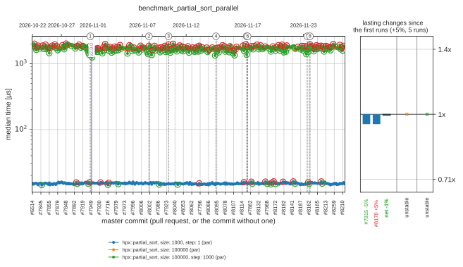

Medians that moved by more than 5% against the median of up to 3 runs before it, not reaching back past the last change (+ is slower); the numbers are those on the graph.

| # | Commit | Pull request | Measurement | Change |
| --- | --- | --- | --- | --- |
| 8 | [f5810fe909e5](2026/medusa00/20261123T223354Z-f5810fe909e5-b0/README.md) | [#8205](https://github.com/TheHPXProject/hpx/pull/8205) | hpx::partial_sort, size: 100000 (par) | +7% |
|  |  |  | hpx::partial_sort, size: 100000, step: 1000 (par) | +29% |
|  | [7dfcaca610c6](2026/medusa00/20261123T155526Z-7dfcaca610c6-b0/README.md) | [#8162](https://github.com/TheHPXProject/hpx/pull/8162) | hpx::partial_sort, size: 1000, step: 1 (par) | -5% |
|  | [30d07dfcd052](2026/medusa00/20261123T155346Z-30d07dfcd052-b0/README.md) | [#8170](https://github.com/TheHPXProject/hpx/pull/8170) | hpx::partial_sort, size: 1000, step: 1 (par) | +6% |
|  |  |  | hpx::partial_sort, size: 100000, step: 1000 (par) | -18% |
| 7 | [a22c833fb46b](2026/medusa00/20261123T155042Z-a22c833fb46b-b0/README.md) | [#8191](https://github.com/TheHPXProject/hpx/pull/8191) | hpx::partial_sort, size: 100000, step: 1000 (par) | +31% |
|  | [120f527c0e33](2026/medusa00/20261123T155001Z-120f527c0e33-b0/README.md) | [#8193](https://github.com/TheHPXProject/hpx/pull/8193) | hpx::partial_sort, size: 100000, step: 1000 (par) | -18% |
|  | [88df87fc49dd](2026/medusa00/20261123T153642Z-88df87fc49dd-b0/README.md) | [#8137](https://github.com/TheHPXProject/hpx/pull/8137) | hpx::partial_sort, size: 100000, step: 1000 (par) | -9% |
|  | [1dbb8ae9ca59](2026/medusa00/20261123T153616Z-1dbb8ae9ca59-b0/README.md) | [#8189](https://github.com/TheHPXProject/hpx/pull/8189) | hpx::partial_sort, size: 100000, step: 1000 (par) | +17% |
|  | [681ba8c18f8a](2026/medusa00/20261123T153548Z-681ba8c18f8a-b0/README.md) | [#8195](https://github.com/TheHPXProject/hpx/pull/8195) | hpx::partial_sort, size: 100000, step: 1000 (par) | -7% |
|  | [5d08dcd12bd1](2026/medusa00/20261122T230647Z-5d08dcd12bd1-b0/README.md) | [#8197](https://github.com/TheHPXProject/hpx/pull/8197) | hpx::partial_sort, size: 100000, step: 1000 (par) | -8% |
|  | [7a208e7d860f](2026/medusa00/20261122T224643Z-7a208e7d860f-b0/README.md) | [#8196](https://github.com/TheHPXProject/hpx/pull/8196) | hpx::partial_sort, size: 100000, step: 1000 (par) | +13% |
|  | [68c527c67bfa](2026/medusa00/20261122T221913Z-68c527c67bfa-b0/README.md) | [#8187](https://github.com/TheHPXProject/hpx/pull/8187) | hpx::partial_sort, size: 100000, step: 1000 (par) | -6% |
|  | [c6ad4d1437be](2026/medusa00/20261122T221036Z-c6ad4d1437be-b0/README.md) | [#8163](https://github.com/TheHPXProject/hpx/pull/8163) | hpx::partial_sort, size: 100000, step: 1000 (par) | +7% |
|  | [56ce50eba39d](2026/medusa00/20261122T220633Z-56ce50eba39d-b0/README.md) | [#8184](https://github.com/TheHPXProject/hpx/pull/8184) | hpx::partial_sort, size: 1000, step: 1 (par) | -6% |
|  |  |  | hpx::partial_sort, size: 100000, step: 1000 (par) | -10% |
|  | [31d207110942](2026/medusa00/20261122T015735Z-31d207110942-b0/README.md) | [#8150](https://github.com/TheHPXProject/hpx/pull/8150) | hpx::partial_sort, size: 1000, step: 1 (par) | +8% |
|  | [d743f131ca2d](2026/medusa00/20261121T210651Z-d743f131ca2d-b0/README.md) |  | hpx::partial_sort, size: 100000, step: 1000 (par) | -9% |
|  | [3af219b1e7b3](2026/medusa00/20261121T202714Z-3af219b1e7b3-b0/README.md) | [#8158](https://github.com/TheHPXProject/hpx/pull/8158) | hpx::partial_sort, size: 100000, step: 1000 (par) | +25% |
|  | [8745b241fa76](2026/medusa00/20261121T202144Z-8745b241fa76-b0/README.md) | [#8043](https://github.com/TheHPXProject/hpx/pull/8043) | hpx::partial_sort, size: 100000, step: 1000 (par) | -16% |
|  | [09263e22dae1](2026/medusa00/20261121T202055Z-09263e22dae1-b0/README.md) | [#8151](https://github.com/TheHPXProject/hpx/pull/8151) | hpx::partial_sort, size: 100000, step: 1000 (par) | +21% |
|  | [2ef6b6dbfb68](2026/medusa00/20261121T201146Z-2ef6b6dbfb68-b0/README.md) | [#8182](https://github.com/TheHPXProject/hpx/pull/8182) | hpx::partial_sort, size: 100000, step: 1000 (par) | -11% |
|  | [374d2bcce4d2](2026/medusa00/20261121T201025Z-374d2bcce4d2-b0/README.md) | [#8180](https://github.com/TheHPXProject/hpx/pull/8180) | hpx::partial_sort, size: 1000, step: 1 (par) | +5% |
|  |  |  | hpx::partial_sort, size: 100000, step: 1000 (par) | -15% |
|  | [e662f93ee492](2026/medusa00/20261121T201000Z-e662f93ee492-b0/README.md) | [#8175](https://github.com/TheHPXProject/hpx/pull/8175) | hpx::partial_sort, size: 100000, step: 1000 (par) | +6% |
|  | [e279227b256e](2026/medusa00/20261121T200313Z-e279227b256e-b0/README.md) | [#8171](https://github.com/TheHPXProject/hpx/pull/8171) | hpx::partial_sort, size: 100000, step: 1000 (par) | +17% |
|  | [efa92d023cc3](2026/medusa00/20261121T200232Z-efa92d023cc3-b0/README.md) | [#8145](https://github.com/TheHPXProject/hpx/pull/8145) | hpx::partial_sort, size: 100000, step: 1000 (par) | -10% |
|  | [9b1249638b03](2026/medusa00/20261121T200204Z-9b1249638b03-b0/README.md) | [#8143](https://github.com/TheHPXProject/hpx/pull/8143) | hpx::partial_sort, size: 100000, step: 1000 (par) | -9% |
|  | [7f7a5193f14c](2026/medusa00/20261121T200117Z-7f7a5193f14c-b0/README.md) | [#8167](https://github.com/TheHPXProject/hpx/pull/8167) | hpx::partial_sort, size: 100000, step: 1000 (par) | +11% |
|  | [0d3ecc3f8063](2026/medusa00/20261121T195932Z-0d3ecc3f8063-b0/README.md) | [#8144](https://github.com/TheHPXProject/hpx/pull/8144) | hpx::partial_sort, size: 100000, step: 1000 (par) | +12% |
|  | [161df7fc6a85](2026/medusa00/20261121T020555Z-161df7fc6a85-b0/README.md) | [#8172](https://github.com/TheHPXProject/hpx/pull/8172) | hpx::partial_sort, size: 1000, step: 1 (par) | -7% |
|  |  |  | hpx::partial_sort, size: 100000, step: 1000 (par) | -7% |
|  | [7ff76b042961](2026/medusa00/20261121T011743Z-7ff76b042961-b0/README.md) | [#8153](https://github.com/TheHPXProject/hpx/pull/8153) | hpx::partial_sort, size: 1000, step: 1 (par) | +5% |
|  |  |  | hpx::partial_sort, size: 100000, step: 1000 (par) | -7% |
|  | [c4ed06bad070](2026/medusa00/20261121T011431Z-c4ed06bad070-b0/README.md) | [#8140](https://github.com/TheHPXProject/hpx/pull/8140) | hpx::partial_sort, size: 100000, step: 1000 (par) | +19% |
|  | [4c8b5abc458a](2026/medusa00/20261121T011354Z-4c8b5abc458a-b0/README.md) | [#8148](https://github.com/TheHPXProject/hpx/pull/8148) | hpx::partial_sort, size: 1000, step: 1 (par) | +6% |
|  | [13283433a175](2026/medusa00/20261121T011251Z-13283433a175-b0/README.md) | [#8160](https://github.com/TheHPXProject/hpx/pull/8160) | hpx::partial_sort, size: 1000, step: 1 (par) | -5% |
|  |  |  | hpx::partial_sort, size: 100000, step: 1000 (par) | -11% |
|  | [6db355aa30b9](2026/medusa00/20261119T152626Z-6db355aa30b9-b0/README.md) | [#8149](https://github.com/TheHPXProject/hpx/pull/8149) | hpx::partial_sort, size: 100000, step: 1000 (par) | -8% |
|  | [4aa61cac50e2](2026/medusa00/20261119T131655Z-4aa61cac50e2-b0/README.md) | [#7968](https://github.com/TheHPXProject/hpx/pull/7968) | hpx::partial_sort, size: 1000, step: 1 (par) | -5% |
|  | [68987f390ee9](2026/medusa00/20261119T125208Z-68987f390ee9-b0/README.md) | [#8133](https://github.com/TheHPXProject/hpx/pull/8133) | hpx::partial_sort, size: 1000, step: 1 (par) | +8% |
|  |  |  | hpx::partial_sort, size: 100000, step: 1000 (par) | +10% |
|  | [0361b3c3a0e5](2026/medusa00/20261118T175138Z-0361b3c3a0e5-b0/README.md) | [#8007](https://github.com/TheHPXProject/hpx/pull/8007) | hpx::partial_sort, size: 100000, step: 1000 (par) | -11% |
|  | [b00a4e68cc8e](2026/medusa00/20261118T170108Z-b00a4e68cc8e-b0/README.md) | [#8089](https://github.com/TheHPXProject/hpx/pull/8089) | hpx::partial_sort, size: 100000, step: 1000 (par) | +14% |
|  | [7d08d4adcc4d](2026/medusa00/20261118T162954Z-7d08d4adcc4d-b0/README.md) | [#8132](https://github.com/TheHPXProject/hpx/pull/8132) | hpx::partial_sort, size: 100000, step: 1000 (par) | -9% |
|  | [4bb510be7551](2026/medusa00/20261118T162831Z-4bb510be7551-b0/README.md) | [#8131](https://github.com/TheHPXProject/hpx/pull/8131) | hpx::partial_sort, size: 100000, step: 1000 (par) | -6% |
|  | [acc3e1884018](2026/medusa00/20261118T162746Z-acc3e1884018-b0/README.md) | [#8130](https://github.com/TheHPXProject/hpx/pull/8130) | hpx::partial_sort, size: 100000, step: 1000 (par) | +7% |
|  | [70dbd992fade](2026/medusa00/20261117T023759Z-70dbd992fade-b0/README.md) | [#8111](https://github.com/TheHPXProject/hpx/pull/8111) | hpx::partial_sort, size: 100000, step: 1000 (par) | +12% |
|  | [aabec893cbe6](2026/medusa00/20261117T023617Z-aabec893cbe6-b0/README.md) | [#8126](https://github.com/TheHPXProject/hpx/pull/8126) | hpx::partial_sort, size: 100000, step: 1000 (par) | -9% |
|  | [9b8facdd8144](2026/medusa00/20261117T023244Z-9b8facdd8144-b0/README.md) | [#7957](https://github.com/TheHPXProject/hpx/pull/7957) | hpx::partial_sort, size: 1000, step: 1 (par) | -7% |
|  | [6a580cf3b81f](2026/medusa00/20261117T023117Z-6a580cf3b81f-b0/README.md) | [#8122](https://github.com/TheHPXProject/hpx/pull/8122) | hpx::partial_sort, size: 1000, step: 1 (par) | +5% |
|  |  |  | hpx::partial_sort, size: 100000, step: 1000 (par) | +13% |
|  | [3bda6151b6d2](2026/medusa00/20261117T022429Z-3bda6151b6d2-b0/README.md) | [#8116](https://github.com/TheHPXProject/hpx/pull/8116) | hpx::partial_sort, size: 100000, step: 1000 (par) | -9% |
| 6 | [495fe11e52e0](2026/medusa00/20261117T002049Z-495fe11e52e0-b0/README.md) | [#7967](https://github.com/TheHPXProject/hpx/pull/7967) | hpx::partial_sort, size: 100000, step: 1000 (par) | +31% |
| 5 | [3489de476d47](2026/medusa00/20261116T235000Z-3489de476d47-b0/README.md) | [#8120](https://github.com/TheHPXProject/hpx/pull/8120) | hpx::partial_sort, size: 100000, step: 1000 (par) | -31% |
|  | [4773beb14c95](2026/medusa00/20261116T234921Z-4773beb14c95-b0/README.md) | [#8121](https://github.com/TheHPXProject/hpx/pull/8121) | hpx::partial_sort, size: 100000, step: 1000 (par) | +23% |
|  | [2de7d8546d6e](2026/medusa00/20261116T181442Z-2de7d8546d6e-b0/README.md) | [#8108](https://github.com/TheHPXProject/hpx/pull/8108) | hpx::partial_sort, size: 1000, step: 1 (par) | +6% |
|  |  |  | hpx::partial_sort, size: 100000, step: 1000 (par) | -16% |
|  | [8df2d4c1dc0b](2026/medusa00/20261116T175421Z-8df2d4c1dc0b-b0/README.md) | [#8091](https://github.com/TheHPXProject/hpx/pull/8091) | hpx::partial_sort, size: 100000, step: 1000 (par) | +13% |
|  | [cf90cc2f3d81](2026/medusa00/20261116T130107Z-cf90cc2f3d81-b0/README.md) | [#8087](https://github.com/TheHPXProject/hpx/pull/8087) | hpx::partial_sort, size: 100000, step: 1000 (par) | +11% |
|  | [aae6119e6f00](2026/medusa00/20261116T003932Z-aae6119e6f00-b0/README.md) | [#8110](https://github.com/TheHPXProject/hpx/pull/8110) | hpx::partial_sort, size: 100000, step: 1000 (par) | +23% |
|  | [91e09fba73d9](2026/medusa00/20261116T003702Z-91e09fba73d9-b0/README.md) | [#8076](https://github.com/TheHPXProject/hpx/pull/8076) | hpx::partial_sort, size: 100000, step: 1000 (par) | -14% |
|  | [e717b479d43d](2026/medusa00/20261115T225634Z-e717b479d43d-b0/README.md) | [#8107](https://github.com/TheHPXProject/hpx/pull/8107) | hpx::partial_sort, size: 100000, step: 1000 (par) | +7% |
|  | [1fee59874aa1](2026/medusa00/20261115T225610Z-1fee59874aa1-b0/README.md) | [#8101](https://github.com/TheHPXProject/hpx/pull/8101) | hpx::partial_sort, size: 100000, step: 1000 (par) | -11% |
|  | [6be0641255d1](2026/medusa00/20261115T225547Z-6be0641255d1-b0/README.md) | [#8035](https://github.com/TheHPXProject/hpx/pull/8035) | hpx::partial_sort, size: 100000, step: 1000 (par) | -14% |
|  | [e5e6ba9670fd](2026/medusa00/20261115T205943Z-e5e6ba9670fd-b0/README.md) | [#8109](https://github.com/TheHPXProject/hpx/pull/8109) | hpx::partial_sort, size: 100000, step: 1000 (par) | +23% |
|  | [d46dcf54b998](2026/medusa00/20261115T164657Z-d46dcf54b998-b0/README.md) | [#8090](https://github.com/TheHPXProject/hpx/pull/8090) | hpx::partial_sort, size: 100000, step: 1000 (par) | -14% |
|  | [a7350342afdc](2026/medusa00/20261115T164525Z-a7350342afdc-b0/README.md) | [#8088](https://github.com/TheHPXProject/hpx/pull/8088) | hpx::partial_sort, size: 100000, step: 1000 (par) | +14% |
|  | [4bf667b566f1](2026/medusa00/20261115T151931Z-4bf667b566f1-b0/README.md) | [#8078](https://github.com/TheHPXProject/hpx/pull/8078) | hpx::partial_sort, size: 100000, step: 1000 (par) | -18% |
|  | [b84e62e55352](2026/medusa00/20261115T151853Z-b84e62e55352-b0/README.md) | [#8100](https://github.com/TheHPXProject/hpx/pull/8100) | hpx::partial_sort, size: 100000, step: 1000 (par) | +12% |
|  | [41b78d5465db](2026/medusa00/20261115T142802Z-41b78d5465db-b0/README.md) | [#8092](https://github.com/TheHPXProject/hpx/pull/8092) | hpx::partial_sort, size: 100000, step: 1000 (par) | -13% |
|  | [5aaa0707ef5f](2026/medusa00/20261115T142636Z-5aaa0707ef5f-b0/README.md) | [#8082](https://github.com/TheHPXProject/hpx/pull/8082) | hpx::partial_sort, size: 100000, step: 1000 (par) | +8% |
|  | [e4271b2fd61e](2026/medusa00/20261115T142037Z-e4271b2fd61e-b0/README.md) | [#8083](https://github.com/TheHPXProject/hpx/pull/8083) | hpx::partial_sort, size: 100000, step: 1000 (par) | +19% |
|  | [23543756c6fc](2026/medusa00/20261115T141852Z-23543756c6fc-b0/README.md) | [#8079](https://github.com/TheHPXProject/hpx/pull/8079) | hpx::partial_sort, size: 100000, step: 1000 (par) | -5% |
|  | [829ce5c6e184](2026/medusa00/20261115T002129Z-829ce5c6e184-b0/README.md) | [#8072](https://github.com/TheHPXProject/hpx/pull/8072) | hpx::partial_sort, size: 100000 (par) | +5% |
|  | [491348b35a06](2026/medusa00/20261115T001534Z-491348b35a06-b0/README.md) | [#8095](https://github.com/TheHPXProject/hpx/pull/8095) | hpx::partial_sort, size: 100000, step: 1000 (par) | -10% |
| 4 | [a3c0afd33556](2026/medusa00/20261114T194707Z-a3c0afd33556-b0/README.md) | [#8000](https://github.com/TheHPXProject/hpx/pull/8000) | hpx::partial_sort, size: 100000, step: 1000 (par) | +29% |
|  | [c3640f63f0af](2026/medusa00/20261114T180323Z-c3640f63f0af-b0/README.md) | [#8009](https://github.com/TheHPXProject/hpx/pull/8009) | hpx::partial_sort, size: 100000, step: 1000 (par) | -20% |
|  | [237024ea67c8](2026/medusa00/20261114T180039Z-237024ea67c8-b0/README.md) | [#8080](https://github.com/TheHPXProject/hpx/pull/8080) | hpx::partial_sort, size: 100000, step: 1000 (par) | -6% |
|  | [57aaa650e3dd](2026/medusa00/20261114T175645Z-57aaa650e3dd-b0/README.md) | [#7891](https://github.com/TheHPXProject/hpx/pull/7891) | hpx::partial_sort, size: 100000, step: 1000 (par) | +8% |
|  | [000d565a8a5e](2026/medusa00/20261114T175049Z-000d565a8a5e-b0/README.md) | [#8093](https://github.com/TheHPXProject/hpx/pull/8093) | hpx::partial_sort, size: 100000, step: 1000 (par) | +11% |
|  | [678a4a862858](2026/medusa00/20261114T003403Z-678a4a862858-b0/README.md) | [#7983](https://github.com/TheHPXProject/hpx/pull/7983) | hpx::partial_sort, size: 100000, step: 1000 (par) | -15% |
|  | [1e47bfebd8ff](2026/medusa00/20261114T003237Z-1e47bfebd8ff-b0/README.md) | [#7910](https://github.com/TheHPXProject/hpx/pull/7910) | hpx::partial_sort, size: 100000, step: 1000 (par) | +11% |
|  | [4cff0512612d](2026/medusa00/20261113T223118Z-4cff0512612d-b0/README.md) | [#8069](https://github.com/TheHPXProject/hpx/pull/8069) | hpx::partial_sort, size: 100000, step: 1000 (par) | -7% |
|  | [0b08cfe93715](2026/medusa00/20261113T222043Z-0b08cfe93715-b0/README.md) | [#8073](https://github.com/TheHPXProject/hpx/pull/8073) | hpx::partial_sort, size: 100000, step: 1000 (par) | +13% |
|  | [5fa150382b72](2026/medusa00/20261112T232311Z-5fa150382b72-b0/README.md) | [#8065](https://github.com/TheHPXProject/hpx/pull/8065) | hpx::partial_sort, size: 100000, step: 1000 (par) | -16% |
|  | [7b677db97986](2026/medusa00/20261112T225952Z-7b677db97986-b0/README.md) | [#8068](https://github.com/TheHPXProject/hpx/pull/8068) | hpx::partial_sort, size: 1000, step: 1 (par) | +5% |
|  |  |  | hpx::partial_sort, size: 100000, step: 1000 (par) | +23% |
|  | [9dda1e8f95ce](2026/medusa00/20261112T225939Z-9dda1e8f95ce-b0/README.md) | [#8067](https://github.com/TheHPXProject/hpx/pull/8067) | hpx::partial_sort, size: 100000, step: 1000 (par) | -16% |
|  | [8793e4fb0220](2026/medusa00/20261112T175410Z-8793e4fb0220-b0/README.md) | [#8025](https://github.com/TheHPXProject/hpx/pull/8025) | hpx::partial_sort, size: 100000, step: 1000 (par) | +17% |
|  | [bfeeb6c95c1a](2026/medusa00/20261112T175350Z-bfeeb6c95c1a-b0/README.md) | [#7882](https://github.com/TheHPXProject/hpx/pull/7882) | hpx::partial_sort, size: 100000, step: 1000 (par) | -11% |
|  | [d5e76cb4cafa](2026/medusa00/20261112T175317Z-d5e76cb4cafa-b0/README.md) | [#7780](https://github.com/TheHPXProject/hpx/pull/7780) | hpx::partial_sort, size: 100000, step: 1000 (par) | +15% |
|  | [dfa8c891248b](2026/medusa00/20261112T174511Z-dfa8c891248b-b0/README.md) | [#8029](https://github.com/TheHPXProject/hpx/pull/8029) | hpx::partial_sort, size: 100000, step: 1000 (par) | -5% |
|  | [d8f44c37a9c6](2026/medusa00/20261112T173935Z-d8f44c37a9c6-b0/README.md) | [#8048](https://github.com/TheHPXProject/hpx/pull/8048) | hpx::partial_sort, size: 100000, step: 1000 (par) | -10% |
|  | [c82bbf1a72cc](2026/medusa00/20261112T170314Z-c82bbf1a72cc-b0/README.md) | [#8063](https://github.com/TheHPXProject/hpx/pull/8063) | hpx::partial_sort, size: 100000, step: 1000 (par) | +7% |
|  | [c667669e477e](2026/medusa00/20261112T015913Z-c667669e477e-b0/README.md) | [#8061](https://github.com/TheHPXProject/hpx/pull/8061) | hpx::partial_sort, size: 100000, step: 1000 (par) | +14% |
|  | [336aac617ec7](2026/medusa00/20261112T015319Z-336aac617ec7-b0/README.md) | [#8059](https://github.com/TheHPXProject/hpx/pull/8059) | hpx::partial_sort, size: 100000, step: 1000 (par) | -20% |
|  | [1cb76f719d73](2026/medusa00/20261112T015251Z-1cb76f719d73-b0/README.md) | [#8058](https://github.com/TheHPXProject/hpx/pull/8058) | hpx::partial_sort, size: 100000, step: 1000 (par) | +11% |
|  | [16d9ce3c46f2](2026/medusa00/20261112T004556Z-16d9ce3c46f2-b0/README.md) | [#8050](https://github.com/TheHPXProject/hpx/pull/8050) | hpx::partial_sort, size: 100000, step: 1000 (par) | -7% |
|  | [6e8e51d75331](2026/medusa00/20261111T194902Z-6e8e51d75331-b0/README.md) | [#8054](https://github.com/TheHPXProject/hpx/pull/8054) | hpx::partial_sort, size: 100000, step: 1000 (par) | +14% |
|  | [1b69deffe666](2026/medusa00/20261111T194824Z-1b69deffe666-b0/README.md) | [#8053](https://github.com/TheHPXProject/hpx/pull/8053) | hpx::partial_sort, size: 100000, step: 1000 (par) | -15% |
|  | [6e273f307bf8](2026/medusa00/20261111T194755Z-6e273f307bf8-b0/README.md) | [#8052](https://github.com/TheHPXProject/hpx/pull/8052) | hpx::partial_sort, size: 100000, step: 1000 (par) | +15% |
|  | [4214f73cac01](2026/medusa00/20261111T191512Z-4214f73cac01-b0/README.md) | [#8056](https://github.com/TheHPXProject/hpx/pull/8056) | hpx::partial_sort, size: 100000, step: 1000 (par) | -11% |
|  | [bada5735d0f9](2026/medusa00/20261111T191259Z-bada5735d0f9-b0/README.md) | [#8051](https://github.com/TheHPXProject/hpx/pull/8051) | hpx::partial_sort, size: 100000, step: 1000 (par) | -6% |
|  | [d6f507de17d6](2026/medusa00/20261111T130955Z-d6f507de17d6-b0/README.md) | [#8031](https://github.com/TheHPXProject/hpx/pull/8031) | hpx::partial_sort, size: 100000, step: 1000 (par) | +7% |
|  | [756d4746cffb](2026/medusa00/20261111T013712Z-756d4746cffb-b0/README.md) | [#8045](https://github.com/TheHPXProject/hpx/pull/8045) | hpx::partial_sort, size: 1000, step: 1 (par) | -6% |
|  |  |  | hpx::partial_sort, size: 100000, step: 1000 (par) | +16% |
|  | [c41788f6dddc](2026/medusa00/20261111T013231Z-c41788f6dddc-b0/README.md) | [#8044](https://github.com/TheHPXProject/hpx/pull/8044) | hpx::partial_sort, size: 100000, step: 1000 (par) | -7% |
|  | [2debed8192f0](2026/medusa00/20261111T013154Z-2debed8192f0-b0/README.md) | [#8040](https://github.com/TheHPXProject/hpx/pull/8040) | hpx::partial_sort, size: 100000, step: 1000 (par) | -16% |
|  | [18a611fc67a6](2026/medusa00/20261111T013124Z-18a611fc67a6-b0/README.md) | [#8027](https://github.com/TheHPXProject/hpx/pull/8027) | hpx::partial_sort, size: 100000 (par) | +6% |
|  | [0f36a4a09242](2026/medusa00/20261111T013105Z-0f36a4a09242-b0/README.md) | [#7965](https://github.com/TheHPXProject/hpx/pull/7965) | hpx::partial_sort, size: 100000, step: 1000 (par) | +23% |
|  | [88925dfc0c20](2026/medusa00/20261111T010929Z-88925dfc0c20-b0/README.md) | [#7989](https://github.com/TheHPXProject/hpx/pull/7989) | hpx::partial_sort, size: 100000 (par) | -5% |
|  | [7757cdb5b188](2026/medusa00/20261111T010906Z-7757cdb5b188-b0/README.md) | [#7672](https://github.com/TheHPXProject/hpx/pull/7672) | hpx::partial_sort, size: 100000, step: 1000 (par) | +14% |
|  | [497de4a5b217](2026/medusa00/20261110T010943Z-497de4a5b217-b0/README.md) | [#7475](https://github.com/TheHPXProject/hpx/pull/7475) | hpx::partial_sort, size: 100000, step: 1000 (par) | -17% |
|  | [4eaeb00c2ce9](2026/medusa00/20261110T010849Z-4eaeb00c2ce9-b0/README.md) | [#8022](https://github.com/TheHPXProject/hpx/pull/8022) | hpx::partial_sort, size: 100000, step: 1000 (par) | -10% |
| 3 | [ddcafa39ebcd](2026/medusa00/20261110T005848Z-ddcafa39ebcd-b0/README.md) | [#8018](https://github.com/TheHPXProject/hpx/pull/8018) | hpx::partial_sort, size: 100000, step: 1000 (par) | +28% |
|  | [1cb414b6cfbb](2026/medusa00/20261110T005757Z-1cb414b6cfbb-b0/README.md) | [#8021](https://github.com/TheHPXProject/hpx/pull/8021) | hpx::partial_sort, size: 100000, step: 1000 (par) | -14% |
|  | [9479d240ceb3](2026/medusa00/20261109T230011Z-9479d240ceb3-b0/README.md) | [#7923](https://github.com/TheHPXProject/hpx/pull/7923) | hpx::partial_sort, size: 100000, step: 1000 (par) | +19% |
|  | [b2733a95fa81](2026/medusa00/20261109T162325Z-b2733a95fa81-b0/README.md) | [#8016](https://github.com/TheHPXProject/hpx/pull/8016) | hpx::partial_sort, size: 100000, step: 1000 (par) | -19% |
|  | [73afdb5761aa](2026/medusa00/20261109T154719Z-73afdb5761aa-b0/README.md) | [#7578](https://github.com/TheHPXProject/hpx/pull/7578) | hpx::partial_sort, size: 100000, step: 1000 (par) | +9% |
|  | [953e6823658a](2026/medusa00/20261109T154348Z-953e6823658a-b0/README.md) | [#8024](https://github.com/TheHPXProject/hpx/pull/8024) | hpx::partial_sort, size: 100000, step: 1000 (par) | +10% |
|  | [2c449c50b3a4](2026/medusa00/20261109T153600Z-2c449c50b3a4-b0/README.md) | [#8015](https://github.com/TheHPXProject/hpx/pull/8015) | hpx::partial_sort, size: 100000, step: 1000 (par) | -11% |
|  | [20da13211d9e](2026/medusa00/20261109T135014Z-20da13211d9e-b0/README.md) | [#8026](https://github.com/TheHPXProject/hpx/pull/8026) | hpx::partial_sort, size: 100000, step: 1000 (par) | +19% |
|  | [9df0c28bd288](2026/medusa00/20261109T134836Z-9df0c28bd288-b0/README.md) |  | hpx::partial_sort, size: 100000, step: 1000 (par) | -13% |
|  | [29e648ba019b](2026/medusa00/20261108T210210Z-29e648ba019b-b0/README.md) | [#7815](https://github.com/TheHPXProject/hpx/pull/7815) | hpx::partial_sort, size: 1000, step: 1 (par) | -7% |
|  | [be63a9fb2cc9](2026/medusa00/20261108T204337Z-be63a9fb2cc9-b0/README.md) | [#7986](https://github.com/TheHPXProject/hpx/pull/7986) | hpx::partial_sort, size: 100000, step: 1000 (par) | +6% |
|  | [bd84353a6b82](2026/medusa00/20261108T143932Z-bd84353a6b82-b0/README.md) | [#7512](https://github.com/TheHPXProject/hpx/pull/7512) | hpx::partial_sort, size: 100000, step: 1000 (par) | -15% |
|  | [0800cb212e30](2026/medusa00/20261108T143845Z-0800cb212e30-b0/README.md) | [#7818](https://github.com/TheHPXProject/hpx/pull/7818) | hpx::partial_sort, size: 100000, step: 1000 (par) | +15% |
|  | [d41f64c48c77](2026/medusa00/20261108T143240Z-d41f64c48c77-b0/README.md) | [#8012](https://github.com/TheHPXProject/hpx/pull/8012) | hpx::partial_sort, size: 100000, step: 1000 (par) | +18% |
|  | [916f037f8899](2026/medusa00/20261108T143055Z-916f037f8899-b0/README.md) | [#7710](https://github.com/TheHPXProject/hpx/pull/7710) | hpx::partial_sort, size: 100000, step: 1000 (par) | -22% |
|  | [8a2503e4eef9](2026/medusa00/20261107T203722Z-8a2503e4eef9-b0/README.md) | [#7795](https://github.com/TheHPXProject/hpx/pull/7795) | hpx::partial_sort, size: 100000, step: 1000 (par) | -8% |
| 2 | [6c02a1b2103d](2026/medusa00/20261107T202922Z-6c02a1b2103d-b0/README.md) | [#8010](https://github.com/TheHPXProject/hpx/pull/8010) | hpx::partial_sort, size: 100000, step: 1000 (par) | +33% |
|  | [175529d41da8](2026/medusa00/20261107T202811Z-175529d41da8-b0/README.md) | [#7998](https://github.com/TheHPXProject/hpx/pull/7998) | hpx::partial_sort, size: 100000, step: 1000 (par) | -6% |
|  | [b58d65528d91](2026/medusa00/20261107T202707Z-b58d65528d91-b0/README.md) | [#7927](https://github.com/TheHPXProject/hpx/pull/7927) | hpx::partial_sort, size: 100000, step: 1000 (par) | -10% |
|  | [8b7498098df9](2026/medusa00/20261107T202624Z-8b7498098df9-b0/README.md) | [#7902](https://github.com/TheHPXProject/hpx/pull/7902) | hpx::partial_sort, size: 100000, step: 1000 (par) | -6% |
|  | [61739d45974f](2026/medusa00/20261107T202123Z-61739d45974f-b0/README.md) | [#8008](https://github.com/TheHPXProject/hpx/pull/8008) | hpx::partial_sort, size: 100000 (par) | +6% |
|  | [f7df98473ccc](2026/medusa00/20261107T201452Z-f7df98473ccc-b0/README.md) | [#7963](https://github.com/TheHPXProject/hpx/pull/7963) | hpx::partial_sort, size: 100000 (par) | -5% |
|  | [f3caaa84647f](2026/medusa00/20261106T161305Z-f3caaa84647f-b0/README.md) | [#7877](https://github.com/TheHPXProject/hpx/pull/7877) | hpx::partial_sort, size: 100000, step: 1000 (par) | +12% |
|  | [740189b0e212](2026/medusa00/20261106T154916Z-740189b0e212-b0/README.md) | [#7962](https://github.com/TheHPXProject/hpx/pull/7962) | hpx::partial_sort, size: 100000, step: 1000 (par) | +14% |
|  | [67899353fad4](2026/medusa00/20261106T154630Z-67899353fad4-b0/README.md) | [#7997](https://github.com/TheHPXProject/hpx/pull/7997) | hpx::partial_sort, size: 100000, step: 1000 (par) | -7% |
|  | [a9de023e4098](2026/medusa00/20261106T150520Z-a9de023e4098-b0/README.md) | [#7951](https://github.com/TheHPXProject/hpx/pull/7951) | hpx::partial_sort, size: 100000, step: 1000 (par) | -9% |
|  | [ec3b59b1fa0b](2026/medusa00/20261106T150024Z-ec3b59b1fa0b-b0/README.md) | [#8001](https://github.com/TheHPXProject/hpx/pull/8001) | hpx::partial_sort, size: 100000, step: 1000 (par) | +12% |
|  | [b8dc6233ffc3](2026/medusa00/20261106T145549Z-b8dc6233ffc3-b0/README.md) | [#7977](https://github.com/TheHPXProject/hpx/pull/7977) | hpx::partial_sort, size: 100000, step: 1000 (par) | -14% |
|  | [2aba6877abca](2026/medusa00/20261106T145306Z-2aba6877abca-b0/README.md) | [#7778](https://github.com/TheHPXProject/hpx/pull/7778) | hpx::partial_sort, size: 100000, step: 1000 (par) | -7% |
|  | [11d80c3254ef](2026/medusa00/20261105T140141Z-11d80c3254ef-b0/README.md) | [#7288](https://github.com/TheHPXProject/hpx/pull/7288) | hpx::partial_sort, size: 100000, step: 1000 (par) | +13% |
|  | [0090ddb68d9d](2026/medusa00/20261105T140010Z-0090ddb68d9d-b0/README.md) | [#7941](https://github.com/TheHPXProject/hpx/pull/7941) | hpx::partial_sort, size: 100000, step: 1000 (par) | +19% |
|  | [0c3d1acb2825](2026/medusa00/20261105T135914Z-0c3d1acb2825-b0/README.md) | [#7715](https://github.com/TheHPXProject/hpx/pull/7715) | hpx::partial_sort, size: 100000, step: 1000 (par) | -18% |
|  | [e0ec0de0ea79](2026/medusa00/20261105T014759Z-e0ec0de0ea79-b0/README.md) | [#7991](https://github.com/TheHPXProject/hpx/pull/7991) | hpx::partial_sort, size: 100000, step: 1000 (par) | -12% |
|  | [2ccda2d570df](2026/medusa00/20261104T202405Z-2ccda2d570df-b0/README.md) | [#7976](https://github.com/TheHPXProject/hpx/pull/7976) | hpx::partial_sort, size: 100000, step: 1000 (par) | +10% |
|  | [2469176f1309](2026/medusa00/20261104T201606Z-2469176f1309-b0/README.md) | [#7985](https://github.com/TheHPXProject/hpx/pull/7985) | hpx::partial_sort, size: 100000, step: 1000 (par) | +10% |
|  | [bb2649ad4a5c](2026/medusa00/20261104T201553Z-bb2649ad4a5c-b0/README.md) | [#7984](https://github.com/TheHPXProject/hpx/pull/7984) | hpx::partial_sort, size: 1000, step: 1 (par) | -5% |
|  |  |  | hpx::partial_sort, size: 100000, step: 1000 (par) | -11% |
|  | [1c9e6dc93fa3](2026/medusa00/20261104T201219Z-1c9e6dc93fa3-b0/README.md) | [#7928](https://github.com/TheHPXProject/hpx/pull/7928) | hpx::partial_sort, size: 100000, step: 1000 (par) | +13% |
|  | [643711237e76](2026/medusa00/20261104T200513Z-643711237e76-b0/README.md) | [#7979](https://github.com/TheHPXProject/hpx/pull/7979) | hpx::partial_sort, size: 100000, step: 1000 (par) | -10% |
|  | [88071b955a3f](2026/medusa00/20261104T195847Z-88071b955a3f-b0/README.md) | [#7670](https://github.com/TheHPXProject/hpx/pull/7670) | hpx::partial_sort, size: 100000, step: 1000 (par) | +19% |
|  | [6a148399c192](2026/medusa00/20261104T195449Z-6a148399c192-b0/README.md) | [#7914](https://github.com/TheHPXProject/hpx/pull/7914) | hpx::partial_sort, size: 100000, step: 1000 (par) | -11% |
|  | [165e38eedbf8](2026/medusa00/20261104T195301Z-165e38eedbf8-b0/README.md) | [#7880](https://github.com/TheHPXProject/hpx/pull/7880) | hpx::partial_sort, size: 100000, step: 1000 (par) | +16% |
|  | [fce10534ffda](2026/medusa00/20261104T195148Z-fce10534ffda-b0/README.md) | [#7813](https://github.com/TheHPXProject/hpx/pull/7813) | hpx::partial_sort, size: 100000, step: 1000 (par) | -17% |
|  | [2655ed112e4e](2026/medusa00/20261104T194920Z-2655ed112e4e-b0/README.md) | [#7803](https://github.com/TheHPXProject/hpx/pull/7803) | hpx::partial_sort, size: 100000, step: 1000 (par) | +14% |
|  | [3ad5bb936852](2026/medusa00/20261104T194628Z-3ad5bb936852-b0/README.md) | [#7808](https://github.com/TheHPXProject/hpx/pull/7808) | hpx::partial_sort, size: 1000, step: 1 (par) | +8% |
|  |  |  | hpx::partial_sort, size: 100000, step: 1000 (par) | -11% |
|  | [2743e92c3610](2026/medusa00/20261104T194307Z-2743e92c3610-b0/README.md) | [#7716](https://github.com/TheHPXProject/hpx/pull/7716) | hpx::partial_sort, size: 1000, step: 1 (par) | -8% |
|  |  |  | hpx::partial_sort, size: 100000, step: 1000 (par) | -9% |
|  | [e65a7a3cd7b2](2026/medusa00/20261102T200026Z-e65a7a3cd7b2-b0/README.md) | [#7972](https://github.com/TheHPXProject/hpx/pull/7972) | hpx::partial_sort, size: 100000 (par) | +8% |
|  |  |  | hpx::partial_sort, size: 100000, step: 1000 (par) | +12% |
|  | [33a1ebcd9bdc](2026/medusa00/20261102T195916Z-33a1ebcd9bdc-b0/README.md) | [#7970](https://github.com/TheHPXProject/hpx/pull/7970) | hpx::partial_sort, size: 100000 (par) | -6% |
|  | [2535af607aa7](2026/medusa00/20261102T195816Z-2535af607aa7-b0/README.md) | [#7975](https://github.com/TheHPXProject/hpx/pull/7975) | hpx::partial_sort, size: 100000, step: 1000 (par) | +24% |
|  | [2506beb245a8](2026/medusa00/20261102T195747Z-2506beb245a8-b0/README.md) | [#7922](https://github.com/TheHPXProject/hpx/pull/7922) | hpx::partial_sort, size: 100000, step: 1000 (par) | -11% |
|  | [b24228a15645](2026/medusa00/20261102T195129Z-b24228a15645-b0/README.md) | [#7871](https://github.com/TheHPXProject/hpx/pull/7871) | hpx::partial_sort, size: 1000, step: 1 (par) | +6% |
|  | [a71ab88dfd37](2026/medusa00/20261102T194939Z-a71ab88dfd37-b0/README.md) | [#7930](https://github.com/TheHPXProject/hpx/pull/7930) | hpx::partial_sort, size: 100000, step: 1000 (par) | +11% |
|  | [b4b1af62b064](2026/medusa00/20261102T194246Z-b4b1af62b064-b0/README.md) | [#7844](https://github.com/TheHPXProject/hpx/pull/7844) | hpx::partial_sort, size: 100000, step: 1000 (par) | -13% |
|  | [e7dcfa1a93b5](2026/medusa00/20261102T173509Z-e7dcfa1a93b5-b0/README.md) | [#7953](https://github.com/TheHPXProject/hpx/pull/7953) | hpx::partial_sort, size: 100000, step: 1000 (par) | +14% |
|  | [0194d98a466d](2026/medusa00/20261102T153810Z-0194d98a466d-b0/README.md) | [#7959](https://github.com/TheHPXProject/hpx/pull/7959) | hpx::partial_sort, size: 100000, step: 1000 (par) | -11% |
|  | [027de27ac2db](2026/medusa00/20261102T153015Z-027de27ac2db-b0/README.md) | [#7958](https://github.com/TheHPXProject/hpx/pull/7958) | hpx::partial_sort, size: 100000, step: 1000 (par) | +9% |
|  | [e8b595c1764d](2026/medusa00/20261102T152924Z-e8b595c1764d-b0/README.md) | [#7964](https://github.com/TheHPXProject/hpx/pull/7964) | hpx::partial_sort, size: 100000 (par) | +8% |
|  | [974ae9d09aad](2026/medusa00/20261102T125313Z-974ae9d09aad-b0/README.md) | [#7616](https://github.com/TheHPXProject/hpx/pull/7616) | hpx::partial_sort, size: 100000 (par) | -7% |
|  | [23292d59e39e](2026/medusa00/20261101T014642Z-23292d59e39e-b0/README.md) | [#7917](https://github.com/TheHPXProject/hpx/pull/7917) | hpx::partial_sort, size: 100000, step: 1000 (par) | +22% |
|  | [7dbfb3a5067f](2026/medusa00/20261031T225539Z-7dbfb3a5067f-b0/README.md) | [#7560](https://github.com/TheHPXProject/hpx/pull/7560) | hpx::partial_sort, size: 100000, step: 1000 (par) | -19% |
|  | [122f97511ef4](2026/medusa00/20261031T215646Z-122f97511ef4-b0/README.md) | [#7949](https://github.com/TheHPXProject/hpx/pull/7949) | hpx::partial_sort, size: 100000, step: 1000 (par) | -19% |
| 1 | [48e2d1ece9e7](2026/medusa00/20261031T215629Z-48e2d1ece9e7-b0/README.md) | [#7948](https://github.com/TheHPXProject/hpx/pull/7948) | hpx::partial_sort, size: 100000, step: 1000 (par) | +39% |
|  | [1e6e51150ec1](2026/medusa00/20261031T215553Z-1e6e51150ec1-b0/README.md) | [#7942](https://github.com/TheHPXProject/hpx/pull/7942) | hpx::partial_sort, size: 1000, step: 1 (par) | +5% |
|  |  |  | hpx::partial_sort, size: 100000, step: 1000 (par) | -8% |
|  | [1a5b15496b23](2026/medusa00/20261031T151324Z-1a5b15496b23-b0/README.md) | [#7856](https://github.com/TheHPXProject/hpx/pull/7856) | hpx::partial_sort, size: 1000, step: 1 (par) | -5% |
|  |  |  | hpx::partial_sort, size: 100000, step: 1000 (par) | -8% |
|  | [85ed2bc23e4d](2026/medusa00/20261031T114057Z-85ed2bc23e4d-b0/README.md) | [#7918](https://github.com/TheHPXProject/hpx/pull/7918) | hpx::partial_sort, size: 100000 (par) | -6% |
|  |  |  | hpx::partial_sort, size: 100000, step: 1000 (par) | -13% |
|  | [4b2db341e39e](2026/medusa00/20261031T113857Z-4b2db341e39e-b0/README.md) | [#7926](https://github.com/TheHPXProject/hpx/pull/7926) | hpx::partial_sort, size: 100000 (par) | -7% |
|  | [ab065771e2ac](2026/medusa00/20261030T211219Z-ab065771e2ac-b0/README.md) | [#7944](https://github.com/TheHPXProject/hpx/pull/7944) | hpx::partial_sort, size: 100000, step: 1000 (par) | -5% |
|  | [9a73996f52ab](2026/medusa00/20261030T132448Z-9a73996f52ab-b0/README.md) | [#7919](https://github.com/TheHPXProject/hpx/pull/7919) | hpx::partial_sort, size: 100000, step: 1000 (par) | +8% |
|  | [bc6756b553a3](2026/medusa00/20261030T131136Z-bc6756b553a3-b0/README.md) | [#7895](https://github.com/TheHPXProject/hpx/pull/7895) | hpx::partial_sort, size: 100000, step: 1000 (par) | -9% |
|  | [e8727ab5a0e9](2026/medusa00/20261029T205016Z-e8727ab5a0e9-b0/README.md) | [#7900](https://github.com/TheHPXProject/hpx/pull/7900) | hpx::partial_sort, size: 100000, step: 1000 (par) | +6% |
|  | [2553fc02be5f](2026/medusa00/20261029T133557Z-2553fc02be5f-b0/README.md) | [#7911](https://github.com/TheHPXProject/hpx/pull/7911) | hpx::partial_sort, size: 1000, step: 1 (par) | -5% |
|  |  |  | hpx::partial_sort, size: 100000, step: 1000 (par) | +8% |
|  | [6e71866f21da](2026/medusa00/20261029T133530Z-6e71866f21da-b0/README.md) | [#7912](https://github.com/TheHPXProject/hpx/pull/7912) | hpx::partial_sort, size: 1000, step: 1 (par) | +7% |
|  | [b98a58cb1f89](2026/medusa00/20261029T133437Z-b98a58cb1f89-b0/README.md) | [#7897](https://github.com/TheHPXProject/hpx/pull/7897) | hpx::partial_sort, size: 100000, step: 1000 (par) | -10% |
|  | [97551e19f6a5](2026/medusa00/20261028T155305Z-97551e19f6a5-b0/README.md) | [#7228](https://github.com/TheHPXProject/hpx/pull/7228) | hpx::partial_sort, size: 100000, step: 1000 (par) | -6% |
|  | [acc9d1823949](2026/medusa00/20261027T152111Z-acc9d1823949-b0/README.md) | [#7896](https://github.com/TheHPXProject/hpx/pull/7896) | hpx::partial_sort, size: 100000, step: 1000 (par) | -5% |
|  | [d13eb7506802](2026/medusa00/20261027T135959Z-d13eb7506802-b0/README.md) | [#7848](https://github.com/TheHPXProject/hpx/pull/7848) | hpx::partial_sort, size: 100000 (par) | +10% |
|  |  |  | hpx::partial_sort, size: 100000, step: 1000 (par) | +20% |
|  | [d6cd9372b23e](2026/medusa00/20261027T113128Z-d6cd9372b23e-b0/README.md) | [#7872](https://github.com/TheHPXProject/hpx/pull/7872) | hpx::partial_sort, size: 100000, step: 1000 (par) | -14% |
|  | [7b6478fb3fbd](2026/medusa00/20261027T112948Z-7b6478fb3fbd-b0/README.md) | [#7885](https://github.com/TheHPXProject/hpx/pull/7885) | hpx::partial_sort, size: 100000, step: 1000 (par) | +18% |
|  | [2acdd1c7de18](2026/medusa00/20261026T210937Z-2acdd1c7de18-b0/README.md) | [#7879](https://github.com/TheHPXProject/hpx/pull/7879) | hpx::partial_sort, size: 100000, step: 1000 (par) | -13% |
|  | [b07138598e83](2026/medusa00/20261026T210849Z-b07138598e83-b0/README.md) | [#7883](https://github.com/TheHPXProject/hpx/pull/7883) | hpx::partial_sort, size: 100000, step: 1000 (par) | +5% |
|  | [55ef914598c3](2026/medusa00/20261026T104728Z-55ef914598c3-b0/README.md) | [#7784](https://github.com/TheHPXProject/hpx/pull/7784) | hpx::partial_sort, size: 100000, step: 1000 (par) | -11% |
|  | [ff9e673a5887](2026/medusa00/20261026T102649Z-ff9e673a5887-b0/README.md) | [#7864](https://github.com/TheHPXProject/hpx/pull/7864) | hpx::partial_sort, size: 100000, step: 1000 (par) | +12% |
|  | [fb5b51af387b](2026/medusa00/20261026T102522Z-fb5b51af387b-b0/README.md) | [#7867](https://github.com/TheHPXProject/hpx/pull/7867) | hpx::partial_sort, size: 100000, step: 1000 (par) | -5% |
|  | [fef31456e98a](2026/medusa00/20261026T102437Z-fef31456e98a-b0/README.md) | [#7865](https://github.com/TheHPXProject/hpx/pull/7865) | hpx::partial_sort, size: 100000, step: 1000 (par) | +7% |
|  | [6f0a12845a8e](2026/medusa00/20261025T224830Z-6f0a12845a8e-b0/README.md) | [#7863](https://github.com/TheHPXProject/hpx/pull/7863) | hpx::partial_sort, size: 100000, step: 1000 (par) | +21% |
|  | [04ee6268abd7](2026/medusa00/20261025T224744Z-04ee6268abd7-b0/README.md) | [#7855](https://github.com/TheHPXProject/hpx/pull/7855) | hpx::partial_sort, size: 100000, step: 1000 (par) | -18% |
|  | [6b30e62af6bf](2026/medusa00/20261025T224510Z-6b30e62af6bf-b0/README.md) | [#7828](https://github.com/TheHPXProject/hpx/pull/7828) | hpx::partial_sort, size: 100000, step: 1000 (par) | +8% |
|  | [47aed4f6502a](2026/medusa00/20261025T154456Z-47aed4f6502a-b16/README.md) |  | hpx::partial_sort, size: 100000, step: 1000 (par) | -15% |
|  | [27381afefe1f](2026/medusa00/20261025T142714Z-27381afefe1f-b15/README.md) | [#7860](https://github.com/TheHPXProject/hpx/pull/7860) | hpx::partial_sort, size: 100000, step: 1000 (par) | +14% |
|  | [c9c9f3e1a70e](2026/medusa00/20261024T180141Z-c9c9f3e1a70e-b13/README.md) | [#7833](https://github.com/TheHPXProject/hpx/pull/7833) | hpx::partial_sort, size: 100000, step: 1000 (par) | -11% |
|  | [9afb016babde](2026/medusa00/20261024T143201Z-9afb016babde-b12/README.md) | [#7787](https://github.com/TheHPXProject/hpx/pull/7787) | hpx::partial_sort, size: 100000, step: 1000 (par) | +11% |
|  | [f251b51f33b2](2026/medusa00/20261024T141942Z-f251b51f33b2-b11/README.md) | [#7836](https://github.com/TheHPXProject/hpx/pull/7836) | hpx::partial_sort, size: 1000, step: 1 (par) | -6% |
|  | [2058cc119343](2026/medusa00/20261023T193102Z-2058cc119343-b9/README.md) |  | hpx::partial_sort, size: 100000, step: 1000 (par) | -9% |
|  | [b5f65f9bbb3f](2026/medusa00/20261023T182839Z-b5f65f9bbb3f-b7/README.md) | [#7839](https://github.com/TheHPXProject/hpx/pull/7839) | hpx::partial_sort, size: 100000, step: 1000 (par) | +6% |
|  | [527180d0b6af](2026/medusa00/20261023T163358Z-527180d0b6af-b6/README.md) |  | hpx::partial_sort, size: 100000, step: 1000 (par) | +10% |
|  | [85b03a1f4663](2026/medusa00/20261023T151352Z-85b03a1f4663-b5/README.md) | [#7832](https://github.com/TheHPXProject/hpx/pull/7832) | hpx::partial_sort, size: 100000, step: 1000 (par) | -8% |
|  | [cacea4d26116](2026/medusa00/20261023T112554Z-cacea4d26116-b4/README.md) | [#7829](https://github.com/TheHPXProject/hpx/pull/7829) | hpx::partial_sort, size: 100000, step: 1000 (par) | -12% |
|  | [eaff5b9649bb](2026/medusa00/20261022T213041Z-eaff5b9649bb-b3/README.md) | [#7831](https://github.com/TheHPXProject/hpx/pull/7831) | hpx::partial_sort, size: 100000, step: 1000 (par) | +7% |
|  | [7ac1a1d7b2c8](2026/medusa00/20261022T210309Z-7ac1a1d7b2c8-b2/README.md) | [#7819](https://github.com/TheHPXProject/hpx/pull/7819) | hpx::partial_sort, size: 100000, step: 1000 (par) | -6% |

### benchmark_remove

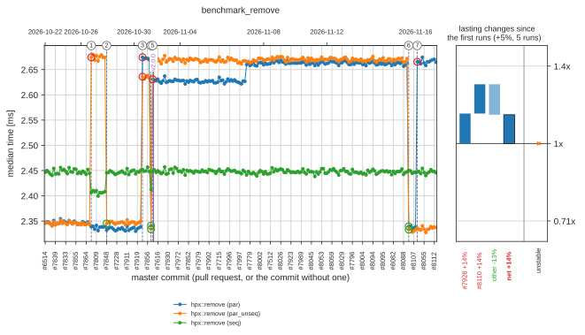

Medians that moved by more than 5% against the median of up to 3 runs before it, not reaching back past the last change (+ is slower); the numbers are those on the graph.

| # | Commit | Pull request | Measurement | Change |
| --- | --- | --- | --- | --- |
| 8 | [4aa61cac50e2](2026/medusa00/20261119T131655Z-4aa61cac50e2-b0/README.md) | [#7968](https://github.com/TheHPXProject/hpx/pull/7968) | hpx::remove (par) | -12% |
| 7 | [aae6119e6f00](2026/medusa00/20261116T003932Z-aae6119e6f00-b0/README.md) | [#8110](https://github.com/TheHPXProject/hpx/pull/8110) | hpx::remove (par) | +14% |
| 6 | [6d7dcc284f37](2026/medusa00/20261115T223105Z-6d7dcc284f37-b0/README.md) | [#7947](https://github.com/TheHPXProject/hpx/pull/7947) | hpx::remove (par) | -12% |
|  |  |  | hpx::remove (par_unseq) | -12% |
| 5 | [122f97511ef4](2026/medusa00/20261031T215646Z-122f97511ef4-b0/README.md) | [#7949](https://github.com/TheHPXProject/hpx/pull/7949) | hpx::remove (par) | +12% |
|  |  |  | hpx::remove (par_unseq) | +14% |
| 4 | [48e2d1ece9e7](2026/medusa00/20261031T215629Z-48e2d1ece9e7-b0/README.md) | [#7948](https://github.com/TheHPXProject/hpx/pull/7948) | hpx::remove (par) | -12% |
|  |  |  | hpx::remove (par_unseq) | -11% |
| 3 | [4b2db341e39e](2026/medusa00/20261031T113857Z-4b2db341e39e-b0/README.md) | [#7926](https://github.com/TheHPXProject/hpx/pull/7926) | hpx::remove (par) | +14% |
|  |  |  | hpx::remove (par_unseq) | +12% |
| 2 | [d13eb7506802](2026/medusa00/20261027T135959Z-d13eb7506802-b0/README.md) | [#7848](https://github.com/TheHPXProject/hpx/pull/7848) | hpx::remove (par_unseq) | -12% |
| 1 | [2acdd1c7de18](2026/medusa00/20261026T210937Z-2acdd1c7de18-b0/README.md) | [#7879](https://github.com/TheHPXProject/hpx/pull/7879) | hpx::remove (par_unseq) | +14% |

### benchmark_remove_if

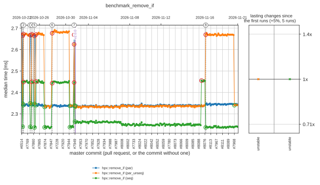

Medians that moved by more than 5% against the median of up to 3 runs before it, not reaching back past the last change (+ is slower); the numbers are those on the graph.

| # | Commit | Pull request | Measurement | Change |
| --- | --- | --- | --- | --- |
|  | [7b3a3f0fd05e](2026/medusa00/20261122T220537Z-7b3a3f0fd05e-b0/README.md) | [#8181](https://github.com/TheHPXProject/hpx/pull/8181) | hpx::remove_if (seq) | +8% |
|  | [4aa61cac50e2](2026/medusa00/20261119T131655Z-4aa61cac50e2-b0/README.md) | [#7968](https://github.com/TheHPXProject/hpx/pull/7968) | hpx::remove_if (par_unseq) | -12% |
| 8 | [aae6119e6f00](2026/medusa00/20261116T003932Z-aae6119e6f00-b0/README.md) | [#8110](https://github.com/TheHPXProject/hpx/pull/8110) | hpx::remove_if (par_unseq) | +14% |
|  |  |  | hpx::remove_if (seq) | -9% |
|  | [6d7dcc284f37](2026/medusa00/20261115T223105Z-6d7dcc284f37-b0/README.md) | [#7947](https://github.com/TheHPXProject/hpx/pull/7947) | hpx::remove_if (seq) | +9% |
|  | [122f97511ef4](2026/medusa00/20261031T215646Z-122f97511ef4-b0/README.md) | [#7949](https://github.com/TheHPXProject/hpx/pull/7949) | hpx::remove_if (par) | -12% |
|  |  |  | hpx::remove_if (par_unseq) | -11% |
|  |  |  | hpx::remove_if (seq) | -7% |
| 7 | [48e2d1ece9e7](2026/medusa00/20261031T215629Z-48e2d1ece9e7-b0/README.md) | [#7948](https://github.com/TheHPXProject/hpx/pull/7948) | hpx::remove_if (par) | +14% |
|  |  |  | hpx::remove_if (par_unseq) | +12% |
|  |  |  | hpx::remove_if (seq) | +9% |
|  | [4b2db341e39e](2026/medusa00/20261031T113857Z-4b2db341e39e-b0/README.md) | [#7926](https://github.com/TheHPXProject/hpx/pull/7926) | hpx::remove_if (par_unseq) | -13% |
|  |  |  | hpx::remove_if (seq) | -9% |
| 6 | [d13eb7506802](2026/medusa00/20261027T135959Z-d13eb7506802-b0/README.md) | [#7848](https://github.com/TheHPXProject/hpx/pull/7848) | hpx::remove_if (par_unseq) | +15% |
|  |  |  | hpx::remove_if (seq) | +9% |
|  | [2acdd1c7de18](2026/medusa00/20261026T210937Z-2acdd1c7de18-b0/README.md) | [#7879](https://github.com/TheHPXProject/hpx/pull/7879) | hpx::remove_if (par_unseq) | -13% |
|  |  |  | hpx::remove_if (seq) | -9% |
|  | [6b30e62af6bf](2026/medusa00/20261025T224510Z-6b30e62af6bf-b0/README.md) | [#7828](https://github.com/TheHPXProject/hpx/pull/7828) | hpx::remove_if (par) | -12% |
|  |  |  | hpx::remove_if (par_unseq) | +14% |
|  |  |  | hpx::remove_if (seq) | +10% |
| 5 | [47aed4f6502a](2026/medusa00/20261025T154456Z-47aed4f6502a-b16/README.md) |  | hpx::remove_if (par) | +14% |
|  |  |  | hpx::remove_if (par_unseq) | -12% |
|  |  |  | hpx::remove_if (seq) | -9% |
| 4 | [c9c9f3e1a70e](2026/medusa00/20261024T180141Z-c9c9f3e1a70e-b13/README.md) | [#7833](https://github.com/TheHPXProject/hpx/pull/7833) | hpx::remove_if (par) | -12% |
|  |  |  | hpx::remove_if (par_unseq) | +14% |
|  |  |  | hpx::remove_if (seq) | +10% |
| 3 | [f251b51f33b2](2026/medusa00/20261024T141942Z-f251b51f33b2-b11/README.md) | [#7836](https://github.com/TheHPXProject/hpx/pull/7836) | hpx::remove_if (par) | +14% |
|  |  |  | hpx::remove_if (par_unseq) | -12% |
|  |  |  | hpx::remove_if (seq) | -8% |
| 2 | [eaff5b9649bb](2026/medusa00/20261022T213041Z-eaff5b9649bb-b3/README.md) | [#7831](https://github.com/TheHPXProject/hpx/pull/7831) | hpx::remove_if (par) | -12% |
|  |  |  | hpx::remove_if (par_unseq) | +14% |
|  |  |  | hpx::remove_if (seq) | +9% |
| 1 | [7ac1a1d7b2c8](2026/medusa00/20261022T210309Z-7ac1a1d7b2c8-b2/README.md) | [#7819](https://github.com/TheHPXProject/hpx/pull/7819) | hpx::remove_if (par) | +14% |
|  |  |  | hpx::remove_if (par_unseq) | -12% |
|  |  |  | hpx::remove_if (seq) | -9% |

### extra_data_benchmark

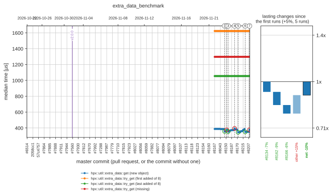

Medians that moved by more than 5% against the median of up to 3 runs before it, not reaching back past the last change (+ is slower); the numbers are those on the graph.

| # | Commit | Pull request | Measurement | Change |
| --- | --- | --- | --- | --- |
| 5 | [7dfcaca610c6](2026/medusa00/20261123T155526Z-7dfcaca610c6-b0/README.md) | [#8162](https://github.com/TheHPXProject/hpx/pull/8162) | hpx::util::extra_data::get (new object) | -9% |
| 4 | [1dbb8ae9ca59](2026/medusa00/20261123T153616Z-1dbb8ae9ca59-b0/README.md) | [#8189](https://github.com/TheHPXProject/hpx/pull/8189) | hpx::util::extra_data::get (new object) | +6% |
| 3 | [ef19302454ec](2026/medusa00/20261122T220732Z-ef19302454ec-b0/README.md) | [#8164](https://github.com/TheHPXProject/hpx/pull/8164) | hpx::util::extra_data::get (new object) | -6% |
| 2 | [7b3a3f0fd05e](2026/medusa00/20261122T220537Z-7b3a3f0fd05e-b0/README.md) | [#8181](https://github.com/TheHPXProject/hpx/pull/8181) | hpx::util::extra_data::get (new object) | +5% |
| 1 | [4241485718db](2026/medusa00/20261122T015611Z-4241485718db-b0/README.md) | [#8134](https://github.com/TheHPXProject/hpx/pull/8134) | hpx::util::extra_data::get (new object) | -7% |

### foreach_report

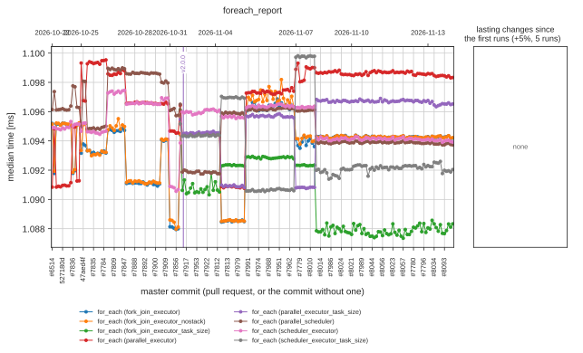

No median moved by more than 5% against the median of up to 3 runs before it, not reaching back past the last change.

### future_overhead_report

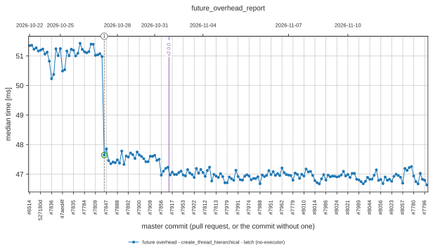

Medians that moved by more than 5% against the median of up to 3 runs before it, not reaching back past the last change (+ is slower); the numbers are those on the graph.

| # | Commit | Pull request | Measurement | Change |
| --- | --- | --- | --- | --- |
| 1 | [d6cd9372b23e](2026/medusa00/20261027T113128Z-d6cd9372b23e-b0/README.md) | [#7872](https://github.com/TheHPXProject/hpx/pull/7872) | future overhead - create_thread_hierarchical - latch (no-executor) | -7% |

### scheduler_latency_report

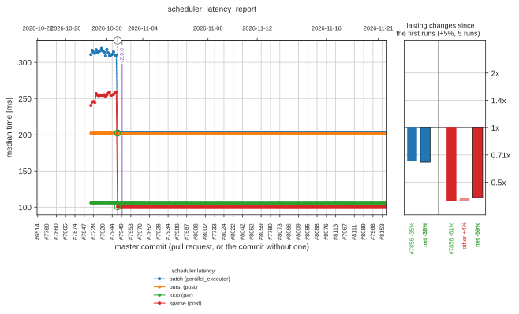

Medians that moved by more than 5% against the median of up to 3 runs before it, not reaching back past the last change (+ is slower); the numbers are those on the graph.

| # | Commit | Pull request | Measurement | Change |
| --- | --- | --- | --- | --- |
| 1 | [1a5b15496b23](2026/medusa00/20261031T151324Z-1a5b15496b23-b0/README.md) | [#7856](https://github.com/TheHPXProject/hpx/pull/7856) | scheduler latency - batch (parallel_executor) | -35% |
|  |  |  | scheduler latency - sparse (post) | -61% |

### scheduler_throughput_report

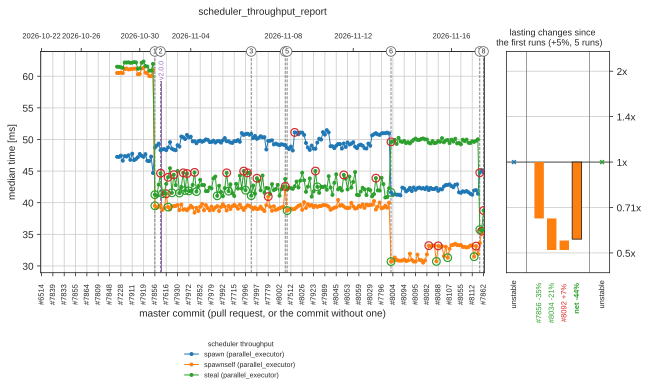

Medians that moved by more than 5% against the median of up to 3 runs before it, not reaching back past the last change (+ is slower); the numbers are those on the graph.

| # | Commit | Pull request | Measurement | Change |
| --- | --- | --- | --- | --- |
|  | [7dfcaca610c6](2026/medusa00/20261123T155526Z-7dfcaca610c6-b0/README.md) | [#8162](https://github.com/TheHPXProject/hpx/pull/8162) | scheduler throughput - spawnself (parallel_executor) | +8% |
|  | [30d07dfcd052](2026/medusa00/20261123T155346Z-30d07dfcd052-b0/README.md) | [#8170](https://github.com/TheHPXProject/hpx/pull/8170) | scheduler throughput - spawnself (parallel_executor) | -7% |
|  | [d743f131ca2d](2026/medusa00/20261121T210651Z-d743f131ca2d-b0/README.md) |  | scheduler throughput - spawnself (parallel_executor) | +6% |
|  |  |  | scheduler throughput - steal (parallel_executor) | -6% |
|  | [3af219b1e7b3](2026/medusa00/20261121T202714Z-3af219b1e7b3-b0/README.md) | [#8158](https://github.com/TheHPXProject/hpx/pull/8158) | scheduler throughput - spawnself (parallel_executor) | -5% |
| 8 | [8745b241fa76](2026/medusa00/20261121T202144Z-8745b241fa76-b0/README.md) | [#8043](https://github.com/TheHPXProject/hpx/pull/8043) | scheduler throughput - steal (parallel_executor) | +9% |
|  | [0d3ecc3f8063](2026/medusa00/20261121T195932Z-0d3ecc3f8063-b0/README.md) | [#8144](https://github.com/TheHPXProject/hpx/pull/8144) | scheduler throughput - spawnself (parallel_executor) | +6% |
|  | [161df7fc6a85](2026/medusa00/20261121T020555Z-161df7fc6a85-b0/README.md) | [#8172](https://github.com/TheHPXProject/hpx/pull/8172) | scheduler throughput - spawnself (parallel_executor) | -6% |
|  | [1865961b7646](2026/medusa00/20261119T005022Z-1865961b7646-b0/README.md) | [#8154](https://github.com/TheHPXProject/hpx/pull/8154) | scheduler throughput - spawnself (parallel_executor) | +6% |
|  | [2ad23f352fcc](2026/medusa00/20261118T173721Z-2ad23f352fcc-b0/README.md) | [#7952](https://github.com/TheHPXProject/hpx/pull/7952) | scheduler throughput - spawnself (parallel_executor) | -7% |
|  | [7d08d4adcc4d](2026/medusa00/20261118T162954Z-7d08d4adcc4d-b0/README.md) | [#8132](https://github.com/TheHPXProject/hpx/pull/8132) | scheduler throughput - spawnself (parallel_executor) | +7% |
|  | [4bb510be7551](2026/medusa00/20261118T162831Z-4bb510be7551-b0/README.md) | [#8131](https://github.com/TheHPXProject/hpx/pull/8131) | scheduler throughput - spawnself (parallel_executor) | -7% |
| 7 | [acc3e1884018](2026/medusa00/20261118T162746Z-acc3e1884018-b0/README.md) | [#8130](https://github.com/TheHPXProject/hpx/pull/8130) | scheduler throughput - spawnself (parallel_executor) | +8% |
|  |  |  | scheduler throughput - steal (parallel_executor) | -25% |
| 6 | [5e54cb5e09d5](2026/medusa00/20261118T160137Z-5e54cb5e09d5-b0/README.md) | [#8123](https://github.com/TheHPXProject/hpx/pull/8123) | scheduler throughput - spawnself (parallel_executor) | -7% |
|  |  |  | scheduler throughput - steal (parallel_executor) | +33% |
|  | [aabec893cbe6](2026/medusa00/20261117T023617Z-aabec893cbe6-b0/README.md) | [#8126](https://github.com/TheHPXProject/hpx/pull/8126) | scheduler throughput - spawnself (parallel_executor) | +6% |
|  | [9b8facdd8144](2026/medusa00/20261117T023244Z-9b8facdd8144-b0/README.md) | [#7957](https://github.com/TheHPXProject/hpx/pull/7957) | scheduler throughput - spawnself (parallel_executor) | -5% |
|  | [6a580cf3b81f](2026/medusa00/20261117T023117Z-6a580cf3b81f-b0/README.md) | [#8122](https://github.com/TheHPXProject/hpx/pull/8122) | scheduler throughput - steal (parallel_executor) | -8% |
| 5 | [52804e03f4e7](2026/medusa00/20261117T022735Z-52804e03f4e7-b0/README.md) | [#7862](https://github.com/TheHPXProject/hpx/pull/7862) | scheduler throughput - steal (parallel_executor) | +9% |
|  | [3bda6151b6d2](2026/medusa00/20261117T022429Z-3bda6151b6d2-b0/README.md) | [#8116](https://github.com/TheHPXProject/hpx/pull/8116) | scheduler throughput - spawnself (parallel_executor) | +7% |
| 4 | [231ccc883b3d](2026/medusa00/20261117T010355Z-231ccc883b3d-b0/README.md) | [#8118](https://github.com/TheHPXProject/hpx/pull/8118) | scheduler throughput - spawn (parallel_executor) | +7% |
|  |  |  | scheduler throughput - steal (parallel_executor) | -28% |
|  | [3489de476d47](2026/medusa00/20261116T235000Z-3489de476d47-b0/README.md) | [#8120](https://github.com/TheHPXProject/hpx/pull/8120) | scheduler throughput - spawnself (parallel_executor) | +5% |
|  | [4773beb14c95](2026/medusa00/20261116T234921Z-4773beb14c95-b0/README.md) | [#8121](https://github.com/TheHPXProject/hpx/pull/8121) | scheduler throughput - spawnself (parallel_executor) | -5% |
|  | [1fee59874aa1](2026/medusa00/20261115T225610Z-1fee59874aa1-b0/README.md) | [#8101](https://github.com/TheHPXProject/hpx/pull/8101) | scheduler throughput - spawnself (parallel_executor) | -5% |
|  | [a7350342afdc](2026/medusa00/20261115T164525Z-a7350342afdc-b0/README.md) | [#8088](https://github.com/TheHPXProject/hpx/pull/8088) | scheduler throughput - spawnself (parallel_executor) | +8% |
|  | [f775e8f802b0](2026/medusa00/20261115T152208Z-f775e8f802b0-b0/README.md) | [#8102](https://github.com/TheHPXProject/hpx/pull/8102) | scheduler throughput - spawnself (parallel_executor) | -8% |
|  | [41b78d5465db](2026/medusa00/20261115T142802Z-41b78d5465db-b0/README.md) | [#8092](https://github.com/TheHPXProject/hpx/pull/8092) | scheduler throughput - spawnself (parallel_executor) | +8% |
| 3 | [4df84c175b63](2026/medusa00/20261114T002158Z-4df84c175b63-b0/README.md) | [#8034](https://github.com/TheHPXProject/hpx/pull/8034) | scheduler throughput - spawn (parallel_executor) | -18% |
|  |  |  | scheduler throughput - spawnself (parallel_executor) | -22% |
|  |  |  | scheduler throughput - steal (parallel_executor) | +21% |
|  | [8793e4fb0220](2026/medusa00/20261112T175410Z-8793e4fb0220-b0/README.md) | [#8025](https://github.com/TheHPXProject/hpx/pull/8025) | scheduler throughput - steal (parallel_executor) | +6% |
|  | [4214f73cac01](2026/medusa00/20261111T191512Z-4214f73cac01-b0/README.md) | [#8056](https://github.com/TheHPXProject/hpx/pull/8056) | scheduler throughput - steal (parallel_executor) | +5% |
|  | [ddcafa39ebcd](2026/medusa00/20261110T005848Z-ddcafa39ebcd-b0/README.md) | [#8018](https://github.com/TheHPXProject/hpx/pull/8018) | scheduler throughput - steal (parallel_executor) | -6% |
|  | [1cb414b6cfbb](2026/medusa00/20261110T005757Z-1cb414b6cfbb-b0/README.md) | [#8021](https://github.com/TheHPXProject/hpx/pull/8021) | scheduler throughput - steal (parallel_executor) | +8% |
|  | [bc88ff5b8392](2026/medusa00/20261108T144211Z-bc88ff5b8392-b0/README.md) | [#7777](https://github.com/TheHPXProject/hpx/pull/7777) | scheduler throughput - spawn (parallel_executor) | +5% |
| 2 | [a9c9c753580e](2026/medusa00/20261108T143523Z-a9c9c753580e-b0/README.md) | [#8014](https://github.com/TheHPXProject/hpx/pull/8014) | scheduler throughput - spawnself (parallel_executor) | -9% |
|  | [d41f64c48c77](2026/medusa00/20261108T143240Z-d41f64c48c77-b0/README.md) | [#8012](https://github.com/TheHPXProject/hpx/pull/8012) | scheduler throughput - spawnself (parallel_executor) | +8% |
|  | [1ad403e0b145](2026/medusa00/20261107T202442Z-1ad403e0b145-b0/README.md) | [#7779](https://github.com/TheHPXProject/hpx/pull/7779) | scheduler throughput - spawnself (parallel_executor) | +5% |
|  | [67899353fad4](2026/medusa00/20261106T154630Z-67899353fad4-b0/README.md) | [#7997](https://github.com/TheHPXProject/hpx/pull/7997) | scheduler throughput - steal (parallel_executor) | +6% |
|  | [712eea2399f9](2026/medusa00/20261106T150625Z-712eea2399f9-b0/README.md) | [#7648](https://github.com/TheHPXProject/hpx/pull/7648) | scheduler throughput - steal (parallel_executor) | -8% |
|  | [ec3b59b1fa0b](2026/medusa00/20261106T150024Z-ec3b59b1fa0b-b0/README.md) | [#8001](https://github.com/TheHPXProject/hpx/pull/8001) | scheduler throughput - steal (parallel_executor) | +7% |
|  | [dbc3a665f6a0](2026/medusa00/20261106T145638Z-dbc3a665f6a0-b0/README.md) | [#7996](https://github.com/TheHPXProject/hpx/pull/7996) | scheduler throughput - steal (parallel_executor) | -7% |
|  | [b8dc6233ffc3](2026/medusa00/20261106T145549Z-b8dc6233ffc3-b0/README.md) | [#7977](https://github.com/TheHPXProject/hpx/pull/7977) | scheduler throughput - steal (parallel_executor) | +7% |
|  | [ff30aa01f64f](2026/medusa00/20261105T132136Z-ff30aa01f64f-b0/README.md) | [#7973](https://github.com/TheHPXProject/hpx/pull/7973) | scheduler throughput - steal (parallel_executor) | -6% |
|  | [326fe34cf521](2026/medusa00/20261105T032145Z-326fe34cf521-b0/README.md) | [#7934](https://github.com/TheHPXProject/hpx/pull/7934) | scheduler throughput - steal (parallel_executor) | +7% |
|  | [2469176f1309](2026/medusa00/20261104T201606Z-2469176f1309-b0/README.md) | [#7985](https://github.com/TheHPXProject/hpx/pull/7985) | scheduler throughput - steal (parallel_executor) | -6% |
|  | [3ad5bb936852](2026/medusa00/20261104T194628Z-3ad5bb936852-b0/README.md) | [#7808](https://github.com/TheHPXProject/hpx/pull/7808) | scheduler throughput - steal (parallel_executor) | -7% |
|  | [2743e92c3610](2026/medusa00/20261104T194307Z-2743e92c3610-b0/README.md) | [#7716](https://github.com/TheHPXProject/hpx/pull/7716) | scheduler throughput - steal (parallel_executor) | +7% |
|  | [e65a7a3cd7b2](2026/medusa00/20261102T200026Z-e65a7a3cd7b2-b0/README.md) | [#7972](https://github.com/TheHPXProject/hpx/pull/7972) | scheduler throughput - steal (parallel_executor) | -6% |
|  | [33a1ebcd9bdc](2026/medusa00/20261102T195916Z-33a1ebcd9bdc-b0/README.md) | [#7970](https://github.com/TheHPXProject/hpx/pull/7970) | scheduler throughput - steal (parallel_executor) | +6% |
|  | [2535af607aa7](2026/medusa00/20261102T195816Z-2535af607aa7-b0/README.md) | [#7975](https://github.com/TheHPXProject/hpx/pull/7975) | scheduler throughput - steal (parallel_executor) | -6% |
|  | [2506beb245a8](2026/medusa00/20261102T195747Z-2506beb245a8-b0/README.md) | [#7922](https://github.com/TheHPXProject/hpx/pull/7922) | scheduler throughput - steal (parallel_executor) | +6% |
|  | [b24228a15645](2026/medusa00/20261102T195129Z-b24228a15645-b0/README.md) | [#7871](https://github.com/TheHPXProject/hpx/pull/7871) | scheduler throughput - steal (parallel_executor) | -7% |
|  | [e7dcfa1a93b5](2026/medusa00/20261102T173509Z-e7dcfa1a93b5-b0/README.md) | [#7953](https://github.com/TheHPXProject/hpx/pull/7953) | scheduler throughput - steal (parallel_executor) | +7% |
|  | [0194d98a466d](2026/medusa00/20261102T153810Z-0194d98a466d-b0/README.md) | [#7959](https://github.com/TheHPXProject/hpx/pull/7959) | scheduler throughput - steal (parallel_executor) | -7% |
|  | [e8b595c1764d](2026/medusa00/20261102T152924Z-e8b595c1764d-b0/README.md) | [#7964](https://github.com/TheHPXProject/hpx/pull/7964) | scheduler throughput - spawnself (parallel_executor) | -5% |
|  |  |  | scheduler throughput - steal (parallel_executor) | +6% |
|  | [974ae9d09aad](2026/medusa00/20261102T125313Z-974ae9d09aad-b0/README.md) | [#7616](https://github.com/TheHPXProject/hpx/pull/7616) | scheduler throughput - spawnself (parallel_executor) | +6% |
|  | [7dbfb3a5067f](2026/medusa00/20261031T225539Z-7dbfb3a5067f-b0/README.md) | [#7560](https://github.com/TheHPXProject/hpx/pull/7560) | scheduler throughput - steal (parallel_executor) | -7% |
|  | [122f97511ef4](2026/medusa00/20261031T215646Z-122f97511ef4-b0/README.md) | [#7949](https://github.com/TheHPXProject/hpx/pull/7949) | scheduler throughput - steal (parallel_executor) | +8% |
| 1 | [1a5b15496b23](2026/medusa00/20261031T151324Z-1a5b15496b23-b0/README.md) | [#7856](https://github.com/TheHPXProject/hpx/pull/7856) | scheduler throughput - spawnself (parallel_executor) | -34% |
|  |  |  | scheduler throughput - steal (parallel_executor) | -32% |

### small_vector_benchmark

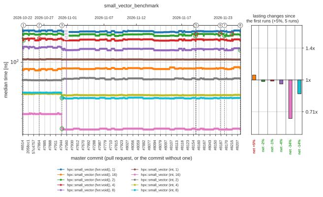

Medians that moved by more than 5% against the median of up to 3 runs before it, not reaching back past the last change (+ is slower); the numbers are those on the graph.

| # | Commit | Pull request | Measurement | Change |
| --- | --- | --- | --- | --- |
| 7 | [88df87fc49dd](2026/medusa00/20261123T153642Z-88df87fc49dd-b0/README.md) | [#8137](https://github.com/TheHPXProject/hpx/pull/8137) | hpx::small_vector (fxn:void(), 2) | -5% |
| 6 | [efd0a39c12db](2026/medusa00/20261122T221816Z-efd0a39c12db-b0/README.md) | [#8194](https://github.com/TheHPXProject/hpx/pull/8194) | hpx::small_vector (fxn:void(), 2) | +7% |
| 5 | [4aa61cac50e2](2026/medusa00/20261119T131655Z-4aa61cac50e2-b0/README.md) | [#7968](https://github.com/TheHPXProject/hpx/pull/7968) | hpx::small_vector (fxn:void(), 2) | +6% |
| 4 | [4d190f95f1fe](2026/medusa00/20261119T131631Z-4d190f95f1fe-b0/README.md) | [#8117](https://github.com/TheHPXProject/hpx/pull/8117) | hpx::small_vector (fxn:void(), 2) | -5% |
| 3 | [4b2db341e39e](2026/medusa00/20261031T113857Z-4b2db341e39e-b0/README.md) | [#7926](https://github.com/TheHPXProject/hpx/pull/7926) | hpx::small_vector (int, 16) | -34% |
|  |  |  | hpx::small_vector (int, 8) | -14% |
| 2 | [ff9e673a5887](2026/medusa00/20261026T102649Z-ff9e673a5887-b0/README.md) | [#7864](https://github.com/TheHPXProject/hpx/pull/7864) | hpx::small_vector (fxn:void(), 4) | +5% |
| 1 | [7ac1a1d7b2c8](2026/medusa00/20261022T210309Z-7ac1a1d7b2c8-b2/README.md) | [#7819](https://github.com/TheHPXProject/hpx/pull/7819) | hpx::small_vector (fxn:void(), 4) | -5% |

### stream_report

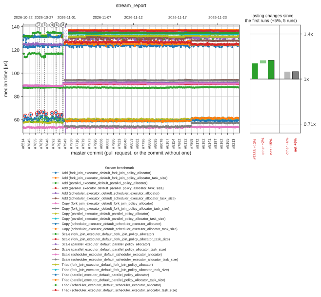

Medians that moved by more than 5% against the median of up to 3 runs before it, not reaching back past the last change (+ is slower); the numbers are those on the graph.

| # | Commit | Pull request | Measurement | Change |
| --- | --- | --- | --- | --- |
| 8 | [1a5b15496b23](2026/medusa00/20261031T151324Z-1a5b15496b23-b0/README.md) | [#7856](https://github.com/TheHPXProject/hpx/pull/7856) | Stream benchmark - Add (parallel_executor_default_parallel_policy_allocator) | +13% |
| 7 | [85ed2bc23e4d](2026/medusa00/20261031T114057Z-85ed2bc23e4d-b0/README.md) | [#7918](https://github.com/TheHPXProject/hpx/pull/7918) | stream benchmark - Copy (scheduler_executor_default_scheduler_executor_allocator) | -8% |
|  | [4b2db341e39e](2026/medusa00/20261031T113857Z-4b2db341e39e-b0/README.md) | [#7926](https://github.com/TheHPXProject/hpx/pull/7926) | stream benchmark - Copy (scheduler_executor_default_scheduler_executor_allocator) | +5% |
|  | [9a73996f52ab](2026/medusa00/20261030T132448Z-9a73996f52ab-b0/README.md) | [#7919](https://github.com/TheHPXProject/hpx/pull/7919) | stream benchmark - Copy (scheduler_executor_default_scheduler_executor_allocator) | -7% |
|  | [965e3686171a](2026/medusa00/20261030T131743Z-965e3686171a-b0/README.md) | [#7925](https://github.com/TheHPXProject/hpx/pull/7925) | stream benchmark - Copy (scheduler_executor_default_scheduler_executor_allocator) | +7% |
| 6 | [e8727ab5a0e9](2026/medusa00/20261029T205016Z-e8727ab5a0e9-b0/README.md) | [#7900](https://github.com/TheHPXProject/hpx/pull/7900) | stream benchmark - Copy (scheduler_executor_default_scheduler_executor_allocator) | -10% |
| 5 | [2152675212c2](2026/medusa00/20261029T133842Z-2152675212c2-b0/README.md) | [#7920](https://github.com/TheHPXProject/hpx/pull/7920) | stream benchmark - Copy (scheduler_executor_default_scheduler_executor_allocator) | +9% |
|  | [f28fd29c4c7f](2026/medusa00/20261028T202642Z-f28fd29c4c7f-b0/README.md) | [#7899](https://github.com/TheHPXProject/hpx/pull/7899) | stream benchmark - Copy (scheduler_executor_default_scheduler_executor_allocator) | -7% |
| 4 | [126b843be369](2026/medusa00/20261028T202529Z-126b843be369-b0/README.md) | [#7903](https://github.com/TheHPXProject/hpx/pull/7903) | stream benchmark - Copy (scheduler_executor_default_scheduler_executor_allocator) | +8% |
|  | [440a78d5bbb4](2026/medusa00/20261027T115041Z-440a78d5bbb4-b0/README.md) | [#7847](https://github.com/TheHPXProject/hpx/pull/7847) | stream benchmark - Copy (scheduler_executor_default_scheduler_executor_allocator) | -6% |
|  | [d6cd9372b23e](2026/medusa00/20261027T113128Z-d6cd9372b23e-b0/README.md) | [#7872](https://github.com/TheHPXProject/hpx/pull/7872) | stream benchmark - Copy (scheduler_executor_default_scheduler_executor_allocator) | +7% |
| 3 | [7b6478fb3fbd](2026/medusa00/20261027T112948Z-7b6478fb3fbd-b0/README.md) | [#7885](https://github.com/TheHPXProject/hpx/pull/7885) | stream benchmark - Copy (scheduler_executor_default_scheduler_executor_allocator) | -10% |
|  | [0bb4fe759234](2026/medusa00/20261026T212323Z-0bb4fe759234-b0/README.md) | [#7809](https://github.com/TheHPXProject/hpx/pull/7809) | stream benchmark - Copy (scheduler_executor_default_scheduler_executor_allocator) | +6% |
|  | [b07138598e83](2026/medusa00/20261026T210849Z-b07138598e83-b0/README.md) | [#7883](https://github.com/TheHPXProject/hpx/pull/7883) | stream benchmark - Copy (scheduler_executor_default_scheduler_executor_allocator) | -7% |
| 2 | [ff9e673a5887](2026/medusa00/20261026T102649Z-ff9e673a5887-b0/README.md) | [#7864](https://github.com/TheHPXProject/hpx/pull/7864) | stream benchmark - Copy (scheduler_executor_default_scheduler_executor_allocator) | +11% |
| 1 | [fb5b51af387b](2026/medusa00/20261026T102522Z-fb5b51af387b-b0/README.md) | [#7867](https://github.com/TheHPXProject/hpx/pull/7867) | stream benchmark - Copy (scheduler_executor_default_scheduler_executor_allocator) | -9% |
|  | [fef31456e98a](2026/medusa00/20261026T102437Z-fef31456e98a-b0/README.md) | [#7865](https://github.com/TheHPXProject/hpx/pull/7865) | stream benchmark - Copy (scheduler_executor_default_scheduler_executor_allocator) | +7% |
|  | [585b332c4aeb](2026/medusa00/20261024T215359Z-585b332c4aeb-b14/README.md) | [#7858](https://github.com/TheHPXProject/hpx/pull/7858) | stream benchmark - Copy (scheduler_executor_default_scheduler_executor_allocator) | -6% |
|  | [9afb016babde](2026/medusa00/20261024T143201Z-9afb016babde-b12/README.md) | [#7787](https://github.com/TheHPXProject/hpx/pull/7787) | stream benchmark - Copy (scheduler_executor_default_scheduler_executor_allocator) | +7% |
|  | [cacea4d26116](2026/medusa00/20261023T112554Z-cacea4d26116-b4/README.md) | [#7829](https://github.com/TheHPXProject/hpx/pull/7829) | stream benchmark - Copy (scheduler_executor_default_scheduler_executor_allocator) | +7% |

### transform_reduce_scaling

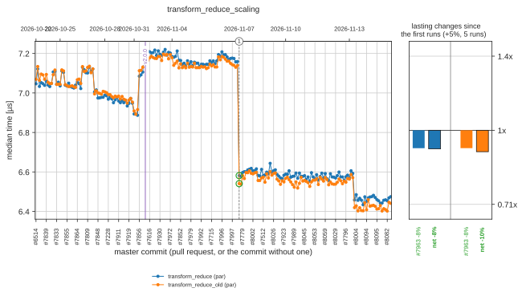

Medians that moved by more than 5% against the median of up to 3 runs before it, not reaching back past the last change (+ is slower); the numbers are those on the graph.

| # | Commit | Pull request | Measurement | Change |
| --- | --- | --- | --- | --- |
| 1 | [f7df98473ccc](2026/medusa00/20261107T201452Z-f7df98473ccc-b0/README.md) | [#7963](https://github.com/TheHPXProject/hpx/pull/7963) | transform_reduce (par) | -8% |
|  |  |  | transform_reduce_old (par) | -8% |

## License

Distributed under the Boost Software License, Version 1.0, see [LICENSE_1_0.txt](LICENSE_1_0.txt).
