# HPX performance history

The results of the performance tests of [HPX](https://github.com/TheHPXProject/hpx) for the commits of its master branch, measured by its Jenkins CI on the Rostam cluster at LSU (see `.jenkins/lsu-perftests` and `tools/perftests_ci` in the HPX repository). The graphs below show the median time of every measurement over the master commits in their order, labeled with their pull requests (or the commits without one); lower is faster. The table below each graph lists the commits after which a median changed, the numbered commits are marked on the graph, and the ringed points are the medians that changed (red slower, green faster).

## Layout

- `<year>/<node>/<commit date>-<commit>-b<build>/`: one run, with its report (`README.md`), the commit, when and where the benchmarks ran and the configuration (`metadata.json`), the medians of all measurements (`summary.json`), the results of all benchmarks as measured (`results.tar.gz`), and the comparison with the references of the node.
- `runs.tsv`: all runs. `timeline.csv`: the medians of all measurements of all runs, as written by `tools/perftests_ci/perftests_history.py`, which rebuilds it from the run directories. `timeline/`: the graphs below, drawn by `tools/perftests_ci/perftests_timeline.py`.

## Runs

- [2026](2026/README.md)

## Performance over time

### benchmark_inplace_merge

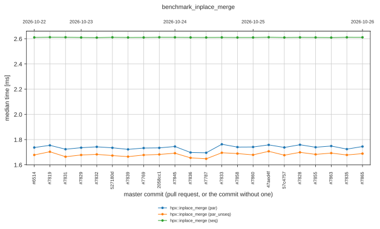

No median moved by more than 5% against the median of the 3 runs before it.

### benchmark_is_heap

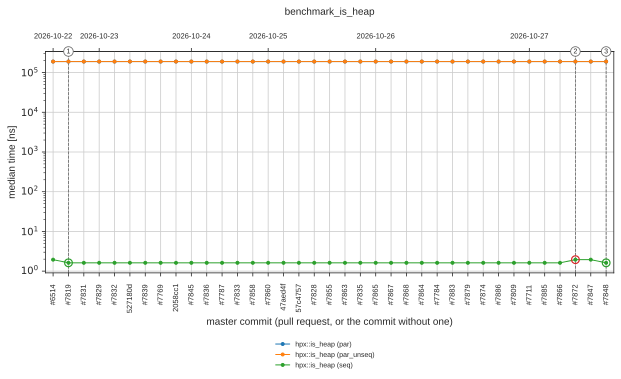

Medians that moved by more than 5% against the median of the 3 runs before them (+ is slower); the numbers are those on the graph.

| # | Commit | Pull request | Measurement | Change |
| --- | --- | --- | --- | --- |
| 1 | [7ac1a1d7b2c8](2026/medusa00/20261022T210309Z-7ac1a1d7b2c8-b2/README.md) | [#7819](https://github.com/TheHPXProject/hpx/pull/7819) | hpx::is_heap (seq) | -17% |

### benchmark_is_heap_until

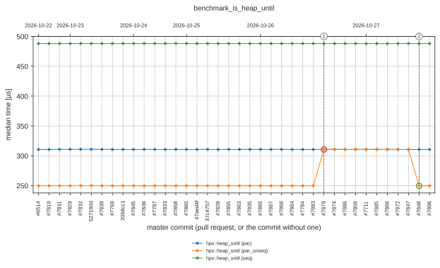

Medians that moved by more than 5% against the median of the 3 runs before them (+ is slower); the numbers are those on the graph.

| # | Commit | Pull request | Measurement | Change |
| --- | --- | --- | --- | --- |
| 1 | [2acdd1c7de18](2026/medusa00/20261026T210937Z-2acdd1c7de18-b0/README.md) | [#7879](https://github.com/TheHPXProject/hpx/pull/7879) | hpx::heap_until (par_unseq) | +24% |

### benchmark_merge

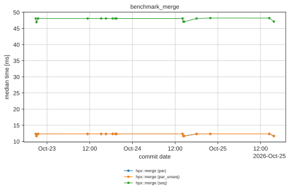

Medians that moved by more than 5% against the median of the 3 runs before them (+ is slower); the numbers are those on the graph.

| # | Commit | Pull request | Measurement | Change |
| --- | --- | --- | --- | --- |
| 7 | [2acdd1c7de18](2026/medusa00/20261026T210937Z-2acdd1c7de18-b0/README.md) | [#7879](https://github.com/TheHPXProject/hpx/pull/7879) | hpx::merge (par_unseq) | -5% |
| 6 | [6b30e62af6bf](2026/medusa00/20261025T224510Z-6b30e62af6bf-b0/README.md) | [#7828](https://github.com/TheHPXProject/hpx/pull/7828) | hpx::merge (par) | +6% |
|  |  |  | hpx::merge (par_unseq) | +6% |
| 5 | [47aed4f6502a](2026/medusa00/20261025T154456Z-47aed4f6502a-b16/README.md) |  | hpx::merge (par) | -5% |
|  |  |  | hpx::merge (par_unseq) | -5% |
| 4 | [c9c9f3e1a70e](2026/medusa00/20261024T180141Z-c9c9f3e1a70e-b13/README.md) | [#7833](https://github.com/TheHPXProject/hpx/pull/7833) | hpx::merge (par) | +6% |
|  |  |  | hpx::merge (par_unseq) | +6% |
| 3 | [f251b51f33b2](2026/medusa00/20261024T141942Z-f251b51f33b2-b11/README.md) | [#7836](https://github.com/TheHPXProject/hpx/pull/7836) | hpx::merge (par) | -5% |
|  |  |  | hpx::merge (par_unseq) | -5% |
| 2 | [eaff5b9649bb](2026/medusa00/20261022T213041Z-eaff5b9649bb-b3/README.md) | [#7831](https://github.com/TheHPXProject/hpx/pull/7831) | hpx::merge (par) | +6% |
|  |  |  | hpx::merge (par_unseq) | +6% |
| 1 | [7ac1a1d7b2c8](2026/medusa00/20261022T210309Z-7ac1a1d7b2c8-b2/README.md) | [#7819](https://github.com/TheHPXProject/hpx/pull/7819) | hpx::merge (par) | -5% |
|  |  |  | hpx::merge (par_unseq) | -5% |

### benchmark_nth_element

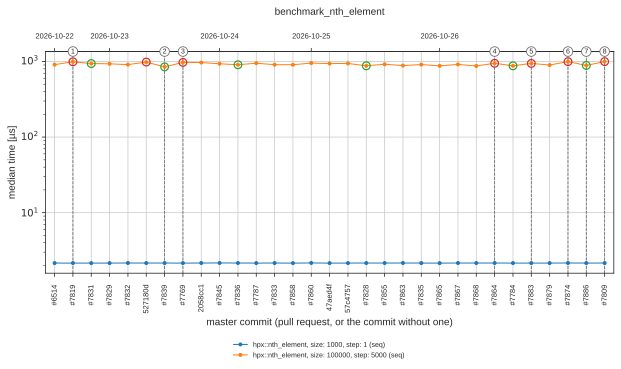

Medians that moved by more than 5% against the median of the 3 runs before them (+ is slower); the numbers are those on the graph.

| # | Commit | Pull request | Measurement | Change |
| --- | --- | --- | --- | --- |
| 8 | [9508ff15ff41](2026/medusa00/20261027T112827Z-9508ff15ff41-b0/README.md) | [#7711](https://github.com/TheHPXProject/hpx/pull/7711) | hpx::nth_element, size: 100000, step: 5000 (seq) | -9% |
| 7 | [0bb4fe759234](2026/medusa00/20261026T212323Z-0bb4fe759234-b0/README.md) | [#7809](https://github.com/TheHPXProject/hpx/pull/7809) | hpx::nth_element, size: 100000, step: 5000 (seq) | +12% |
| 6 | [9925ce705b23](2026/medusa00/20261026T211303Z-9925ce705b23-b0/README.md) | [#7886](https://github.com/TheHPXProject/hpx/pull/7886) | hpx::nth_element, size: 100000, step: 5000 (seq) | -11% |
| 5 | [924c62330602](2026/medusa00/20261026T211221Z-924c62330602-b0/README.md) | [#7874](https://github.com/TheHPXProject/hpx/pull/7874) | hpx::nth_element, size: 100000, step: 5000 (seq) | +8% |
|  | [b07138598e83](2026/medusa00/20261026T210849Z-b07138598e83-b0/README.md) | [#7883](https://github.com/TheHPXProject/hpx/pull/7883) | hpx::nth_element, size: 100000, step: 5000 (seq) | +8% |
|  | [55ef914598c3](2026/medusa00/20261026T104728Z-55ef914598c3-b0/README.md) | [#7784](https://github.com/TheHPXProject/hpx/pull/7784) | hpx::nth_element, size: 100000, step: 5000 (seq) | -7% |
| 4 | [ff9e673a5887](2026/medusa00/20261026T102649Z-ff9e673a5887-b0/README.md) | [#7864](https://github.com/TheHPXProject/hpx/pull/7864) | hpx::nth_element, size: 100000, step: 5000 (seq) | +8% |
|  | [6b30e62af6bf](2026/medusa00/20261025T224510Z-6b30e62af6bf-b0/README.md) | [#7828](https://github.com/TheHPXProject/hpx/pull/7828) | hpx::nth_element, size: 100000, step: 5000 (seq) | -7% |
|  | [f251b51f33b2](2026/medusa00/20261024T141942Z-f251b51f33b2-b11/README.md) | [#7836](https://github.com/TheHPXProject/hpx/pull/7836) | hpx::nth_element, size: 100000, step: 5000 (seq) | -6% |
| 3 | [076e45a6ceb9](2026/medusa00/20261023T191320Z-076e45a6ceb9-b8/README.md) | [#7769](https://github.com/TheHPXProject/hpx/pull/7769) | hpx::nth_element, size: 100000, step: 5000 (seq) | +15% |
| 2 | [b5f65f9bbb3f](2026/medusa00/20261023T182839Z-b5f65f9bbb3f-b7/README.md) | [#7839](https://github.com/TheHPXProject/hpx/pull/7839) | hpx::nth_element, size: 100000, step: 5000 (seq) | -14% |
|  | [527180d0b6af](2026/medusa00/20261023T163358Z-527180d0b6af-b6/README.md) |  | hpx::nth_element, size: 100000, step: 5000 (seq) | +5% |
|  | [eaff5b9649bb](2026/medusa00/20261022T213041Z-eaff5b9649bb-b3/README.md) | [#7831](https://github.com/TheHPXProject/hpx/pull/7831) | hpx::nth_element, size: 100000, step: 5000 (seq) | -5% |
| 1 | [7ac1a1d7b2c8](2026/medusa00/20261022T210309Z-7ac1a1d7b2c8-b2/README.md) | [#7819](https://github.com/TheHPXProject/hpx/pull/7819) | hpx::nth_element, size: 100000, step: 5000 (seq) | +9% |

### benchmark_nth_element_parallel

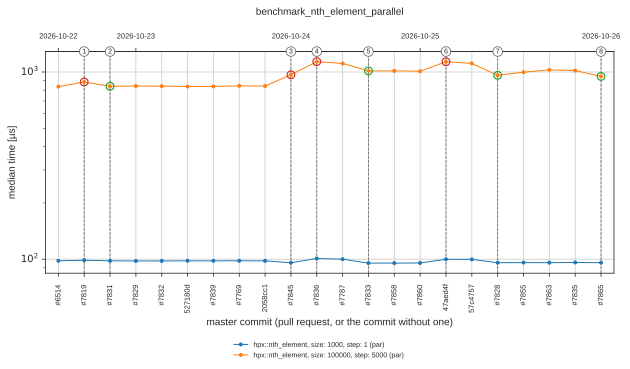

Medians that moved by more than 5% against the median of the 3 runs before them (+ is slower); the numbers are those on the graph.

| # | Commit | Pull request | Measurement | Change |
| --- | --- | --- | --- | --- |
| 8 | [2acdd1c7de18](2026/medusa00/20261026T210937Z-2acdd1c7de18-b0/README.md) | [#7879](https://github.com/TheHPXProject/hpx/pull/7879) | hpx::nth_element, size: 100000, step: 5000 (par) | -10% |
|  | [b07138598e83](2026/medusa00/20261026T210849Z-b07138598e83-b0/README.md) | [#7883](https://github.com/TheHPXProject/hpx/pull/7883) | hpx::nth_element, size: 100000, step: 5000 (par) | -6% |
| 7 | [55ef914598c3](2026/medusa00/20261026T104728Z-55ef914598c3-b0/README.md) | [#7784](https://github.com/TheHPXProject/hpx/pull/7784) | hpx::nth_element, size: 100000, step: 5000 (par) | +18% |
| 6 | [ff9e673a5887](2026/medusa00/20261026T102649Z-ff9e673a5887-b0/README.md) | [#7864](https://github.com/TheHPXProject/hpx/pull/7864) | hpx::nth_element, size: 100000, step: 5000 (par) | -12% |
|  | [fef31456e98a](2026/medusa00/20261026T102437Z-fef31456e98a-b0/README.md) | [#7865](https://github.com/TheHPXProject/hpx/pull/7865) | hpx::nth_element, size: 100000, step: 5000 (par) | -7% |
| 5 | [6b30e62af6bf](2026/medusa00/20261025T224510Z-6b30e62af6bf-b0/README.md) | [#7828](https://github.com/TheHPXProject/hpx/pull/7828) | hpx::nth_element, size: 100000, step: 5000 (par) | -15% |
| 4 | [47aed4f6502a](2026/medusa00/20261025T154456Z-47aed4f6502a-b16/README.md) |  | hpx::nth_element, size: 100000, step: 5000 (par) | +12% |
| 3 | [c9c9f3e1a70e](2026/medusa00/20261024T180141Z-c9c9f3e1a70e-b13/README.md) | [#7833](https://github.com/TheHPXProject/hpx/pull/7833) | hpx::nth_element, size: 100000, step: 5000 (par) | -10% |
| 2 | [f251b51f33b2](2026/medusa00/20261024T141942Z-f251b51f33b2-b11/README.md) | [#7836](https://github.com/TheHPXProject/hpx/pull/7836) | hpx::nth_element, size: 100000, step: 5000 (par) | +17% |
| 1 | [5741795e5c3a](2026/medusa00/20261024T140557Z-5741795e5c3a-b10/README.md) | [#7845](https://github.com/TheHPXProject/hpx/pull/7845) | hpx::nth_element, size: 100000, step: 5000 (par) | +15% |
|  | [eaff5b9649bb](2026/medusa00/20261022T213041Z-eaff5b9649bb-b3/README.md) | [#7831](https://github.com/TheHPXProject/hpx/pull/7831) | hpx::nth_element, size: 100000, step: 5000 (par) | -5% |
|  | [7ac1a1d7b2c8](2026/medusa00/20261022T210309Z-7ac1a1d7b2c8-b2/README.md) | [#7819](https://github.com/TheHPXProject/hpx/pull/7819) | hpx::nth_element, size: 100000, step: 5000 (par) | +6% |

### benchmark_partial_sort

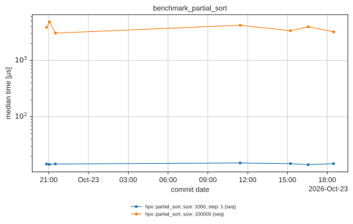

Medians that moved by more than 5% against the median of the 3 runs before them (+ is slower); the numbers are those on the graph.

| # | Commit | Pull request | Measurement | Change |
| --- | --- | --- | --- | --- |
|  | [9508ff15ff41](2026/medusa00/20261027T112827Z-9508ff15ff41-b0/README.md) | [#7711](https://github.com/TheHPXProject/hpx/pull/7711) | hpx::partial_sort, size: 100000 (seq) | +21% |
|  | [0bb4fe759234](2026/medusa00/20261026T212323Z-0bb4fe759234-b0/README.md) | [#7809](https://github.com/TheHPXProject/hpx/pull/7809) | hpx::partial_sort, size: 100000 (seq) | -21% |
|  | [2acdd1c7de18](2026/medusa00/20261026T210937Z-2acdd1c7de18-b0/README.md) | [#7879](https://github.com/TheHPXProject/hpx/pull/7879) | hpx::partial_sort, size: 100000 (seq) | +16% |
|  | [55ef914598c3](2026/medusa00/20261026T104728Z-55ef914598c3-b0/README.md) | [#7784](https://github.com/TheHPXProject/hpx/pull/7784) | hpx::partial_sort, size: 100000 (seq) | +11% |
|  | [ff9e673a5887](2026/medusa00/20261026T102649Z-ff9e673a5887-b0/README.md) | [#7864](https://github.com/TheHPXProject/hpx/pull/7864) | hpx::partial_sort, size: 100000 (seq) | -19% |
|  | [fef31456e98a](2026/medusa00/20261026T102437Z-fef31456e98a-b0/README.md) | [#7865](https://github.com/TheHPXProject/hpx/pull/7865) | hpx::partial_sort, size: 100000 (seq) | -7% |
|  | [1097623840cb](2026/medusa00/20261025T224947Z-1097623840cb-b0/README.md) | [#7835](https://github.com/TheHPXProject/hpx/pull/7835) | hpx::partial_sort, size: 100000 (seq) | +13% |
|  | [6f0a12845a8e](2026/medusa00/20261025T224830Z-6f0a12845a8e-b0/README.md) | [#7863](https://github.com/TheHPXProject/hpx/pull/7863) | hpx::partial_sort, size: 100000 (seq) | +13% |
| 8 | [6b30e62af6bf](2026/medusa00/20261025T224510Z-6b30e62af6bf-b0/README.md) | [#7828](https://github.com/TheHPXProject/hpx/pull/7828) | hpx::partial_sort, size: 100000 (seq) | -26% |
| 7 | [57c47578605f](2026/medusa00/20261025T164831Z-57c47578605f-b17/README.md) |  | hpx::partial_sort, size: 1000, step: 1 (seq) | +6% |
|  |  |  | hpx::partial_sort, size: 100000 (seq) | +29% |
| 6 | [27381afefe1f](2026/medusa00/20261025T142714Z-27381afefe1f-b15/README.md) | [#7860](https://github.com/TheHPXProject/hpx/pull/7860) | hpx::partial_sort, size: 100000 (seq) | -29% |
| 5 | [585b332c4aeb](2026/medusa00/20261024T215359Z-585b332c4aeb-b14/README.md) | [#7858](https://github.com/TheHPXProject/hpx/pull/7858) | hpx::partial_sort, size: 100000 (seq) | +53% |
|  | [c9c9f3e1a70e](2026/medusa00/20261024T180141Z-c9c9f3e1a70e-b13/README.md) | [#7833](https://github.com/TheHPXProject/hpx/pull/7833) | hpx::partial_sort, size: 100000 (seq) | -22% |
| 4 | [5741795e5c3a](2026/medusa00/20261024T140557Z-5741795e5c3a-b10/README.md) | [#7845](https://github.com/TheHPXProject/hpx/pull/7845) | hpx::partial_sort, size: 100000 (seq) | +25% |
|  | [2058cc119343](2026/medusa00/20261023T193102Z-2058cc119343-b9/README.md) |  | hpx::partial_sort, size: 100000 (seq) | -23% |
| 3 | [076e45a6ceb9](2026/medusa00/20261023T191320Z-076e45a6ceb9-b8/README.md) | [#7769](https://github.com/TheHPXProject/hpx/pull/7769) | hpx::partial_sort, size: 100000 (seq) | +31% |
|  | [b5f65f9bbb3f](2026/medusa00/20261023T182839Z-b5f65f9bbb3f-b7/README.md) | [#7839](https://github.com/TheHPXProject/hpx/pull/7839) | hpx::partial_sort, size: 100000 (seq) | -19% |
|  | [527180d0b6af](2026/medusa00/20261023T163358Z-527180d0b6af-b6/README.md) |  | hpx::partial_sort, size: 100000 (seq) | +18% |
|  | [85b03a1f4663](2026/medusa00/20261023T151352Z-85b03a1f4663-b5/README.md) | [#7832](https://github.com/TheHPXProject/hpx/pull/7832) | hpx::partial_sort, size: 100000 (seq) | -20% |
| 2 | [cacea4d26116](2026/medusa00/20261023T112554Z-cacea4d26116-b4/README.md) | [#7829](https://github.com/TheHPXProject/hpx/pull/7829) | hpx::partial_sort, size: 100000 (seq) | +38% |
| 1 | [eaff5b9649bb](2026/medusa00/20261022T213041Z-eaff5b9649bb-b3/README.md) | [#7831](https://github.com/TheHPXProject/hpx/pull/7831) | hpx::partial_sort, size: 100000 (seq) | -37% |
|  | [7ac1a1d7b2c8](2026/medusa00/20261022T210309Z-7ac1a1d7b2c8-b2/README.md) | [#7819](https://github.com/TheHPXProject/hpx/pull/7819) | hpx::partial_sort, size: 100000 (seq) | +25% |

### benchmark_partial_sort_parallel

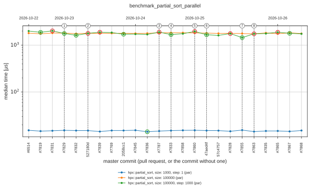

Medians that moved by more than 5% against the median of the 3 runs before them (+ is slower); the numbers are those on the graph.

| # | Commit | Pull request | Measurement | Change |
| --- | --- | --- | --- | --- |
| 8 | [2acdd1c7de18](2026/medusa00/20261026T210937Z-2acdd1c7de18-b0/README.md) | [#7879](https://github.com/TheHPXProject/hpx/pull/7879) | hpx::partial_sort, size: 100000, step: 1000 (par) | -13% |
|  | [b07138598e83](2026/medusa00/20261026T210849Z-b07138598e83-b0/README.md) | [#7883](https://github.com/TheHPXProject/hpx/pull/7883) | hpx::partial_sort, size: 100000, step: 1000 (par) | +5% |
|  | [55ef914598c3](2026/medusa00/20261026T104728Z-55ef914598c3-b0/README.md) | [#7784](https://github.com/TheHPXProject/hpx/pull/7784) | hpx::partial_sort, size: 100000, step: 1000 (par) | -11% |
| 7 | [ff9e673a5887](2026/medusa00/20261026T102649Z-ff9e673a5887-b0/README.md) | [#7864](https://github.com/TheHPXProject/hpx/pull/7864) | hpx::partial_sort, size: 100000, step: 1000 (par) | +12% |
|  | [fb5b51af387b](2026/medusa00/20261026T102522Z-fb5b51af387b-b0/README.md) | [#7867](https://github.com/TheHPXProject/hpx/pull/7867) | hpx::partial_sort, size: 100000, step: 1000 (par) | -5% |
|  | [fef31456e98a](2026/medusa00/20261026T102437Z-fef31456e98a-b0/README.md) | [#7865](https://github.com/TheHPXProject/hpx/pull/7865) | hpx::partial_sort, size: 100000, step: 1000 (par) | +7% |
| 6 | [6f0a12845a8e](2026/medusa00/20261025T224830Z-6f0a12845a8e-b0/README.md) | [#7863](https://github.com/TheHPXProject/hpx/pull/7863) | hpx::partial_sort, size: 100000, step: 1000 (par) | +21% |
| 5 | [04ee6268abd7](2026/medusa00/20261025T224744Z-04ee6268abd7-b0/README.md) | [#7855](https://github.com/TheHPXProject/hpx/pull/7855) | hpx::partial_sort, size: 100000, step: 1000 (par) | -18% |
|  | [6b30e62af6bf](2026/medusa00/20261025T224510Z-6b30e62af6bf-b0/README.md) | [#7828](https://github.com/TheHPXProject/hpx/pull/7828) | hpx::partial_sort, size: 100000, step: 1000 (par) | +8% |
| 4 | [47aed4f6502a](2026/medusa00/20261025T154456Z-47aed4f6502a-b16/README.md) |  | hpx::partial_sort, size: 100000, step: 1000 (par) | -15% |
| 3 | [27381afefe1f](2026/medusa00/20261025T142714Z-27381afefe1f-b15/README.md) | [#7860](https://github.com/TheHPXProject/hpx/pull/7860) | hpx::partial_sort, size: 100000, step: 1000 (par) | +14% |
| 2 | [c9c9f3e1a70e](2026/medusa00/20261024T180141Z-c9c9f3e1a70e-b13/README.md) | [#7833](https://github.com/TheHPXProject/hpx/pull/7833) | hpx::partial_sort, size: 100000, step: 1000 (par) | -11% |
|  | [9afb016babde](2026/medusa00/20261024T143201Z-9afb016babde-b12/README.md) | [#7787](https://github.com/TheHPXProject/hpx/pull/7787) | hpx::partial_sort, size: 100000, step: 1000 (par) | +11% |
|  | [f251b51f33b2](2026/medusa00/20261024T141942Z-f251b51f33b2-b11/README.md) | [#7836](https://github.com/TheHPXProject/hpx/pull/7836) | hpx::partial_sort, size: 1000, step: 1 (par) | -6% |
|  | [2058cc119343](2026/medusa00/20261023T193102Z-2058cc119343-b9/README.md) |  | hpx::partial_sort, size: 100000, step: 1000 (par) | -9% |
|  | [b5f65f9bbb3f](2026/medusa00/20261023T182839Z-b5f65f9bbb3f-b7/README.md) | [#7839](https://github.com/TheHPXProject/hpx/pull/7839) | hpx::partial_sort, size: 100000, step: 1000 (par) | +6% |
|  | [527180d0b6af](2026/medusa00/20261023T163358Z-527180d0b6af-b6/README.md) |  | hpx::partial_sort, size: 100000, step: 1000 (par) | +10% |
|  | [85b03a1f4663](2026/medusa00/20261023T151352Z-85b03a1f4663-b5/README.md) | [#7832](https://github.com/TheHPXProject/hpx/pull/7832) | hpx::partial_sort, size: 100000, step: 1000 (par) | -8% |
| 1 | [cacea4d26116](2026/medusa00/20261023T112554Z-cacea4d26116-b4/README.md) | [#7829](https://github.com/TheHPXProject/hpx/pull/7829) | hpx::partial_sort, size: 100000, step: 1000 (par) | -12% |
|  | [eaff5b9649bb](2026/medusa00/20261022T213041Z-eaff5b9649bb-b3/README.md) | [#7831](https://github.com/TheHPXProject/hpx/pull/7831) | hpx::partial_sort, size: 100000, step: 1000 (par) | +7% |
|  | [7ac1a1d7b2c8](2026/medusa00/20261022T210309Z-7ac1a1d7b2c8-b2/README.md) | [#7819](https://github.com/TheHPXProject/hpx/pull/7819) | hpx::partial_sort, size: 100000, step: 1000 (par) | -6% |

### benchmark_remove

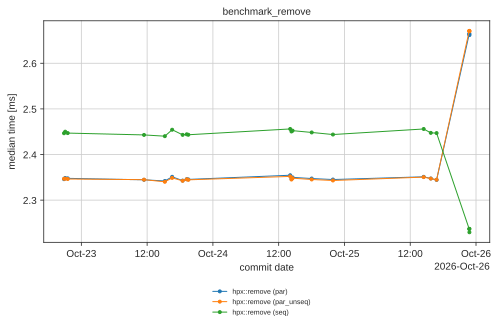

Medians that moved by more than 5% against the median of the 3 runs before them (+ is slower); the numbers are those on the graph.

| # | Commit | Pull request | Measurement | Change |
| --- | --- | --- | --- | --- |
| 1 | [2acdd1c7de18](2026/medusa00/20261026T210937Z-2acdd1c7de18-b0/README.md) | [#7879](https://github.com/TheHPXProject/hpx/pull/7879) | hpx::remove (par_unseq) | +14% |

### benchmark_remove_if

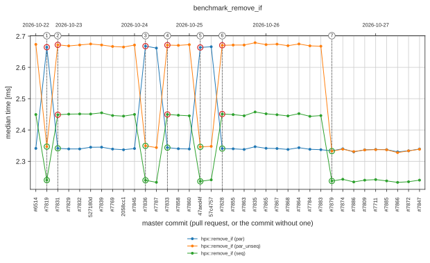

Medians that moved by more than 5% against the median of the 3 runs before them (+ is slower); the numbers are those on the graph.

| # | Commit | Pull request | Measurement | Change |
| --- | --- | --- | --- | --- |
| 7 | [2acdd1c7de18](2026/medusa00/20261026T210937Z-2acdd1c7de18-b0/README.md) | [#7879](https://github.com/TheHPXProject/hpx/pull/7879) | hpx::remove_if (par_unseq) | -13% |
|  |  |  | hpx::remove_if (seq) | -9% |
| 6 | [6b30e62af6bf](2026/medusa00/20261025T224510Z-6b30e62af6bf-b0/README.md) | [#7828](https://github.com/TheHPXProject/hpx/pull/7828) | hpx::remove_if (par) | -12% |
|  |  |  | hpx::remove_if (par_unseq) | +14% |
|  |  |  | hpx::remove_if (seq) | +10% |
| 5 | [47aed4f6502a](2026/medusa00/20261025T154456Z-47aed4f6502a-b16/README.md) |  | hpx::remove_if (par) | +14% |
|  |  |  | hpx::remove_if (par_unseq) | -12% |
|  |  |  | hpx::remove_if (seq) | -9% |
| 4 | [c9c9f3e1a70e](2026/medusa00/20261024T180141Z-c9c9f3e1a70e-b13/README.md) | [#7833](https://github.com/TheHPXProject/hpx/pull/7833) | hpx::remove_if (par) | -12% |
|  |  |  | hpx::remove_if (par_unseq) | +14% |
|  |  |  | hpx::remove_if (seq) | +10% |
| 3 | [f251b51f33b2](2026/medusa00/20261024T141942Z-f251b51f33b2-b11/README.md) | [#7836](https://github.com/TheHPXProject/hpx/pull/7836) | hpx::remove_if (par) | +14% |
|  |  |  | hpx::remove_if (par_unseq) | -12% |
|  |  |  | hpx::remove_if (seq) | -8% |
| 2 | [eaff5b9649bb](2026/medusa00/20261022T213041Z-eaff5b9649bb-b3/README.md) | [#7831](https://github.com/TheHPXProject/hpx/pull/7831) | hpx::remove_if (par) | -12% |
|  |  |  | hpx::remove_if (par_unseq) | +14% |
|  |  |  | hpx::remove_if (seq) | +9% |
| 1 | [7ac1a1d7b2c8](2026/medusa00/20261022T210309Z-7ac1a1d7b2c8-b2/README.md) | [#7819](https://github.com/TheHPXProject/hpx/pull/7819) | hpx::remove_if (par) | +14% |
|  |  |  | hpx::remove_if (par_unseq) | -12% |
|  |  |  | hpx::remove_if (seq) | -9% |

### foreach_report

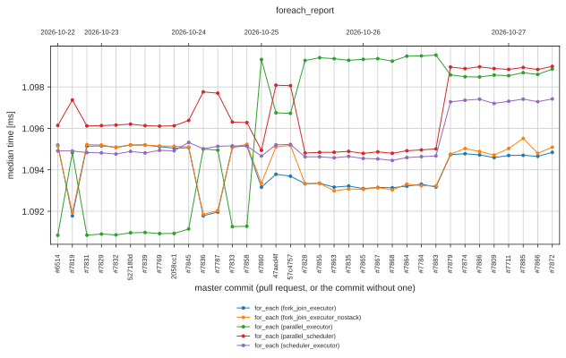

No median moved by more than 5% against the median of the 3 runs before it.

### future_overhead_report

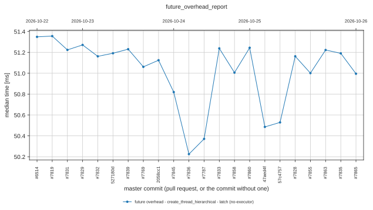

No median moved by more than 5% against the median of the 3 runs before it.

### small_vector_benchmark

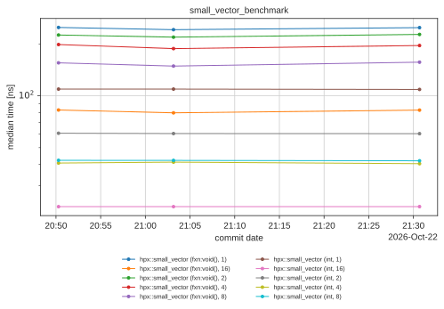

Medians that moved by more than 5% against the median of the 3 runs before them (+ is slower); the numbers are those on the graph.

| # | Commit | Pull request | Measurement | Change |
| --- | --- | --- | --- | --- |
| 2 | [ff9e673a5887](2026/medusa00/20261026T102649Z-ff9e673a5887-b0/README.md) | [#7864](https://github.com/TheHPXProject/hpx/pull/7864) | hpx::small_vector (fxn:void(), 4) | +5% |
| 1 | [7ac1a1d7b2c8](2026/medusa00/20261022T210309Z-7ac1a1d7b2c8-b2/README.md) | [#7819](https://github.com/TheHPXProject/hpx/pull/7819) | hpx::small_vector (fxn:void(), 4) | -5% |

### stream_report

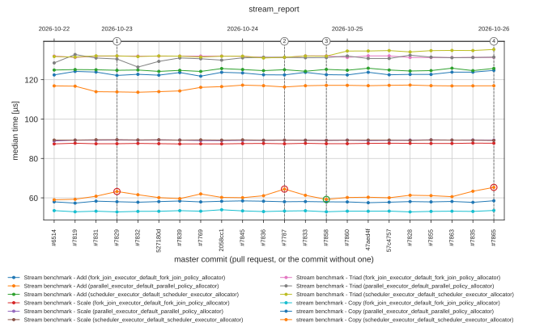

Medians that moved by more than 5% against the median of the 3 runs before them (+ is slower); the numbers are those on the graph.

| # | Commit | Pull request | Measurement | Change |
| --- | --- | --- | --- | --- |
| 8 | [0bb4fe759234](2026/medusa00/20261026T212323Z-0bb4fe759234-b0/README.md) | [#7809](https://github.com/TheHPXProject/hpx/pull/7809) | stream benchmark - Copy (scheduler_executor_default_scheduler_executor_allocator) | +6% |
| 7 | [b07138598e83](2026/medusa00/20261026T210849Z-b07138598e83-b0/README.md) | [#7883](https://github.com/TheHPXProject/hpx/pull/7883) | stream benchmark - Copy (scheduler_executor_default_scheduler_executor_allocator) | -7% |
| 6 | [ff9e673a5887](2026/medusa00/20261026T102649Z-ff9e673a5887-b0/README.md) | [#7864](https://github.com/TheHPXProject/hpx/pull/7864) | stream benchmark - Copy (scheduler_executor_default_scheduler_executor_allocator) | +11% |
| 5 | [fb5b51af387b](2026/medusa00/20261026T102522Z-fb5b51af387b-b0/README.md) | [#7867](https://github.com/TheHPXProject/hpx/pull/7867) | stream benchmark - Copy (scheduler_executor_default_scheduler_executor_allocator) | -9% |
| 4 | [fef31456e98a](2026/medusa00/20261026T102437Z-fef31456e98a-b0/README.md) | [#7865](https://github.com/TheHPXProject/hpx/pull/7865) | stream benchmark - Copy (scheduler_executor_default_scheduler_executor_allocator) | +7% |
| 3 | [585b332c4aeb](2026/medusa00/20261024T215359Z-585b332c4aeb-b14/README.md) | [#7858](https://github.com/TheHPXProject/hpx/pull/7858) | stream benchmark - Copy (scheduler_executor_default_scheduler_executor_allocator) | -6% |
| 2 | [9afb016babde](2026/medusa00/20261024T143201Z-9afb016babde-b12/README.md) | [#7787](https://github.com/TheHPXProject/hpx/pull/7787) | stream benchmark - Copy (scheduler_executor_default_scheduler_executor_allocator) | +7% |
| 1 | [cacea4d26116](2026/medusa00/20261023T112554Z-cacea4d26116-b4/README.md) | [#7829](https://github.com/TheHPXProject/hpx/pull/7829) | stream benchmark - Copy (scheduler_executor_default_scheduler_executor_allocator) | +7% |

### transform_reduce_scaling

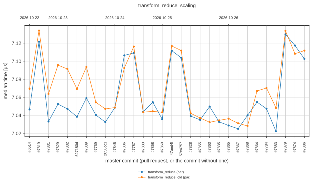

No median moved by more than 5% against the median of the 3 runs before it.

## License

Distributed under the Boost Software License, Version 1.0, see [LICENSE_1_0.txt](LICENSE_1_0.txt).
